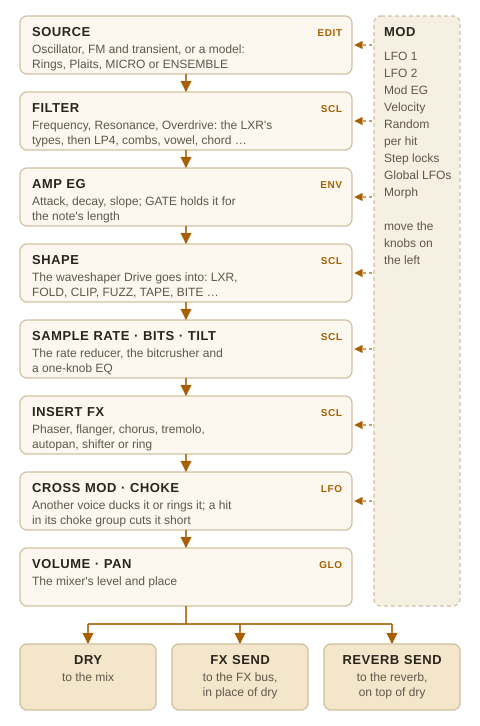
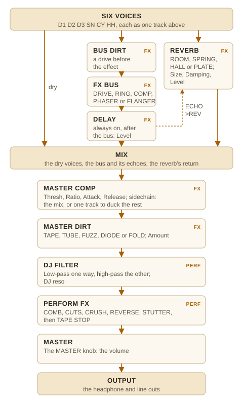

# Elixir manual

Elixir is the firmware of the Erica Synths LXR-02 drum machine, ported to the M-VAVE FM-1 and extended. This manual covers version 0.23: the LXR's sound engine and sequencer as they map onto the FM-1's keys, buttons and knobs, and everything Elixir adds.

Elixir is **unofficial**. It is not affiliated with or endorsed by Erica Synths, M-VAVE or Hügelton Instruments. It is free software under the GPL-3.0 (see *Licence and credits* at the end).

---

## Contents

1. [Before you install](#1-before-you-install)
2. [Quick start: a beat in two minutes](#2-quick-start-a-beat-in-two-minutes)
3. [The panel](#3-the-panel)
4. [Tracks and voices](#4-tracks-and-voices)
5. [Programming patterns](#5-programming-patterns)
6. [Step edit: velocity, timing, locks, conditions, ratchets](#6-step-edit)
7. [Recording live](#7-recording-live)
8. [Patterns, banks and songs](#8-patterns-banks-and-songs)
9. [Shaping the sound](#9-shaping-the-sound)
10. [Mixer, sends, FX bus and reverb](#10-mixer-sends-fx-bus-and-reverb)
11. [Kits and morph](#11-kits-and-morph)
12. [Generating tracks: generators (Euclid, Grids …), melody, scale, directions, track clocks](#12-generating-tracks)
13. [Performance mode (PERF)](#13-performance-mode-perf)
14. [Saving: kits, patterns, songs, projects](#14-saving)
15. [MIDI](#15-midi)
16. [Settings (CONFIG) and the CPU meter](#16-settings-config-and-the-cpu-meter)
17. [Reference tables](#17-reference-tables)
18. [How Elixir differs from the LXR-02](#18-how-elixir-differs-from-the-lxr-02)
19. [Troubleshooting](#19-troubleshooting)
20. [Licence and credits](#20-licence-and-credits)

---

## 1. Before you install

### Status

Elixir has been tested extensively in its browser emulator and with host tests (the same C sources compiled for a computer), and **it has run on one real FM-1 so far** (October 2026). From 0.15 it uses both of the FM-1's processor cores: the second renders the three drum voices. With the LXR-02's own kits it uses about 27% of the first core (about 45% before 0.15, on one core), and two drum voices on Rings or Plaits models with morphing peaked at about 70% of the second. Elixir shows its load on screen (see [the CPU meter](#16-settings-config-and-the-cpu-meter) and [the LOAD page](#the-load-page)); reports from other FM-1s are welcome, especially from units whose second core switches off (the LOAD page says why).

0.16 adds the scale, note lengths, the melody generator, DENSITY, a third global LFO, the tape delay, the plate reverb, dirt, a master compressor with sidechain and STUTTER. They are tested on the host and in the emulator; on the unit they are new, so please report the CPU figures with the tape delay, the plate and the master DIRT running together.

The Rings and Plaits models are **experimental**: they are not part of the LXR-02, they are still being tested, and they may change in later versions (see [Models](#models-rings-and-plaits-drum-13-experimental)).

### Before the first install: official V15

Put the FM-1 on M-VAVE's official firmware **V15** before installing Elixir for the first time. This is what everyone who makes FM-1 firmware recommends. Elixir's package, like Felucca's, is built for V15's flash layout and update loader, and V15 is the firmware you return to.

The install page has a **Check my FM-1** button. It asks the FM-1 what it runs: `FM-1_015` is official V15, `FM-1_359…` is Elixir (from 0.22; before that Elixir answered `FM-1_900`), other numbers of 900 and up are alternative firmwares (Felucca and others), and anything lower is an older official version. If it isn't V15, get V15 (`FM-1.fwsc`) from M-VAVE's download page and install it with the page's **Official V15** section, or with M-VAVE's own updater.

### Installing

Use the Elixir install page (`install/` on the Elixir site) in Chrome or Edge. Connect the FM-1 straight to the computer with a USB data cable, close other apps that use MIDI, and press **Install Elixir**. Allow MIDI (SysEx) when the browser asks. The page sends the package, waits for the FM-1 to restart and checks that it now runs Elixir. Don't unplug the cable or close the page while it writes.

From a terminal, `tools/fm1_install.py` does the same. It needs Python 3 with `mido` and `python-rtmidi`:

```sh
python3 tools/fm1_install.py elixir.fwsc
```

### Going back

Install the official `FM-1.fwsc` (V15) with the install page's **Official V15** section, or with `fm1_install.py FM-1.fwsc`. Elixir has no backup of its own: copy anything you want to keep before you go back. (The page checks that the file is the unmodified V15, so a damaged or wrong file can't be written.)

Elixir keeps its projects and settings in the same flash area Felucca uses for its own data, so **installing Elixir replaces anything saved by Felucca** (back it up with Felucca's own page first), and installing something else afterwards replaces Elixir's projects.

**Coming from Wyrd** (from 0.24.1). Wyrd uses the same flash areas too. When Elixir starts on a unit that still holds Wyrd's projects, library kits or settings, it shows **WYRD'S DATA IS HERE** before anything else and saves nothing until you answer:

- **SHIFT (OCT−): keep.** Elixir runs but saves nothing this time: no projects, kits, settings or autosave ("WYRD'S DATA: NOT SAVED"). It asks again at the next power-on, so you can go back to Wyrd and back its data up on Wyrd's library page.
- **COPY (OCT+) twice: erase.** Only Wyrd's records go: its project slots, its settings and its library entries. Elixir's own projects and kits stay, including kits that shared a library sector with Wyrd's. Then Elixir saves normally.

PLAY and REC still work while the question is on screen. Grimoire can't be recognised yet, because it still saves with Elixir's own marks: back up Grimoire's data before installing Elixir.

### If something goes wrong

How an update works decides what can be recovered. The firmware that is running (official, Felucca or Elixir) answers the installer, checks the package and starts the FM-1's **update loader**. The loader writes the new firmware and restarts. So:

- **An install was cut off** (cable pulled, page closed, computer asleep): the FM-1 stays in update mode, waiting for the loader's write. Plug it in and press Install again (or run `fm1_install.py` again). It finishes the write. This works for Elixir and for V15.
- **Elixir runs but something is wrong** (it misbehaves, it's too slow, you don't like it): install V15 from the page. Elixir answers the installer like any other firmware.
- **Elixir crashes as it starts** (it never reaches the grid): this is the case to worry about, because no firmware is left to answer the installer. Elixir's boot guard notices two crashed starts in a row and sends the FM-1 to the chip's own **UBOOT** mode on the next start. UBOOT is built into the chip and survives any firmware, but neither the install page nor `fm1_install.py` can write from it. Recovery then needs Leo Kuroshita's [FM-1-transporter](https://github.com/kurogedelic/FM-1-transporter): a Seeed XIAO RP2040 board wired to the FM-1's USB lines, which can rewrite its flash.
- **Turn the FM-1 on with OCT− and OCT+ held, and keep them held for 5 seconds,** to enter UBOOT by hand (the screen shows UBOOT). Held together during play they are SHIFT (OCT−) and COPY (OCT+) and do nothing of the kind. This is only useful with the Transporter. Turning the FM-1 off and on should leave it, but this hasn't been tried on hardware.

Elixir has installed and started on one real FM-1, from V15, with the install page. That is still very little testing: install it knowing that a start-up crash would need the Transporter to undo.

---

## 2. Quick start: a beat in two minutes

1. Press **HOME**. The screen shows the grid: seven tracks (D1 D2 D3 SN CY CH OH) by sixteen steps.
2. Press black key **1** (D1, the kick). Tap white keys **1, 5, 9, 13**. They light up: the kick plays on every beat.
3. Press black key **4** (SN). Tap white keys **5** and **13**.
4. Press black key **6** (CH, closed hat). Tap white keys **1, 3, 5, 7, 9, 11, 13, 15**.
5. Press **PLAY**. Turn **PRESETS** to browse the LXR-02's factory kits and press **OCT+** to hear your beat on one.
6. Turn **KNOB 1** to change the tempo, **KNOB 2** for shuffle.
7. Select D1 again (black key 1), press **EDIT** and turn the knobs to change the kick's pitch and waveform. Press **ENV** for its envelope.
8. Hold COPY (**OCT+**) and press black key **9** (bar 2): bar 1 of every track is copied into bar 2 and the pattern is now two bars long. Press bar key **9** again on its own to see bar 2, and change it.
9. Press **SAVE**, turn KNOB 1 to PROJECT, press **OCT+**, name it, press **OCT+** again.

---

## 3. The panel

<!-- panel -->

### Keys, buttons and knobs

The FM-1's keyboard has 16 white keys and 11 black keys, numbered left to right in this manual.

| Control | What it does in Elixir |
|---|---|
| **White keys 1–16** | The 16 steps of the bar on screen. On the pattern page: patterns. In PERF: rolls and effects. |
| **Black keys 1–7** | Select a track: D1 D2 D3 SN CY CH OH. SHIFT (OCT−) + key: mute / unmute it. |
| **Black keys 8–11** | Show bar 1–4. On pattern, song, save and load pages: the bank of 16. SHIFT (OCT−) + key: track length (16, 32, 48, 64). COPY (OCT+) + key: copy the shown bar into it. In PERF: the repeat length. |
| **OCT−** | **SHIFT** (hold). While held, the screen shows the menu: what SHIFT (OCT−) + each key does ([table](#shift-oct--white-keys-outside-perf)). On PERF's pages SHIFT keeps PERF's own jobs (latching, SPELLS, WANDER). **Held while turning a knob: fine adjust**, one step a detent with no acceleration; the page stays on screen so you can see the value (from 1.0). |
| **OCT+** | **COPY** (hold). SHIFT (OCT−) + OCT+ = **CLEAR**. OK in the save, load and action dialogs. Held on a sound page, a knob turned is **Control All**. |
| **EDIT** | Sound: model → oscillator → FM → transient (press again: the next section; SELECT goes through every sound page). SHIFT (OCT−) + EDIT: **KEYS** (the keys play the track's voice, on every page until SHIFT (OCT−) + EDIT again) |
| **ENV** | Sound: amp envelope → gate → mod envelope / velocity |
| **SCL** | Sound: filter → shape → insert FX |
| **LFO** | Sound: LFO 1 → LFO 2 → random per hit → cross mod / choke |
| **GLO** | Mixer → config |
| **FX** | FX bus → reverb (turn SELECT for the pages) |
| **SEQ** | The track's pages (track, generator, action, groove, bounce, melody, scale) → step edit (press again: back; SELECT for the pages). SHIFT (OCT−) + SEQ: the links |
| **ARP** | PERF: PERFORM → SPELLS → WANDER → GLOBAL MOD (the global LFOs, macros, links); press again for the next set, SELECT for its pages |
| **HOME** | Grid → patterns → [load](#loading-and-saving) → song |
| **SAVE** | Save → load (SHIFT (OCT−) + SAVE: load) |
| **PLAY** | Start / stop: the pattern or the song, as **Play** says (the pattern page). SHIFT (OCT−) + PLAY: play the song from its start. |
| **REC** | Record on / off. SHIFT (OCT−) + REC: record options. |
| **ALGORITHM** (encoder) | Select the track |
| **SELECT** (encoder) | The page; in lists, the row |
| **PRESETS** (encoder) | The kit browser. On a sound page or in KEYS: the [sound browser](#the-sound-browser) |
| **KNOB 1–4** | The four parameters shown at the bottom of the screen |
| **MASTER** (pot) | Output volume |

**Locks:** on any sound page, *hold a step key and turn a knob* to set that parameter for that step only (a parameter lock). See [locks](#locks).

### The screen

| Area | Shows |
|---|---|
| Header (top line) | The playing pattern (P01), the queued one (>02), the kit's name or SONG nn, M when morph is on, MIDI when synced to MIDI clock, the tempo, play (triangle, bright on the beat) and record (red dot) |
| Title | The selected track (coloured tag), the page's name, page dots (or "3/14" when there are many pages), or a message |
| Body | The grid, or the page's own display |
| Cards (bottom) | The four knobs: each parameter's name, value and position. The card of the last knob turned is highlighted. A locked value shows in the accent colour. |

### LEDs

- **Step keys:** lit = step on; the playing step flips its light; beats (1, 5, 9, 13) glow faintly.
- **Track keys:** the selected track lit; each flashes when its track plays; a muted track goes dark.
- **Bar keys:** the shown bar lit, the playing bar breathing, bars past the track's length dark.
- **Buttons:** the current mode's button lit; REC lit when recording; OCT− lit while SHIFT is held, OCT+ while COPY is held; OCT+ breathes when it will act as OK, and during Control All and its dialog.
- **PLAY:** green while playing, dark for half a step on each beat.

---

## 4. Tracks and voices

Elixir has the LXR-02's six voices on seven tracks:

| Track | Key | Voice |
|---|---|---|
| D1, D2, D3 | black 1–3 | Drum voices: oscillator plus FM or mix oscillator, pitch envelope, transient |
| SN | black 4 | Snare / clap: oscillator plus filtered noise, repeating envelope (claps) |
| CY | black 5 | Cymbal: three-operator FM |
| CH | black 6 | Closed hi-hat: three-operator FM |
| OH | black 7 | Open hi-hat: the same voice as CH with its open decay; one cuts the other |

Every voice has a transient generator (click), an amp envelope, a filter, a waveshaper, a sample-rate reducer, pan and an output, plus Elixir's additions: sends, bit reduction, tilt EQ, waveshaper choice, random per hit, choke groups and cross modulation.

---

## 5. Programming patterns

A pattern has seven tracks of up to 64 steps (four bars of 16). Each track has its own length, so tracks can loop against each other (polymeter).

### The grid (HOME)

- **Select a track** with its black key (or ALGORITHM).
- **Tap a white key** to turn that step on or off.
- **Bar keys** (black 8–11) show bars 1–4. With FOLLOW on (CONFIG), the screen follows the playhead.
- **Knobs:** tempo, shuffle, the track's length, the track's volume.

On the grid, a step's height shows its velocity, an outline means a chance below 100%, a notch means a flam, a tick underneath means a shift, a dot top right means a lock, a dot top left means a trig condition, and a bar underneath means a ratchet.

### Track length

- **SHIFT (OCT−) + bar key:** the selected track becomes 1, 2, 3 or 4 bars long.
- **Length knob** on the grid (KNOB 3): any length from 1 to 64.
- **Every track at once** (from 1.0): hold **OCT+** and turn the length knob (on the grid or SEQ's TRACK page). Every track takes the selected track's length as you turn, so you can shorten and lengthen the whole pattern live. When you let go, **REVERT THE LENGTHS?**: **OCT+** puts each track's own length back, **OCT−** keeps the new one.

The pattern lasts as long as its longest track (in time, counting [track clocks](#track-length-clock-direction)). Shorter tracks keep looping on their own across the pattern's end.

### Copying

- **Copy a bar to another bar:** on the grid, hold **COPY** (OCT+) and press a bar key. The shown bar is copied, *every track*, into that bar, with each step's velocity, locks, timing, conditions and ratchets. A track that ended before the target bar grows to include it, unless its length isn't a whole number of bars (a 12-step track stays at 12). On other pages (sound pages, step edit), COPY (OCT+) + bar key copies the selected track only.
- **Copy a track:** hold COPY (OCT+), press the source track's black key, then the target's.
- **Copy a pattern:** on the pattern page, hold COPY (OCT+), press the source pattern's white key, then the target's.

### Clearing

Hold SHIFT (OCT−) and press **OCT+** (CLEAR). A list opens; turn SELECT to choose, then press SHIFT (OCT−) + OCT+ again to confirm. Letting go of SHIFT (OCT−) cancels. On a sound page (or in KEYS) the list opens on CLEAR SOUND, so SHIFT (OCT−) + OCT+ twice puts the sound you're shaping back to its init state.

| Choice | Clears |
|---|---|
| CLEAR TRACK | the selected track's steps |
| CLEAR PATTERN | every track of the pattern |
| CLEAR AUTOMATION 1 / 2 | lock lane 1 or 2 of the selected track |
| CLEAR SOUND (INIT) | the selected track's voice back to the init kit's, every one of its parameters (sends, shape, LFO, model …); the other voices stay as they are. CH and OH share a voice. |
| CLEAR KIT (INIT) | every voice back to the init kit |
| DELETE SONG ROW | (song page) the selected row |

### Mutes and solo

SHIFT (OCT−) + a track's black key mutes or unmutes it (in PERF, the black keys mute on their own).

**SHIFT (OCT−) + GLO** solos the selected track: only soloed tracks play, from any page, so you can shape one sound inside a busy pattern. Select another track and press SHIFT (OCT−) + GLO again to solo it too; SHIFT (OCT−) + GLO on a soloed track takes it out. The mutes are kept underneath and come back as they were when the last solo goes. A soloed track has a bar beside its name on the grid; the others show as muted. Solo isn't saved.

### Tempo, shuffle, MIDI sync

- **Tempo:** KNOB 1 on the grid, the PERF page or CONFIG. Turn it all the way down to **MIDI** to follow incoming MIDI clock.
- **Shuffle:** delays every other 16th; saved with the pattern. For other feels see [Groove](#groove-from-018).

---

## 6. Step edit

Press **SEQ** twice (the first press opens the track's pages, [section 12](#12-generating-tracks)). Tap a white key to select a step (its key breathes; tap it again to turn the step on or off). Turn **SELECT** for the four pages; SEQ again goes back to the track's pages, and any other button leaves step edit:

| Page | KNOB 1 | KNOB 2 | KNOB 3 | KNOB 4 |
|---|---|---|---|---|
| STEP | Note | Length | Velocity | – |
| TRIG | Chance | Condition | Shift | Flam |
| LOCKS | Lock 1 parameter | its value | Lock 2 parameter | its value |
| RATCHET | Hits | Shape | Rate (bouncing: Curve) | Fade |

- **Note:** the pitch the voice plays at (C4 = as set). From 0.23-test7 a step plays relative to its track's **Base** (the SCALE page, [Scale](#scale-from-016)): change Base and every step moves with it. Turning Note here **locks** the step's note (the label reads **Locked**): Base leaves it where you put it. Turn a locked note back to the Base note and it follows Base again. Notes played in from the keys, melodies and spells all follow Base.
- **Chance:** the probability the step plays (PERF's FILL key plays it anyway).
- **Flam:** OFF, x2, x3, x4, x6, x8: the step repeats evenly inside its length.
- **Shift:** −7 … +7 eighths of a step, early or late.
- **Length** (from 0.16): how long the note lasts. **AUTO** (the default) is the LXR's: the voice's own envelope, and MIDI's note-off at the next tick. **1/32, 1/16, 1/8, 1/8., 1/4, 1/2**, and from 0.23-test11 **3/4, 1 BAR, 1.5, 2, 3, 4, 6, 8, 12, 16, 24, 32, 48, 64 BARS** hold the note that long: a voice with **Gate** on (the amp EG's next page, see [section 9](#elixirs-sound-pages)) holds its attack's top until then, and MIDI out sends the note-off at the end, so a synth over USB plays real lengths. **INF** holds it until the track's next note (or STOP): a drone. **TIE** (the knob's last) slides into the next note: its pitch changes, nothing is struck again (MIDI: the new note on, then the old one off). A tied step shows a line into the next one on the grid. A new note on the track always cuts a long one short, as on the Elektrons. A length uses none of the step's two locks.
- **Ratchet:** the step plays Hits times, evenly at Rate (1/32, 1/48, 1/64, 1/24). Fade: FLAT, DOWN or UP.

### Bouncing ratchets

Turn **Shape** to **BOUNCE** and the ratchet falls like a dropped ball: the hits start far apart and come closer and closer together. With BOUNCE, KNOB 1 sets 3, 4, 5, 6, 8, 12 or 16 hits, and KNOB 2 sets the **Curve**:

| Curve | Each gap |
|---|---|
| **BALL** | 0.7 of the one before |
| **TIGHT** | 0.55 of the one before: a quick rattle |
| **SLOW** | 1.3 of the one before: it spreads out and slows down (half a bar at most) |
| **DRUNK** | 0.7, give or take 15% each time |

The first gap and a pitch drift are set for the whole track on the BOUNCE page (section 12): **Bounce** (1/4, 1/8, 1/16, 1/32; 1/8 at first) and **Bnc pitch** (−12 … +12 semitones over the bounce: −5 makes a tom fall as it settles). Fade works on bounces too.

A bounce plays out over the steps that follow it. The next hit on the same track cuts it off, so leave room after it. TAPE STOP slows bounces with everything else.

MIDI notes played while in step edit set the selected step's note.

### Locks

A lock sets one parameter to a different value on one step, for example a higher filter cutoff on the last kick of the bar. Each step can hold **two** locks.

- **The quick way:** on any sound page (EDIT, ENV, SCL, LFO, GLO, the mixer), hold a step key and turn a knob. The step turns on if it was off, and the knob's card shows the locked value in the accent colour.
- **On the LOCKS page:** choose any lockable parameter (any voice's sound parameter, the FX bus, the sends, the reverb, Elixir's shaping parameters) and its value.

Every sound parameter can be locked except the reverb's model.

### Trig conditions

The Condition knob (STEP page) sets *when* a step plays:

| Condition | Plays |
|---|---|
| – | always (subject to its chance) |
| A:B | the A-th time of every B times round the track (1:2, 2:2, 1:3 … 8:8) |
| FILL / !FILL | only while PERF's FILL key is held / only while it isn't |
| PRE / !PRE | if this track's last conditional step played / didn't |
| NEI / !NEI | if the previous track's last conditional step played / didn't |
| 1ST / !1ST | only the first time round after PLAY / every time but the first |

"Times round" are counted per track from PLAY, so on a 12-step track, 1:2 plays every other 12 steps. The step's chance still applies on top of its condition.

### Ratchets

A ratchet repeats the step: **Hits** 2–8, at a **Rate** of 1/32, 1/48, 1/64 or 1/24, with the velocity **FLAT**, fading **DOWN** or rising **UP**. Unlike a flam (which divides the step), a ratchet keeps its own rate and can run past its step.

For a roll you play with a knob, see [Rush](#rush-from-023): it can be recorded as a lock on each step.

---

## 7. Recording live

Press **REC** (it lights), then **PLAY**.

- **Notes** you play (MIDI notes on a track's channel, or rolls in PERF) are written into the nearest step.
- **Knob moves** on sound pages are written as locks onto the step that is playing, if that step is on.
- **SHIFT (OCT−) + CLEAR while recording** erases the selected track's steps as they pass.
- **SHIFT (OCT−) + REC** opens the record options: the lock lane (1 or 2) knob moves record into.

### KEYS: playing a voice

**SHIFT (OCT−) + EDIT** turns the keyboard into an instrument for the selected track (ALGORITHM picks the track): the white and black keys play its voice chromatically, as on a piano, from F at the octave set (KNOB 1, **Octave**: F3 by default). Under REC each note is written into the nearest step with its note and velocity, as a MIDI note would be, and it goes out on USB MIDI too. PRESETS opens the [sound browser](#the-sound-browser).

**KEYS stays on** (from 0.19) as you change pages, so you can play and turn knobs anywhere: the sound pages, FX, the mixer, SEQ's track pages, HOME. The header shows **KEYS** while the keys play notes. On the pages whose keys are their own (the patterns, the song, SAVE and LOAD, step edit and PERF) the keys do that page's job, and play again when you leave. **SHIFT (OCT−) + EDIT** on the KEYS page goes back to the grid; on any other page it turns KEYS off and stays there.

**In a scale:** when the pattern has a scale (SEQ → SCALE, [section 12](#scale)) and the track follows it, the white keys play the scale's degrees upwards from the root at or below F3, so every white key is in key; the black keys stay chromatic.

The FM-1's keys have no velocity, so KEYS sets it: **Velocity** (KNOB 2) is the velocity of a key, and of PERF's rolls and SHIFT (OCT−) + white keys 1–7. **Accent** (KNOB 3) is the velocity of a key played with SHIFT (OCT−) held. Both are kept in the settings.

---

## 8. Patterns, banks and songs

Elixir has **32 patterns** in two banks of 16, and **64 songs**.

### The pattern page (HOME, press again)

- **White key:** queue that pattern. While playing, it starts when the current pattern ends (the header shows >nn); while stopped, at once.
- **Bar keys 8–9:** bank 1 (patterns 1–16) or bank 2 (17–32).
- **Knobs:** **Voices** (FREE, LOCKED or KIT, below), shuffle, Edits (KEEP or DROP, below), **Play** (PATTERN or SONG: what PLAY plays, see [Songs](#songs-home-a-fourth-press)).
- **Copy a pattern:** hold **COPY (OCT+)** and tap the pattern, then hold COPY again and tap the target. The page shows both steps (COPY, PASTE). A LOCKED pattern's voices go with it.

**Voices** (from 0.20) sets where a pattern's sounds come from. The page shows a lock: open for FREE, shut for LOCKED and KIT.

| Voices | |
|---|---|
| **FREE** | The default, and what a new pattern starts with: the shared voices. A sound edit on any FREE pattern is heard on every FREE pattern. |
| **LOCKED** | The pattern keeps its own voices. Locking takes the voices you hear at that moment; edits made while it plays stay with it, and edits on other patterns don't reach it. They are kept in kit slot 32 + the pattern's number (pattern 1 in slot 33, named P01 LOCK; pattern 32 in slot 64), so don't keep your own kits in slots 33–64 if you lock patterns. Back on FREE, the pattern plays the shared voices again; its slot keeps what it had. |
| **KIT** | The pattern loads a saved kit slot when it starts (the LXR's KIT CHANGE AUTO, now per pattern). Choosing KIT points it at the slot the shared voices came from; loading another kit slot while it plays (LOAD → KIT, or PRESETS) points it there. Edits while it plays aren't kept: save the kit (SAVE → KIT) to keep them. |

Projects from before 0.20 that had CONFIG's Kit change on AUTO load with every pattern on KIT.

**Your edits stay.** With **Edits** on KEEP (the default), a pattern keeps its changes when you switch to another, as on an Elektron box: the patterns are part of the project, and AUTOSAVE keeps the session, every pattern in it, through power-off. To keep a version for good, save the project (SAVE → PROJECT). **RELOAD** (SHIFT (OCT−) + white key 13) brings back the kit (a LOCKED pattern's voices as it last kept them), and the playing pattern as it was when it started playing (or was last saved with SAVE → PATTERN).

With **Edits** on DROP, the LXR's way, changes to the playing pattern that haven't been saved (SAVE → PATTERN) are lost when another pattern starts. Edits is a setting: it stays through power-off.

### Songs (HOME, a fourth press)

A song is up to 64 rows, each a pattern (or END / LOOP).

- **KNOB 1 (Song):** which song; **KNOB 2 (Row):** the row (from 0.20; SELECT used to move it); **KNOB 3 (Pattern):** the row's pattern, END or LOOP; **KNOB 4 (Repeats):** how many times the row's pattern plays before the song moves on: x1, x2, x3, x4, x6, x8 or x16 (from 0.19). A row shows its count (PATTERN 02  x4); while the song plays, the row playing shows which time it is (2/4). Changing a row's pattern keeps its count.
- **White key:** write that pattern into the row and move to the next (bar keys pick the bank).
- **SELECT:** the second page, **ROWS**: **KNOB 1** the row, **KNOB 2 (Action)** INSERT or DELETE, **KNOB 3** the row's pattern, **KNOB 4 (Play)**. The title says what OCT+ does. **INSERT** adds a row at the row shown (a copy of it, the rows below move down a row): pick its pattern with KNOB 3. **DELETE** removes the row (the rows below move up).
- **COPY (OCT+)** on the first page inserts a row too, and **CLEAR → DELETE SONG ROW** removes it, as before.

**Playing a song.** **Play** (on the ROWS page, the pattern page and CONFIG → SEQUENCER) sets what **PLAY** plays: **PATTERN** loops the pattern; **SONG** plays the song from its first row. Switched to SONG while playing, the song carries on from the first row with the playing pattern. **SHIFT (OCT−) + PLAY** plays the song from the start and sets Play to SONG. The header shows SONG and its number while Play is on SONG.

**ROADS: a song by chance** (from 0.23-test6). SELECT again for the third page, **ROADS** (each song has its own):
- **KNOB 1 (Song):** which song.
- **KNOB 2 (Way):** **PLAY** plays the rows as written; **ROADS** plays the song by its own chances. When a row is done, Elixir looks at every row of the song with the same pattern and goes on to the row after one of them. If P01 goes on to P02 three times in the song and to P03 once, it goes to P02 three times in four. When the rows before match too (the pattern before this one), it follows those first, so a phrase you wrote stays together. The title says **ROADS: BY CHANCE** or **AS WRITTEN**.
- **KNOB 3 (Surprise):** 0% always takes the commonest next pattern; turned up, the rarer ones come more often, now and then any row of the song plays next, and a row's Repeats may be one more or one less.
- **KNOB 4 (Home):** NEVER, or 8 to 512 bars: after that long the song goes back to its first row, so it keeps coming home.

A ROADS song never stops at END or LOOP: the row after the last is the first. The same pattern doesn't play more than four rows in a row (its Repeats aside) when the song has another. Each song's ROADS settings are saved with the project.

---

## 9. Shaping the sound

Select a track, then press a sound button. Pressing the same button again moves to the next section; turning SELECT steps through every page, in a synth's order: **model, oscillator, FM, transient, filter, shape, insert FX, amp EG, gate, mod EG / velocity**, then the modulation: **LFO 1, LFO 2, random per hit, cross mod / choke**. EDIT opens the first (MODEL), ENV the amp EG, SCL the filter and LFO the LFOs. Each page shows eight parameters (two rows of four); the lit row is on the knobs, and SELECT gives the other row. From 1.0 pressing a sound button again only moves to its next section, never to a section's second page. A section with more than one page has its page in the title: MOD EG / VELO (1/2), (2/2).

From 0.19 the top of each page is a picture of what its knobs do rather than a list of their values (the knob cards below already show those): the oscillator's wave, the envelope's curve with its times, the filter's response with its cutoff in Hz, an LFO over a bar at the tempo with the track's retriggers, a model's description with its knobs as vials, and so on. It changes as you turn a knob. The FX pages (the reverb's tail, the delay's echoes, the compressors' curves and gain reduction, DIRT) and the SEQ pages Groove, Bounce, Melody, Melody loop and Scale have pictures too; Track, Generator and Action keep the grid. The MODEL page names the model, says what it is and draws it. A Rings, Plaits, MICRO or ENSEMBLE model makes its own sound, so on that voice the FM and TRANSIENT pages are hidden and the OSC page keeps only Coarse and Fine (the model's pitch); its other knobs show -- and don't turn. The AMP EG page stays where the amp EG shapes the model (from 0.25: ENSEMBLE, and the Plaits engines that don't make their own envelope: all but P STRING, P MODAL, P BD, P SD and P HH); for Rings and MICRO it is hidden. Rings with Exciter turned up keeps every page, since the voice's own sound strikes it. If Exciter is down in the kit but up in the morph kit, those pages stay, greyed and locked, until you morph. The reverb page draws what makes its sound (from 0.20: ROOM a hut, HALL a castle, PLATE a steel shield, SPRING a bare spring), growing with Size, its echoes going out as arcs (Level, Damping); P SPEECH's MODEL page is a wizard whose lips move as you turn its knobs; the delay page spells out its mode (Tape ping pong and so on). Knobs read in their own units where those say more than 0–127: the filter's cutoff in Hz, its resonance as Q, the envelopes' times in ms, the LFOs' rates in Hz, the sample rate in kHz.

### The LXR's sound pages

| Section (button) | Drum 1–3 | Snare | Cymbal, hats |
|---|---|---|---|
| **Model** (EDIT, first; Elixir's) | Model; on Rings or Plaits: Decay, Bright, Struct / Position, Exciter, Tension (see *Models* below). On LXR, the model alone | the model alone (LXR or a MICRO type) | same |
| **Oscillator** (EDIT) | Coarse, Fine, Waveform, Pulse width | Coarse, Fine, Noise frequency, Mix / Waveform, Pulse width | Coarse, Fine, Waveform, Pulse width (OH: no pulse width) |
| **FM** (EDIT) | Amount, Frequency, Waveform, Mode (FM or mix) | – | Mod 1 & 2 frequency and gain / their waveforms |
| **Transient** (EDIT) | Waveform, Volume, Frequency | same | same |
| **Amp EG** (ENV; then Elixir's GATE page) | Attack, Decay, Slope | Attack, Decay, Repeat count (claps), Slope | Attack, Decay (CH: closed; OH: open), Repeat (cymbal), Slope |
| **Mod EG / velocity** (ENV) | Pitch EG: Decay, Slope, Amount / Velocity: destination, amount, volume mod | same | Velocity: destination, amount, volume mod |
| **Filter** (SCL) | Type (LP HP BP UNITY BP NOTCH PEAK LP2 OFF; then Elixir's, below), Freq, Reso, Drive (from 1.0 in this order; the LXR's: Frequency, Resonance, Type, Overdrive) | same | same |
| **LFO 1** (LFO, 2 pages) | Dest, Depth, Sync, Rate / Wave, Phase, Mode, Retrigger ([the LFO pages](#the-lfo-pages-from-10)) | same | same |
| **LFO 2** (LFO, Elixir's) | the same knobs as LFO 1 | same | same |

The LXR's Mix page is gone from 0.19: volume and pan are on the mixer (GLO), the sample rate on SHAPE, the drive on SHAPE, the length on SEQ's TRACK page, the MIDI channel and note on CONFIG. The LXR's output setting is the FX send (see [section 10](#10-mixer-sends-fx-bus-and-reverb)).

The LXR's waveforms are SINE, TRI, SAW, SQUARE, NOISE and PWM; its transients SNAP, OFFSET, CLICK, CLICK 2, TICK, KICK, RIM, DRIP, HAT, CLAP, KICK 2, SNARE, TOM and SNAP 2. Each voice has one LFO, which can modulate any parameter of any voice; the velocity destination can be any of the voice's own parameters.

**Elixir's LFO and velocity targets** (from 0.18). Besides the LXR's parameters, the LFO's **Dest** and the velocity's destination reach Elixir's own: the voice's **FX** and **Rev** sends, **Tilt**, **Bits**, the random-per-hit amounts (**RndPitch**, **RndDecay**, **RndFiltr**, **RndPan**), the cross mod's **XAmount**, and the six MODEL knobs (named for the voice's model: Rings', Plaits' or MICRO's, e.g. Length, Colour, Jitter), then the kit's **Rev size**, **Rev damp**, **Rev level**, **Echo>Rev**, **Glitch**, **Bus dirt** and **Dirt amt**, then the voice's LFO 2 **Rate** and **Depth** and its insert's **Amount** and two knobs. The per-voice ones belong to the voice LFO 1's Dest is on, or for velocity to the voice itself. Switches (the model, the filter type, choke, the output) aren't targets: a moving one would click. Each voice's LFO can already move another voice's LFO rate or amount (the LXR's targets), for a wobble of a wobble. A kit sent to an LXR-02 as a .SND file has OFF in place of these targets.

**The Dest list** (from 0.25.2). Turning Dest goes from OFF through the targets in groups, in the order EDIT shows the pages (the signal path): MODEL, OSCILLATOR, FM, TRANSIENT, FILTER, SHAPE, INSERT FX, AMP EG, MOD EG / VELO, LFO 1, LFO 2, RANDOM PER HIT, CROSS MOD, then the ones on no sound page: MIX & SENDS (volume, pan, the FX and reverb sends), FX BUS, REVERB and MASTER. Within a group they go by name. The LFO's page shows the group above the target's full name (FILTER, Frequency; MOD EG / VELO, Velocity amount); when LFO 1 moves another voice, the group starts with that voice. The velocity's destination turns through the same order.

**LFO 1 reaches every voice** (from 1.0). LFO 1's Dest goes on past its own voice's targets into the other voices': its own voice first, then the others in order (D1, D2, D3, SN, CY, HH), each in the order above, so one knob picks both the voice and the parameter. The Dest card names the voice when it isn't the LFO's own (SN Frequncy). The LXR's separate destination voice knob is gone; kits keep it, and it follows Dest. Control All (OCT+ held) turns every track's LFO 1 Dest the same number of places through its own list.

### Elixir's filter types

After the LXR's eight (OFF stays where it was), the filter's **Type** goes on to seven of Elixir's (from 0.18) and four character filters (from 1.0). They use the same knobs: **Frequency**, **Resonance** and **Overdrive** (the drive into the filter, as on the LXR's types). The LFO, velocity, locks and the random cutoff move them as they move the others.

| Type | Sound | Frequency | Resonance |
|---|---|---|---|
| **LP4** | A four-pole ladder low-pass: steeper than LP, with the squelch of a Moog or a TB-303 | the cutoff | up to the edge of oscillation: it rings, then dies away |
| **COMB+** | A comb filter: the sound rings at a pitch and its harmonics, like a plucked string or a metal tube | the pitch: 86 Hz at 0, up five octaves; the played note moves it, so it rings in the track's scale | the feedback: how long it rings |
| **COMB−** | The same with the feedback turned over: hollow, an octave lower, odd harmonics only | the same | the same |
| **ALLPASS** | A phaser's two notches, standing still. Put the LFO on the filter's frequency and it sweeps like a phaser, with no effect used | where the notches are | feedback: deeper, sharper notches |
| **VOWEL** | Two band-passes at a voice's formants: talking toms and snares | the vowel, from A through E, I, O to U | how sharp the formants are |
| **DUB BP** | The LXR's BP into a saturator: the ringing band of a dub chord stab | the band | as the BP's; Overdrive drives the saturator as well (2× to 15×) |
| **CHORD** | Three band-passes at a root, its fifth and its octave: a chord out of a hat, a noise burst or a click | the root, as the combs' pitch (and the note moves it) | how long they ring (high values ring like a bell) |
| **ACID** (1.0) | A TB-303-style diode ladder: four stages that load each other, so the slope is softer (about 18 dB an octave) and the resonance is glassy. As on the 303 the resonance thins out the bass and fades at low cutoffs | the cutoff (the peak sits about two octaves over it; at 0 resonance it is open at the top) | up to just under a whistle; it squelches through the output's saturation |
| **MS20 LP** (1.0) | A Korg MS-20-style two-pole low-pass: the resonance goes through a lopsided diode clip in the loop, so it gets rougher, not louder, as you turn it up | the cutoff | up to a scream that stays bounded |
| **MS20 HP** (1.0) | The same filter's two-pole high-pass (12 dB an octave) | the cutoff | the same |
| **LADDER** (1.0) | A Moog-style transistor ladder: LP4 with the first stage saturating too, and **Bass comp** to bring back the bass the resonance takes away | the cutoff | as LP4's |

**FILTER X** (from 1.0): the four character types have a second FILTER page (SELECT, or SCL again) with one knob:

- **Env amt** (ACID, MS20 LP, MS20 HP): opens the cutoff with the voice's amp envelope, up to the whole range at 127: a hit starts bright and closes as it decays. This is the 303's squelch on any voice, the accent of an acid line on a kick or a tom. At 0 the cutoff stays where Frequency puts it. The envelope is followed smoothly, so a fast decay doesn't step.
- **Bass comp** (LADDER): 0 is LP4's balance; up, the bass the resonance takes away comes back (about +10 dB of low end at full resonance), so a resonant ladder keeps its body.

The Resonance knob of the four character types is curved: more of it sits where the filter starts to sing (halfway is three quarters of the way to the top). FILTER X is part of the kit, morphs and can be locked per step. The character types cost about as much as LP4 (ACID, LADDER) or a little more than LP (the MS20s); see CONFIG → LOAD.

- The combs and CHORD follow the note a step, KEYS or the melody generator plays (a scale, SEQ → SCALE, keeps them in key); at the track's default note they stay where Frequency puts them. The voice's own tuning and random pitch don't move them.
- A drum voice (D1–D3) starts its filter from rest at each hit, as on the LXR: a comb's ringing doesn't carry over to the next hit. On the snare, cymbal and hats it carries on.
- **Morph:** between two of the LXR's types the type moves through the values between, as the LXR does. If either kit uses one of Elixir's, the type switches at the halfway point.
- A kit sent to an LXR-02 as a .SND file (the library page) has LP in place of Elixir's types, which the LXR doesn't have.

### The LFO pages (from 1.0)

Every LFO has the same knobs in the same places, the global LFOs (PERF, GLOBAL MOD) included:

| | KNOB 1 | KNOB 2 | KNOB 3 | KNOB 4 |
|---|---|---|---|---|
| Page 1 | **Dest** | **Depth** | **Sync** | **Rate** |
| Page 2 | **Wave** | **Phase** | **Mode** | **Retrigger** (the global LFOs: **Trig**) |

- **Dest:** what it moves. **Depth:** how far (the LXR's Amount).
- **Sync:** OFF, or one cycle's length at the tempo. With Sync OFF the LFO runs at **Rate** (in Hz); with a sync value Rate reads SYNC and does nothing. The track LFOs' sync values, slow to fast: 4/1 (four bars), 2/1, 1/1, 3/4, 1/2, 3/8, 1/2T, 5/16, 1/4, 3/16, 1/4T, 1/8, 1/8T, 1/16, 1/32. T is a triplet; 3/4, 3/8 and 3/16 are the dotted half, quarter and eighth. (1/2T, 1/4T and 1/8T are the LXR's 1/3, 1/6 and 1/12, renamed; 3/4, 3/8, 5/16 and 3/16 are new in 1.0.)
- **Wave:** SINE, TRI, SAW UP, SAW DN, SQUARE, RANDOM, EXP UP, EXP DN.
- **Phase:** where in its cycle a restart starts it (the LXR's Offset).
- **Mode:** how a hit starts it (below).
- **Retrigger:** whose hits restart it: OFF, or a voice (D1 … HH). A kick's LFO with Retrigger D1 starts its cycle again on every kick, so a filter sweep lands the same way on each hit. With OFF it runs free (in TRIG; in HOLD, ONE and HALF OFF means the LFO's own voice's hits).

Turning Sync goes by length, so the new values sit between the LXR's; kits store them as before (an older Elixir reads 3/4, 3/8, 5/16 and 3/16 as free running; a kit sent to an LXR-02 as a .SND gets the LXR's nearest: 1/1, 1/3, 1/3, 1/6). When the kit and the morph kit have different syncs and either is one of the new ones, morph switches it at the halfway point.

### The LFO's mode

**Mode** (page 2, KNOB 3, on every LFO) sets how a hit starts the LFO, as on Elektron's machines. Retrigger still picks whose hits those are.

| Mode | Does |
|---|---|
| **TRIG** | The LXR's way (the default): each hit starts the cycle again from its Phase. With Retrigger OFF, the LFO runs free. |
| **HOLD** | The LFO runs free; each hit takes its value at that moment and holds it until the next hit. A random sample and hold per hit, or a "where was the sweep when it hit" value. |
| **ONE** | One-shot: each hit starts it from its Phase, it runs one cycle and stops at the end. Until the first hit it waits at its Phase. A saw becomes an envelope; a sine a single swell. |
| **HALF** | The same, half a cycle: a triangle or sine rises and stays up. |

In HOLD, ONE and HALF, Retrigger OFF means the LFO's own voice's hits. A RANDOM wave draws a new value at each one-shot. The mode is part of the kit and can be locked per step; it doesn't morph.

### Track LFO 2 (from 0.18)

Every track has a second LFO: **LFO 2** (LFO, after LFO 1). It has LFO 1's knobs in the same places ([the LFO pages](#the-lfo-pages-from-10)).

- **Dest:** OFF, then the track's own parameters, the LXR's and Elixir's, in the Dest list's order (above). Unlike LFO 1 it doesn't reach the other voices: it always moves its own track. Kits start with its Depth at 0.
- **On the same target as LFO 1** (or as the velocity), LFO 2 adds to it: LFO 1 sweeping the cutoff slowly and LFO 2 wobbling it fast give both movements. (LFO 1 and velocity on one target don't add: the LFO wins, as on the LXR.)
- Every setting is part of the kit, can be locked per step, and LFO 1 (or another track's LFO 1) can move LFO 2's Rate or Depth.
- **Morph:** Rate, Depth and Phase glide. Dest, Wave, Mode, Sync and Retrigger switch at the halfway point; when they differ between the two kits, the Depth goes down to 0 at the halfway point and up to the other kit's after it, so nothing jumps.
- A sound moved to another drum takes LFO 2 with it, its target and retrigger following the new voice. A kit sent to an LXR-02 leaves it out.

### Elixir's sound pages

**Shape** (SCL, after the filter):

| | KNOB 1 | KNOB 2 | KNOB 3 | KNOB 4 |
|---|---|---|---|---|
| SHAPE (1/2) | Shape | Drive | Sample rate | Bits |
| SHAPE (2/2) | Tilt | – | – | – |

- **Shape** chooses the waveshaper the voice's **Drive** goes into: **LXR** (the original curve; the default), **FOLD** (folds back from full scale), **CLIP** (hard clip), **ASYM** (soft on top, clipped below: even harmonics), **RECTIFY** (full-wave: an octave up). From 0.16 also **FUZZ** (a lot of gain into a hard clip; the very end of a tail is gated away), **TAPE** (a soft clip that darkens as the drive rises), **SINE FOLD** (the input through a sine: smooth West Coast folds, more of them with more drive) and **BITE** (the highs pushed into a lopsided overdrive: odd and even harmonics). For all but LXR, the drive sets a gain of 1× to 8× (FUZZ adds its own on top).
- **Sample rate:** the LXR's per-voice sample-rate reducer (on the LXR's Mix page). PERF's SRate scales every voice's at once.
- **Bits:** OFF, then 15 down to 1. Works after the sample-rate reducer for a full bitcrusher.
- **Tilt:** a one-knob EQ around 700 Hz. 0 is flat, + brighter, − darker.

**Insert FX** (SCL, after Shape; from 0.18): one effect on each track, after the shape, bits and tilt and before the pan and the sends, so the FX bus and the reverb get it too.

| KNOB 1 | KNOB 2 | KNOB 3 | KNOB 4 |
|---|---|---|---|
| Type | Amount | (the type's) | (the type's) |

**Amount** is how much of the effect you hear: 0 is none, whatever the type. Knobs 3 and 4 are named for the type:

| Type | Sound | Knob 3 | Knob 4 |
|---|---|---|---|
| **PHASER** | Four allpasses swept from 150 Hz to 4.8 kHz: the classic swirl, per drum | Rate | Feedback (0 none, + or −) |
| **FLANGER** | A short delay (0.2–4.7 ms) swept: jet, metallic | Rate | Feedback (0 none, + or −) |
| **CHORUS** | Two voices of the sound around 6 ms, swept opposite ways: width and shimmer (mono until the pan) | Rate | Depth |
| **TREMOLO** | The level moved | Rate | Shape (sine to square) |
| **AUTOPAN** | The pan moved: one side turned down at a time | Rate | Shape (sine to square) |
| **SHIFTER** | A frequency shifter: every partial moved by the same Hz, so the sound goes inharmonic and metallic (dub techno's smear). Feedback makes the barber-pole rising or falling sweep | Shift (−500 to +500 Hz; middle none) | Feedback (0 none, + or −) |
| **RING** | Ring modulation against a sine | Pitch (20 Hz to 2.6 kHz) | AM (0: ring, the sound's own pitch gone; up: amplitude modulation, which keeps it) |

- The rates go from one cycle in 20 s to about 13 Hz. The insert's LFO runs free (it doesn't restart at hits); for a synced sweep, put LFO 2 on the insert's knobs.
- **Morph:** the knobs glide; the type switches at the halfway point, and when the two kits' types differ the Amount goes down to 0 there and up again, so the switch is silent.
- All the knobs can be locked per step and moved by the LFOs and velocity (the type can't: a moving one would click).
- **CPU** (estimated, not yet measured on the FM-1): a phaser, flanger, chorus or ring should cost well under 1% a track, the shifter about 1%. Six shifters on a busy kit can push the CPU meter up: see CONFIG's CPU meter.
- A comb is in the filter (COMB+ and COMB−), not here.

**Gate** (ENV, after the amp EG; from 0.16): **OFF** (the LXR's: a hit runs the attack and the decay, whatever the step) or **ON**: the voice holds the top of its attack for the step's **Length** (step edit's STEP page), then decays. With Length AUTO a gated voice plays as before. Part of the kit; it doesn't morph. A Plaits model's low-pass gate stays open while it holds, so P VA or P WTABLE can play a held bass note or a pad.

**Random per hit** (LFO, after LFO 1 and LFO 2):

| KNOB 1 | KNOB 2 | KNOB 3 | KNOB 4 |
|---|---|---|---|
| Pitch | Decay | Filter | Pan |

Each hit varies by up to the amount set: pitch up to an octave either way at 127 (on a track that follows a scale, whole degrees of it, up to 7 either way) (small amounts are subtle, for humanising), decay from half to double, filter cutoff up to half its range either way, pan across the field.

**Cross mod / choke** (LFO, next):

| KNOB 1 | KNOB 2 | KNOB 3 | KNOB 4 |
|---|---|---|---|
| Source | Mode | Amount | Choke |

- **Source:** another voice that modulates this one.
- **Mode:** **DUCK** (this voice drops while the source sounds: sidechain), **FILTER** (the source's level opens this voice's filter), **RING** (the two multiplied).
- **Choke:** a group 1–4. A hit on any voice in the group fades the others in that group out (within 1.5 ms). The hats already choke each other, since they share a voice.

### Models: Rings and Plaits (Drum 1–3, experimental)

**Experimental.** The models are not part of the LXR-02: they are Elixir's own addition, ported from two Mutable Instruments Eurorack modules, **Rings** (from 0.9) and **Plaits** (from 0.15). They are still being tested on the FM-1, they use far more of the processor than the LXR's voices, and their sound and settings may change in later versions, so a kit that uses them may sound different after an update. Everything else in Elixir works without them.

The three DRUM voices have more engines than the LXR's own. They are set in the **MODEL** section (EDIT's first page). Model **LXR** is the LXR's engine (the default); **MODAL**, **STRING** and **FM** are Rings' resonators, struck by the voice; the sixteen **P …** models are Plaits' engines (below). After them come the **MICRO** types, which every track has ([MICRO](#micro-microsound-voices-every-track)).

#### Rings

A port of the resonators of Mutable Instruments' **Rings**. Its knobs:

| | KNOB 1 | KNOB 2 | KNOB 3 | KNOB 4 |
|---|---|---|---|---|
| Row 1 | Model | Decay | Bright | Struct |
| Row 2 | Position | Exciter | Tension | |

- **Model:** **LXR** (the LXR's own engine; the default), **MODAL** (Rings' modal resonator: a bank of up to 32 tuned modes, a struck bar, plate, bell or drum head), **STRING** (Rings' string: a plucked or struck string with dispersion) or **FM** (Rings' FM voice: two operators, with an envelope from the hit).
- **Pitch** is the voice's own Coarse and Fine on the oscillator page; the pitch EG and random pitch still bend it.
- **Decay** (Rings' DAMPING): how long it rings, from a short knock to minutes (STRING near 127 sustains for good).
- **Bright** (Rings' BRIGHTNESS): how much of the high end the hit brings out and keeps. Dark hits are quieter as well as duller, as in Rings.
- **Struct** (Rings' STRUCTURE): MODAL, the modes' spacing: around 34 (0.27) they are harmonic, lower they draw together, higher they spread into bells and metal. STRING: below 32 a curved bridge (a sitar's buzz), around 32 a plain string, above it a stiffer, more inharmonic one. FM: the modulator's frequency ratio, in steps (½, 1, √2, 2, 3, π, 4 …).
- **Position** (Rings' POSITION): MODAL, where it is struck (which modes sound); STRING, where it is picked up; FM, the feedback (below 64 on the phase, above on the modulator: grit).
- **Exciter:** what strikes it. 0 is Rings' own exciter (a filtered pulse for MODAL, a plucked noise burst for STRING, the envelope for FM); 127 is the voice's own sound (the LXR's oscillators, transient and amp EG, as if patched into Rings' input); between, a mix. With the voice's sound, the model rings with whatever the LXR plays into it.
- **Tension:** the pitch starts high on a hard hit and falls back in about 50 ms, as a drum head does. Up to an octave at 127, scaled by velocity.

**Velocity** sets how hard it's struck.

The modes a MODAL voice runs drop as more drums use MODAL: 32 with one, 24 with two, 16 with three (Rings does the same with its polyphony). STRING plays down to 43 Hz at full bandwidth; below that it runs at a lower rate, as Rings' does at its lowest. A limiter keeps every model below full scale. Rings' sympathetic strings, its other models and its reverb aren't ported.

#### Plaits

A port of the original engines of Mutable Instruments' **Plaits** (its first two banks; the six engines Plaits added in its 1.2 firmware aren't ported): fifteen of its sixteen. Its wavetable engine (P WTABLE, in 0.23) was taken out in 0.24 to free 48 KB of flash for new features; a kit that used it loads on P ADDTV. The voice strikes the engine at each hit, as Plaits plays with its TRIGGER patched; velocity is the hit's accent. On a P model the MODEL section's knobs become Plaits':

| | KNOB 1 | KNOB 2 | KNOB 3 | KNOB 4 |
|---|---|---|---|---|
| Row 1 | Model | Harmonic | Timbre | Morph |
| Row 2 | Colour | Aux | Env | |

- **Harmonic, Timbre, Morph:** Plaits' three main knobs. What they do depends on the engine (the table below). They can be locked per step, which is how Plaits is often sequenced with CV.
- **Pitch:** the voice's Coarse and Fine, the step's note, the pitch EG and KEYS, as on the other models.
- **Colour:** Plaits' low-pass gate. At 0 (the default) the engine goes through the voice's amp EG as through a plain VCA; turned up, its filter also closes as the amp EG falls, the sound darkening as it dies away, as a vactrol does. The drum, string and modal engines shape their own decay (Morph), so the amp EG and Colour don't apply to them.
- **Aux:** Plaits has two outputs, OUT and AUX (a variant of the sound, listed below). Aux blends from OUT (0) to AUX (127).
- **Env:** how far the amp EG opens Timbre and Morph at each hit (Plaits' internal envelope, patched to its TIMBRE and MORPH inputs).

| Model | Plaits engine | Harmonic | Timbre | Morph | AUX |
|---|---|---|---|---|---|
| P VA | Two virtual-analog oscillators | detune between them | pulse width, then sync | saw shape | the two, synced |
| P WSHAPE | Waveshaper and wavefolder | shaper curve | fold amount | asymmetry | another folder |
| P FM | Two-operator FM | ratio | FM index | feedback | sub-oscillator |
| P GRAIN | Formant / grains | formant ratio | formant frequency | formant width | windowed sines |
| P ADDTV | Additive (harmonics) | bumps in the spectrum | most prominent harmonic | bump shape | organ harmonics only |
| P CHORD | Chords | chord type (the knob is named **Chord** and shows it: OCTAVE, FIFTH, SUS4, MINOR, MINOR 7, MINOR 9, MINOR 11, 6/9, MAJOR 9, MAJOR 7, MAJOR) | inversion (**Invert**) | waveform (**Wave**: ORGAN up to half, then WAVE 1–15 from the wavetable) | the chord's root |
| P SPEECH | Speech | vowels, then word banks | species (formant shift) | phoneme or word | raw vocal cords |
| P SWARM | Eight sawtooth swarm | pitch spread | grain density | grain length | sine swarm |
| P NOISE | Clocked filtered noise | filter LP → BP → HP | clock rate | resonance | two band-passes |
| P PARTCL | Particle noise | frequency spread | density | filter: diffuse, then resonant | raw dust |
| P STRING | Inharmonic string | inharmonicity, material | brightness | decay | raw exciter |
| P MODAL | Modal resonator | material | brightness | decay | raw exciter |
| P BD | Analog bass drum | attack, drive | brightness | decay | a synthetic kick |
| P SD | Analog snare | tone against noise | the head's modes | decay | a synthetic snare |
| P HH | Analog hi-hat | metal against noise | high-pass | decay | a synthetic hat |

**The wave on the MODEL page** (from 0.23-test7). On P CHORD the picture shows the Wave knob's waveform: up to half, the organ (octave-apart saws, as its registration), past half, the wavetable's 15 waves. The pictures follow the knobs, not ENV's movement.

Where the port differs from Plaits: P STRING plays one string a voice (Plaits overlaps three); P PARTCL's diffuser (its reverb-like smear) belongs to the first drum voice on P PARTCL, and the others play it dry; P SPEECH has no prosody or speed control; Plaits' sustain modes (with nothing patched to TRIGGER) and its user wavetables aren't ported. In the first measurements on an FM-1, P NOISE, P ADDTV and P PARTCL cost the most (each about three LXR voices), P VA a little less; Rings' MODAL is heavier than any of them, STRING and FM lighter.

#### Both

**Two models at once.** The models are much heavier than the LXR's voices, so at most two of D1–D3 play a model at a time (from 0.15). They play on the FM-1's second core. A third, counted in D1, D2, D3 order, plays as an LXR voice, and its MODEL page says **OVER 2 MODELS: PLAYS AS LXR** in red. It keeps its setting and plays its model again as soon as another drum goes back to LXR. On an FM-1 running on one core (see [the LOAD page](#the-load-page)), only one model plays.

The model replaces the oscillators, transient and amp EG in the output: the model's own Decay sets how long the voice sounds. Plaits' engines that don't envelope themselves are the exception: the voice's amp EG (Attack, Decay, Slope, Gate) shapes them, and from 0.25 its page is shown for them (P VA, P WSHAPE, P FM, P GRAIN, P ADDTV, P CHORD, P SPEECH, P SWARM, P NOISE, P PARTCL); Colour turns it into Plaits' low-pass gate and Env sends it to Timbre and Morph. Everything after the oscillator still applies: the filter, drive and shape, bits, tilt, sends, LFO, random per hit and cross modulation. The model's settings are part of the kit and can be locked per step; Model itself doesn't morph: the voice keeps its own kit's engine while the other knobs morph.

**From 0.8 and earlier:** the old models (SKIN, BAR, BELL, PLATE, TUBE) are gone. A project or kit that used them loads with MODAL in place of SKIN, BAR, BELL and PLATE, and STRING in place of TUBE; the knobs keep their values, so they sound different. Check those sounds after updating.

### MICRO: microsound voices (every track)

From 0.17, any track can play a **microsound** instead of its LXR voice: a click a fraction of a millisecond long, a rasp of clicks, crunchy sample-and-hold bits, a burst of noise, a resonant noise grain. They are for glitch, clicks-and-cuts and microhouse beats, after the sounds of **GLITCH**, ttreu's FM-1 firmware. (0.20's PULSAR, WAVELET and SPLINTER, after Curtis Roads' *Microsound*, were taken out in 0.23-test5 to make room; a kit that used one plays its LXR voice.)

Pick one with **Model** on the MODEL page (EDIT's first page). On the snare, cymbal and hats the page holds only Model until a MICRO type is picked, and Model steps from **LXR** straight to the MICRO types; on D1–D3 they come after Plaits' engines. The closed and open hats share one voice, so they share one MICRO type, as they share every other sound setting.

The type replaces the voice's oscillators, FM and transient. There is nothing else to turn off.

| Type | The sound | Colour |
|---|---|---|
| **CLICK** | one square pulse, 0.1–1.5 ms | a single click → a doublet (a second, opposite half) |
| **TRAIN** | 3–20 clicks in a row, alternating and fading: a short rasp | speeding up (low) → slowing down (high) |
| **CRUNCH** | sample-and-hold digital noise | smooth steps → harsh and jittery |
| **BITS** | 8-bit-style LFSR noise | tonal and buzzy → noisy |
| **BURST** | a short burst of noise, 2–22 ms | dark → bright |
| **SNAP** | a gated band of noise with a click | dark → bright |
| **GRAIN** | noise ringing through a resonator, in a smooth window | wide → resonant |
| **DUST** | a crackle of random clicks | sparse → dense |
| **POP** | a speaker pop: a jump that slides back | soft → a sharp edge |
| **CHIRP** | a fast sine sweep | sweeping down → up |

The knobs:

| | KNOB 1 | KNOB 2 | KNOB 3 | KNOB 4 |
|---|---|---|---|---|
| Row 1 | Model | Length | Colour | Jitter |
| Row 2 | Reverse | Tension | | |

- **Length:** how long the sound lasts: a click's width, how many clicks a train has, a grain's window, a crackle's duration.
- **Colour:** the type's own character (the table above).
- **Jitter:** each hit a little different: its length and colour vary, and a train's gaps go uneven. At 0 every hit is the same.
- **Reverse:** the chance that a hit plays backwards: a swell that stops with a cut, a train that grows louder and faster and a sweep the other way. At 127 every hit is backwards.
- **Tension:** each hit's pitch is thrown up and falls back (an octave at 127 and full velocity), as on Rings' and Plaits' models.

**The pitch** (the voice's coarse and fine tune, its pitch EG, the scale, the melody generator, KEYS, random pitch) moves the sound: a higher note makes a click shorter, a train faster, crunch and bits clocked faster, a grain or a snap's band higher, a pop sharper, a chirp start higher. A grain played by the melody generator is a pitched blip.

**Length shapes the sound, not the amp EG.** A MICRO sound plays its own length, so the amp EG's attack and decay don't apply (on the hats, CH and OH sound the same length; set the open hat's sound with a lock if you want it longer). Velocity still sets the level when VOL MOD is on, and everything after the oscillators still applies: the filter, drive and shape, bits, tilt, sample rate, sends, choke, cross modulation, LFO and random per hit. The filter is worth opening: the init kit's cymbal is a high-pass that hides the lower types.

Each type's level is matched to the others, so changing the type doesn't jump in volume. MICRO costs less processor than the LXR voice it replaces, and it isn't one of the [two models at once](#both): every track can play MICRO together with two Rings or Plaits models.

**Locks:** Model can be locked per step, so one track can play a click on one step, a grain on the next and the LXR's snare after. Length, Colour, Jitter, Reverse and Tension lock and morph like any knob; Model itself doesn't morph.

**Compatibility:** MICRO uses the MODEL parameters a kit already stores for every voice, so kits and projects keep their format. An earlier Elixir plays a MICRO voice as LXR.

### ENSEMBLE: eight stacked sines (every track)

From 0.25, any track can play **ENSEMBLE**, after 4ms' Ensemble Oscillator (Matthias Puech and Dan Green): eight sine oscillators stacked up from the voice's pitch, quantized to a scale, each one twisted and warped. Through the voice's amp EG it gives gongs, chimes, organ stabs, clusters and drones. It is the last entry of Model (after CHIRP); on the snare, cymbal and hats Model steps from LXR to the MICRO types and then ENSEMBLE.

| | KNOB 1 | KNOB 2 | KNOB 3 | KNOB 4 |
|---|---|---|---|---|
| Row 1 | Model | Spread | Warp | Twist |
| Row 2 | Balance | Detune | Scale | |

- **Spread:** 0–12 semitones from each oscillator to the next, before the scale. Between two notes of the scale an oscillator crossfades from one to the other, as the original does, so a slow turn morphs through chords.
- **Warp:** the shape of each sine. From 0 (clean) the knob passes through **FOLD** (a wavefolder), **CHEBY** (Chebyshev harmonics, T1 up to T16) and **SEGMENT** (piecewise-linear bends); each rises to its most at the middle of its third and falls back to clean, so a sweep never jumps.
- **Twist:** the phase of each sine, the same way: **FEEDBACK** (each one modulated by itself: towards a saw, then grit), **PULSAR** (the cycle squeezed into its start, then silence: formant pulses) and **CRUSH** (the phase's bits scrambled: digital).
- **Balance:** 64 plays them evenly; down the low ones louder, up the high ones.
- **Detune:** spreads them alternately sharp and flat, more the higher they are (up to 1.25 semitones): beating, chorus.
- **Scale:** FREE (no quantizing), OCTAVE, FIFTH, MAJOR, MINOR, PENTA, HARMONIC (harmonics 8–16) or SEMI.

The MODEL page draws the eight oscillators as bars at their pitches, as tall as their levels, and spells out Warp and Twist. **The pitch** is the voice's: Coarse and Fine on the OSC page, the pitch EG (on D1–D3: a sweep for gongs and drops), the scale, KEYS, random pitch. The cymbal and the hats sit high by default, so on them turn Coarse down first, or every oscillator is above the audible range and the voice is silent. Each hit restarts the oscillators together, so hits sound the same. **The amp EG** shapes it on every voice (its page stays), with the filter, drive, shape and the rest after it.

**Cost:** ENSEMBLE isn't one of the [two models at once](#both) and can be on any voice, but each one takes about 10% of the CPU (see the LOAD page): D1–D3 run on the second core, SN, CY and the hats on the first. Its cost depends mostly on Twist: FEEDBACK is the heaviest. One Rings model, one Plaits engine and three ENSEMBLE voices play together without trouble.

### The sound browser

On a track's sound pages (or in KEYS), turn **PRESETS**: a list of sounds that track can take opens, and each step plays the sound on the track. It lists the library's saved sounds, then the voices of the library's kits, of the 64 kit slots and of the factory kits (FAC 1 …, from 0.19); a drum track lists all three drums of each kit, the others their own voice. Kits' voices still as the init kit are left out. SELECT moves through it too. **OCT+** keeps the sound; **OCT−** puts back what you had. SAVE → SOUND saves the track's sound into the library, to come up first next time.

### Control All: every track at once

As on Elektron's boxes: hold **OCT+** on a sound page and turn a knob, and that parameter moves on every track. The title reads **CONTROL ALL**. Turn the filter's frequency and the whole kit gets darker.

- **Relative.** Each voice moves by the knob's steps from its own value, clamped to its range, so the voices keep their differences. The card shows the selected track's value.
- **The same parameter** is the one with the same name in the same section: the filter's frequency on each voice, the amp EG's decay (the closed hat's and the open hat's decay both). A voice without it is left alone: FM moves only Drum 1–3, a model only the drums. Elixir's own pages (shape, random, cross mod) move every voice. The hats share a voice, so it moves once.
- **Page while you hold.** The sound buttons and SELECT still page: hold OCT+, turn the filter, press ENV, turn the decay. Everything you change during the hold is one move.
- **Keep or revert.** When you let go of OCT+, a dialog asks **REVERT THE KIT?** and the changes keep sounding until you answer. Press **OCT+** again (the default) to put the whole kit back as it was before the first turn (**CONTROL ALL REVERTED**), or **OCT−** to keep the changes (**CONTROL ALL KEPT**). So a thumb slipping off OCT+ doesn't keep anything by accident. While the dialog is open, the knobs, keys and other buttons do nothing, except PLAY and REC. You can also press OCT− while still holding OCT+ to revert at once, then turn again to start a new one. As on Elektron, the kit is the working copy: RELOAD (SHIFT (OCT−) + key 13) or loading the kit goes back further.
- **COPY (OCT+) still works.** Until a knob turns, OCT+ is COPY as before (track, bar). Once a knob has turned, the voice keys select a track and the bar keys show a bar; nothing is copied on release.
- **With morph.** What you hear is a mix of the kit and the morph target, so a change to the kit alone fades out as morph goes up: at full morph you'd hear nothing. So with morph turned up, Control All moves the morph target's value by the same steps too, and the change is heard at any morph amount and stays as you turn morph. Reverting puts the target back as well. CONFIG → MORPH → **Ctrl all: KIT ONLY** moves the kit alone instead (the LXR's way); **BOTH KITS** is the default. The kit slot the target was loaded from isn't changed. Single knob edits work the same way (below).
- **Not recorded.** Under REC, Control All writes no locks: it changes the kit. A kit loaded during the hold or the dialog (a pattern change, MIDI) ends it, kept.

---

## 10. Mixer, sends, FX bus and reverb

### Signal flow

Each voice runs through the same chain, in this order. The page button that holds each stage is on its right; the modulation (LFOs, envelopes, velocity, locks, morph) moves the knobs of any stage. At the end the voice splits three ways: dry, the FX send and the reverb send.



The six voices meet in the mix: their dry sound, the FX bus (which the FX sends feed in place of dry) and the reverb's return. The whole mix then goes through the master's chain to the outputs.



### The mixer (GLO)

Turn SELECT for eight pages:

| Pages | Knobs |
|---|---|
| VOLUME (2 pages) | each voice's volume; FX dry/wet; the master level (shown, set by the MASTER pot) |
| PAN (2 pages) | each voice's pan; the reverb's level and size |
| FX SEND (2 pages) | each voice's FX send; FX dry/wet |
| REVERB SEND (2 pages) | each voice's reverb send; the reverb's level |

The bars show the current page's values, with each voice's level on the volume pages.

### Sends

- **FX send** sets how much of the voice goes *through* the FX bus instead of straight to its output. At 127 all of it does. (This is the LXR's "Out = FX BUS"; kits from the LXR or from older Elixir versions that used it load as FX send 127.)
- **Reverb send** feeds the voice into the reverb, on top of its output.

### The FX bus (FX)

One effect at a time, then **the delay, always there after it** (from 1.0). The pages come in order: the reverb first, then the bus and the selected effect's page, then the delay's pages, then DIRT, then the DJ FILTER (from 1.0), then the master compressor's two pages, then the voices' FX and reverb sends, the mixer's four send pages, so you can set them while you shape the effects. Only the pages that apply are shown: with the bus OFF there are no effect parameters, and DELAY: TAPE is there only in the TAPE modes.

| Page | KNOB 1 | KNOB 2 | KNOB 3 | KNOB 4 |
|---|---|---|---|---|
| REVERB | Model | Size | Damping | Level |
| FX BUS | Type | Dry/Wet | the type's mode | – |
| FX BUS: *type* | P1 | P2 | P3 | P4 |
| DELAY (1/2) | Mode | Sync | Time | Level |
| DELAY (2/2) | Tone | Echo>Rev | Feedback | Band |
| DELAY: TAPE (TAPE modes) | Wow | Saturate | Glitch | Pitch |
| DIRT | Bus dirt | – | Master | Amount |
| DJ FILTER (1.0) | Type | Filt | Reso | – |
| MASTER COMP | Thresh | Ratio | Attack | Release |
| COMP: SIDECHAIN | Sidechain | Makeup | Mix | – |
| FX SEND (1/2) | D1 fx | D2 fx | D3 fx | SN fx |
| FX SEND (2/2) | CY fx | HH fx | Dry/Wet | – |
| REVERB SEND (1/2) | D1 rev | D2 rev | D3 rev | SN rev |
| REVERB SEND (2/2) | CY rev | HH rev | Rev level | Volume (1.0) |

| Type | Mode | P1 | P2 | P3 | P4 |
|---|---|---|---|---|---|
| DRIVE | TUBE / FOLD / CLIP | Drive | Color | Tone | Volume |
| RING | the carrier waveform | Frequency | – | – | – |
| COMP | ratio 1:1 … 8:1 | Attack | Release | Threshold | Gain |
| PHASER | – | Rate | Depth | Feedback | Centre |
| FLANGER | – | Rate | Depth | Feedback (below the middle: negative) | Delay |
| CHORUS (1.0) | – | Rate | Depth (up to 4 ms) | Delay (5–18 ms) | Lo cut (20–800 Hz) |

The phaser and flanger sound strongest at DRY/WET 50%. **CHORUS** (from 1.0) is made for drums: two voices a side drifting around the dry sound (the sides a quarter turn apart, so it spreads wide), no feedback (no metallic ring on a snare), and **Lo cut** on the voices it adds, so a kick sent to it keeps its low end solid and in the middle. Try Lo cut around 200 Hz on a full kit, a short Delay for a thick doubling, a longer one with slow Rate for a wide wash on hats and claps. It costs a little more than the flanger, a fraction of the phaser. From 1.0 the **PHASER** has four stages (two notches, the classic sound) rather than six: about a quarter cheaper. **COMP** (the LXR's bus compressor) now works out its gain every 8 samples, as the master compressor does, for less than half the CPU; kits that use it sound as before. The bus always plays in stereo (the FM-1 has one stereo output).

### The delay (from 1.0: always on)

The FX sends feed the bus, and the delay hears what comes out of it: **BUS DIRT → the bus's effect → the delay → the mix**. So you can have a phaser *and* echoes, a flanged ring *and* a dub delay. The delay adds its echoes on top of the bus's sound at **Level**; with Mode OFF or at Level 0 it is off (the echoes fade out in a few milliseconds, then it sleeps and costs nothing). With the bus type OFF and Level up, it is the plain delay of before.

**DELAY (1/2):**

- **Mode:** OFF (the first, and a new kit's), MONO, PING PONG, TAPE or TAPE PP. Changing it fades the echoes out over a few milliseconds, clears the line and fades its input back in, so the switch doesn't click; the new mode's first echoes come about 20 ms after the turn. OFF keeps every other setting: pick a mode again and the delay is as it was. A saved kit keeps its mode; the init kit, and an LXR or factory kit without a delay, load with OFF.
- **Sync** ON turns Time into note values at the tempo: 1/32, 1/16T, 1/16, 1/8T, 1/16., 1/8, 1/4T, 1/8., 1/4, 1/2T, 1/4., 1/2 (each detent of Time the next one; a value too long for the line plays at half, the card shows /2 or /4; a tempo change follows).
- **Time:** from 0.6 ms to the line's most (0.74 s; half a side in PING PONG; twice in the TAPE modes), finer at the short end. The card shows milliseconds, or the note value with Sync on.
- **Level:** how loud the echoes are. 0: the delay is off.

**DELAY (2/2):**

- **Tone:** darkens the repeats.
- **Echo>Rev** feeds the echoes into the reverb, the classic dub chain (echo, then spring or plate). PERF's **THROW REV** key also throws the echoes into the reverb while held.
- **Feedback:** how long the echoes go on (TAPE modes: up to 115%, a roar that stays bounded). It sits beside Band, which works with it.
- **Band:** below.

**Band** (from 1.0) puts a resonant peak in the delay's loop, the dub engineer's mid boost on the echo return: OFF (the default), or a frequency from 150 Hz to 5 kHz (TAPE and TAPE PP to about 3.3 kHz). That band goes round a little louder than the rest of the echo on every pass, so it colours the repeats halfway up **Feedback** and, pushed near the top, builds into a self-oscillating howl at its pitch while the rest of the echo dies away. TAPE howls from about Feedback 80, PING PONG and TAPE PP from about 100, MONO builds slowly at the very top. Turn Band while it howls to sweep the scream; FB PUSH (held) gets there at once. The howl is held by a soft clip in the loop (TAPE's saturation, which MONO and PING PONG use too while Band is on), so it saturates rather than running away; it can still be loud, so keep Level in mind. It is part of the kit; a morph turns it on or off halfway. A global LFO's **DELAY BAND** sweeps it up to two octaves either way (OFF stays off), and the remote's GLOBAL **CC 3** turns it. Off, it costs nothing; on, a little CPU (well under 1%).

Its Time, Feedback, Tone and Level are **LFO and velocity destinations** (a track's DEST list ends with Delay time, Delay feedback, Delay tone, Delay level), so a kick can open the echoes or an LFO can sweep their time.

**Older kits:** a kit whose bus was DELAY loads with the delay on at its old dry/wet, the same time, tone and feedback, and the bus OFF. A kit without the delay loads with Level 0 and Mode OFF. MIDI's LXR FX type DELAY turns the delay on the same way. The delay's RANGE knob is gone: its time is one curve now, and older kits' times are converted. (An LFO that was on D2's FX P1–P4 moves to D1's: those slots are the delay's now.)

### The tape delay (from 0.16)

The **TAPE** and **TAPE PP** (ping-pong, left then right) modes keep the line at half the sample rate, so it holds twice as long (1.49 s, 0.74 s a side in PP) and the repeats are darker, as a tape echo's are. In the feedback loop the lows are cut (the repeats thin out instead of booming), **Tone** darkens them, and a soft clip keeps them in check, so **Feedback** past 100% grows into a roar that stays bounded: dub. Changing the time bends the pitch as the tape's motor catches up, instead of the crossfade MONO and PING PONG use.

The **DELAY: TAPE** page:

- **Wow** drifts the tape's speed slowly and adds a little flutter.
- **Saturate:** how hard the loop's soft clip bites: from clean to a quarter of full scale.
- **Glitch:** the chance that each repeat is changed: **STUTTER** (its first 1/32 or 1/64 looped), **REVERSE** (played backwards), **SKIP** (an earlier slice instead), or **HALF** (half speed: an octave down).
- **Pitch:** each repeat shifted again: **+12**, **+7**, **−12** or **DETUNE** (a few cents), so the echoes climb or fall. Into the plate it shimmers.

The delay's settings are part of the kit; Mode, Sync and Pitch don't morph.

### Dirt (from 0.16)

The **DIRT** page (the FX bus's last) has two drives, both off at 0:

- **Bus dirt** drives whatever goes into the FX bus before its effect, whatever the type: dirty echoes, a driven phaser. With the type OFF the bus is just a drive for the voices you send to it.
- **Master** and **Amount** put a drive on the whole mix, before the DJ filter: **TAPE** (soft, darker as it rises), **TUBE** (soft and lopsided: warm even harmonics), **FUZZ** (a hard clip, mixed in parallel so the kick keeps its punch), **DIODE** (the LXR's diode curve) or **FOLD** (a sine fold, in parallel). Amount sets the drive, and each type's tone and mix follow it; the level is trimmed as it rises so it stays near the dry sound.

They are part of the kit; the amounts morph and can be locked per step, the Master type doesn't morph. The per-voice shapes (SCL → Shape) are the third kind of dirt.

### The DJ filter and the global character filter (from 1.0)

The **DJ FILTER** page (after DIRT) holds the [DJ filter](#perf-pages-arp-select) on the whole mix (its cards: Type, Filt, Reso, and Tune for RING): **DJ filter** (the same knob as PERFORM: MORE's: left a low-pass, right a high-pass, off in the middle), **DJ reso** (its resonance; it was on the DIRT page before 1.0) and **DJ type**, which filter it is:

- **LXR** (the default): the LXR's SVF, as it always was.
- **ACID**: the ACID diode ladder on the low-pass side, for a 303 sweep over the whole beat; the high-pass side stays the LXR's.
- **MS20**: the MS20 low-pass on the left, its high-pass on the right.
- **RING** (from 1.0): a tuned resonator, after the Torso S-4's RING: eight band-pass filters tuned to a chord, so the whole beat rings in key. **Filt** sets the chord's root, in semitones (the card names it): C3 just off the middle, down to C1 at the left end, up to C6 at the right; off in the middle as always. **Decay** (Reso's place) is how long the bands ring, from a short knock (0.08 s) to a long shimmer (2.6 s). **Tune** picks the chord: **NOTE** (one pitch and its harmonics, like a struck string), **OCTAVES**, **FIFTHS**, **MAJOR** (the default), **MINOR**, **SUS4**, **MIN7** and **PENTA** (minor pentatonic). The bands are spread across the stereo field, the root in the middle; half the dry mix stays under them so the drums keep their hit. Sweep Filt (or a global LFO on FILTER) for stepped, in-tune glides; set Decay long and the hats become a drone. It costs about what the LXR's filter does (OCTAVES, four bands, less); bands above about 6 kHz are left out. Tune is saved with the project.

Everything that moves the DJ filter moves the character filter the same way: the knob, the LP~ and HP~ sweeps, a global LFO on FILTER, LP or HP, RUSH's high-pass. DJ type is saved with the project (as DJ reso), not the kit. The filter runs on the first core only while the DJ filter is off the middle: the LXR's and RING about 13% of it, MS20 about 16%, ACID about 26% (estimates; the LOAD page shows them under MIXER). The page draws the filter's curve where it is.

**DJ reso** (from 0.24.3, on the DJ FILTER page from 1.0) is the DJ filter's resonance. At 0 it is the gentle bump it always had; turned up, the filter whistles at its cutoff and rings on every hit, and near 127 it screams as you sweep it (the knob, the LP~ / HP~ keys, a global LFO). It gets louder as it rises, and with Master dirt in front of it, nastier. It costs no extra CPU: the filter is the same, only its damping changes. Turning it glides the filter there over a few milliseconds (from 1.0), so a sweep doesn't click. Unlike the drives it belongs to the project, not the kit (as the tape time does), so loading a kit doesn't change it. At the very top of the low-pass's range (the knob just left of the middle) the filter keeps its resonance low, so the bump comes in as you sweep down. The remote's GLOBAL CC 47 turns it too.

### Master compressor and sidechain (from 0.16)

A compressor on the whole mix, after the FX bus and the reverb and before the master's DIRT. It is off until **Ratio** is set (OFF by default), so kits sound as before.

- **Thresh:** 0 to −48 dB. **Ratio:** OFF, 1.5:1, 2:1, 3:1, 4:1, 6:1, 10:1, LIMIT. The knee is soft (6 dB).
- **Attack:** 0.1 ms to 100 ms. **Release:** 20 ms to 2 s. For ducking, the release is the pump: an eighth or a quarter note's worth breathes with the tempo.
- **Sidechain:** what the compressor listens to. **MIX** (the default) makes it a bus compressor that glues the mix. A track (**D1 … HH**) makes it duck everything else whenever that track plays. That track's own dry sound is kept out of the gain, so a kick ducks the pads, hats and echoes and keeps its own punch. Its FX and reverb sends are still ducked.
- **Makeup:** 0 to +24 dB after the compression. **Mix:** dry and compressed together (parallel compression) below 100%.

The page shows the gain reduction as it happens. The settings are part of the kit; Ratio and Sidechain don't morph, the rest do and can be locked per step.

**Classic kick ducking:** Sidechain D1, Ratio 4:1 or 6:1, Thresh −24 dB or lower, Attack 0.1 to 1 ms, Release about 150 to 250 ms. Send a long pad, a bass or the reverb up loud and hear it pump. PERFORM 2's PUMP is the quick, fixed version of this on a key.

### Reverb

A separate send bus after the FX bus, from Felucca: **ROOM** (a Freeverb-style room), **SPRING** (one spring of a spring tank: chirps and drips), **HALL** (a dense, smooth, stereo hall). From 0.16 also **PLATE**: Mutable Instruments Clouds' reverb (Jon Dattorro's plate), long and lush, with a slow shimmer in its tail; checked against Clouds' own code (`tests/reverb_compare.sh`). Size sets the length, Damping the darkness, Level the return. PERFORM 2's SPACE holds any of them. When nothing is fed to it and its tail has died away, it stops processing to save CPU.

---

## 11. Kits and morph

A kit is every sound parameter of all six voices (including the sends, the reverb and Elixir's shaping). Each project holds **64 kits** in its slots. The FM-1 also keeps a **kit library** of 128, and Elixir has the LXR-02's **85 factory kits** built in (from 0.19, with Erica Synths' permission).

- **Browse and load:** turn **PRESETS**. One list opens: the **factory kits** (F1 …), then the **library's** (L1 …, empty slots left out), then the **64 slots**. Turn PRESETS (or SELECT) to move through it. **KNOB 1** (**From**) jumps to the start of FACTORY, LIBRARY or SLOTS. Press **OCT+** to load the kit into the sound you're editing; the list opens where you left it next time. It closes by itself after 6 seconds, or with OCT−. A factory or library kit you load plays at once; SAVE → KIT keeps it in a slot or the library. (On a sound page, PRESETS browses single sounds instead: the [sound browser](#the-sound-browser).)

  **Kits first** (CONFIG → BUTTONS & KITS, KNOB 2): **FACTORY** (the default) lists the factory kits first; **SLOTS** turns the list around (slots, library, factory), for working within a project's kits.
- **Load / save:** SHIFT (OCT−) + white key 8 opens LOAD KIT; SAVE opens SAVE KIT (see [saving](#14-saving)).
- **LXR-02 kits:** kits from an LXR-02 SD card (.SND files) come in through the [library page](#backing-up-restoring-and-lxr-02-kits). A voice the LXR routed to its FX bus comes in with FX SEND 127, which sounds the same. Elixir's own settings (sends, reverb, shaping, models) start at their defaults. A whole LXR project (kits, patterns, songs) comes in the same way.
- **The kit library:** besides the 64 slots, the FM-1 keeps **128 kits and 128 single sounds** in its flash, apart from the projects: loading another project leaves them. SAVE → KIT with **To: LIBRARY** (KNOB 2, before the Slot) saves there; LOAD → KIT with **From: LIBRARY** loads one into the sound being edited (SAVE → KIT keeps it in a slot). SAVE / LOAD → SOUND does the same for one track's sound (KNOB 3: the track). The library page backs the library up.

  **Slots or library?** The slots are the project's kits, as on the LXR-02: patterns name their kit by slot number (a pattern whose Voices are KIT loads it), and loading another project brings its own 64. The library is a collection that stays whatever project is loaded: the place for kits you want everywhere, such as your favourites or Hrtl's kit packs. If you don't switch kits per pattern, you never need the slots: load kits from the factory list or the library and save the project. Browse it with PRESETS, use a kit from it as the morph target directly, or take single voices from it with the sound browser. To give a pattern a library kit, load it and save it into a slot (SAVE → KIT, To SLOTS).
- **Morph:** load a second kit as the *morph target* (SHIFT (OCT−) + white key 9: LOAD MORPH; KNOB 3 picks the slots or the library), then turn **Morph** (PERF's first page, KNOB 3) from 0 to 100%. Every sound parameter crossfades towards the target (outputs, LFO 1's and the velocity's targets and the reverb model stay; switches such as Elixir's filter types, LFO 2's target and wave and the insert's type change at the halfway point). The header shows M while morph is above 0. SAVE → MORPH saves the mixture you hear as a new kit.
- **Editing with morph on.** CONFIG → MORPH → **Edits** sets what a sound knob changes while morph is up:
  - **SPLIT** (the default from 1.0): with the morph knob at **100%**, the knobs edit the **morph kit** (the cards show its values), so you hear every change; below 100% they edit the **kit**. To build a morph between two related kits: load kit 1 as the kit and as the morph target, turn morph to 100%, reshape it, then SAVE → MORPH (at 100% that saves the morph kit as you edited it) to a new slot or the library. Turn morph back down to edit the kit itself (SAVE → KIT keeps it).
  - **BOTH KITS** (the default up to 0.25): an edit moves the kit and the morph target by the same amount, so it is heard at any morph amount and stays as you turn morph.
  - **KIT ONLY**: the kit alone, the LXR's way (at 100% you hear nothing change).

  Locks are not affected. The remote's knobs and Control All follow the same setting (Control All's own Ctrl all: KIT ONLY still keeps it to the kit).

---

## 12. Generating tracks

Press **SEQ** (once; twice is step edit). Turn SELECT for nine pages. Most are for the selected track; SCALE's root and scale and GROOVE's groove, amount and humanize are for the pattern. The grid stays on screen, so you see what a generator writes:

| Page | KNOB 1 | KNOB 2 | KNOB 3 | KNOB 4 |
|---|---|---|---|---|
| TRACK | Length | Clock | Direction | Follow |
| GENERATOR | Generator | the generator's settings … | | |
| ACTION | Action | GRIDS: Map X · EUCLID: Hits 2 | Map Y · Rotate 2 | Chaos · Join |
| GROOVE | Groove | Amount | Humanize | Follow |
| BOUNCE | Bounce | Bnc pitch | – | – |
| MELODY (1/2) | Shape | Spread | Bias | Steps |
| MELODY (2/2) | Deja vu | Loop | Length | Len var |
| SCALE | Root | Scale | Follow | Base |
| TIME STRETCH (1.0) | Stretch | Realign | – | – |

The links, which belong to the pattern, are on ARP's GLOBAL MOD pages from 0.19 ([links](#links-track-coupling)).

### Generators

KNOB 1 on the GENERATOR page picks how the track is made: **OFF**, **EUCLID**, **MUTATE**, **TURING**, **CELLULAR** or **GRIDS**. As you turn it, the generator's name and a line on what it does show over the page for 3 seconds (from 1.0). KNOBS 2–4 are that generator's settings, and change with it.

| Generator | Settings | What it does |
|---|---|---|
| **EUCLID** | Length, Hits, Rotate | Writes the track's steps: that many hits spread as evenly as possible over that length, rotated. |
| **MUTATE** | Amount, –, Freeze | Each time round, up to two changes at the Amount's chance: a step flipped, a step moved to a free neighbour, a lock's (or the velocity's) value drifted. Freeze stops it. |
| **TURING** | Length, Lock, Density | A shift register (2–16 bits), as in a Turing Machine module. Lock 127: the loop repeats exactly; lower, its bits flip at random more often. Density: how many steps play. The velocity follows the register. |
| **CELLULAR** | Rule, –, Freeze | Each time round the steps become the next row of a cellular automaton (rule 0–255, Wolfram's numbering: 30, 90, 110 …). An empty row starts again from the pattern. |
| **GRIDS** | Part, Density, Accent | Mutable Instruments' Grids drum sequencer's map: see below. |

**EUCLID** is the LXR's Euclid: it rewrites the pattern's steps directly. It starts with no hits over the track's length and leaves the track alone until you turn **Hits**; from then on every turn of Length, Hits or Rotate rewrites the track at once (Hits back to 0 clears it). Its settings are saved with the pattern.

**A second pulse.** With EUCLID, the ACTION page (titled **ACTION / EUCLID 2**) has a second Euclidean pulse over the same length on KNOBS 2–4: **Hits 2**, **Rotate 2** and **Join**, how the two are combined:

| Join | Plays a step when |
|---|---|
| **OR** (default) | either pulse has a hit |
| **XOR** | one pulse has a hit, not both |
| **AND** | both have a hit |
| **SUB** | the first has a hit and the second doesn't |

Hits 2 at 0 (OFF) leaves the first pulse alone, whatever the join. 4 hits OR 3 hits over 16 gives a tresillo against four on the floor; SUB carves gaps out of a busy pulse. DICE then keeps the number of hits the two made.

The others play a **live copy** of the track and change it as it plays; the grid shows what is playing. The pattern itself isn't changed until you COMMIT. Turning a generator on, RESET, or changing pattern starts the live copy again from the pattern; stopping and starting doesn't. So EUCLID then MUTATE mutates the Euclid rhythm. COMMIT leaves the generator on, still playing its live copy; set it to OFF to play the committed steps as they are. Editing a step on a generator's track (its chance, velocity, note, condition, timing, ratchet, length or locks, in step edit or with the step held) changes the step in the pattern and in the live copy, so you hear it at once; whether the step plays is still the generator's choice.

Steps you tap on a generator's track change both the pattern and the live copy.

### Actions

On the ACTION page, turn **Action** (KNOB 1) to pick one; the title then reads **PRESS OCT+ TO …**. Press **OCT+** to do it. The actions are the generator's:

| Action | Generator | Does |
|---|---|---|
| **DICE** | EUCLID | A new track at random: the same number of hits, anywhere over the length |
| **COMMIT** | MUTATE, TURING, CELLULAR, GRIDS | Writes the generator's live track into the pattern |
| **UNDO** | all | Takes back the last DICE, COMMIT or Euclid change on this track. UNDO again redoes it. |
| **RESET** | MUTATE, TURING, CELLULAR, GRIDS | Starts the generator's live track again from the pattern |

When a melody runs on the track (below), COMMIT and RESET are there too, whatever the generator: COMMIT writes the notes and lengths the melody last played into the steps (UNDO takes it back), RESET starts the melody and its loop again.

### Melody (from 0.16)

The rhythm generators decide *when* a track plays; MELODY decides *which note*. It runs beside any generator, or none, so EUCLID or GRIDS can make the rhythm while MELODY makes the notes, on the same track. It picks each note as the hit plays, so steps you tap are heard at once. The design follows Mutable Instruments Marbles' X section (no Marbles code is used).

The notes are degrees of the pattern's scale (SCALE page, below; with CHROMATIC, every semitone), the root at the voice's tune.

| Knob | Does |
|---|---|
| **Shape** | **OFF** (the default: the steps' own notes), **RANDOM** (a bell round Bias), **WALK** (one or two degrees up or down from the last: smooth lines, good for bass), **ARP UP**, **ARP DN**, **ARP U/D** (the chord tones), **MOTIF** (a 4-note motif, then moved up two degrees, inverted, played backwards ending on the root; a new motif now and then), and from 0.23-test11 more arp orders over the chord tones (shown for 4 notes): **CONVERGE** 1-4-2-3 (outside in), **DIVERGE** 2-3-1-4 (the middle out), **CON/DIV** one then the other, **LEAPFROG** 1-3-2-4-3-5 (up two, back one), **SPIRAL** 1-2-4-3, **ALTERNATE** (the low half and the high half interleaved), **PAIRS** 2-1-4-3, **ROTATE** 1234 2341 3412 4123, **INVERT** 1234 4321, **PEDAL** 1-2-1-3-1-4 (the lowest note between the others) |
| **Spread** | The range, up to an octave either side (wider for the arpeggios) |
| **Bias** | The centre, up to an octave down or up |
| **Steps** | Which degrees: low, all of them; then the chord tones (root, third, fifth, seventh), the triad, and at the top only the root and fifth |
| **Deja vu** | 0: a new note every time. The middle: a loop of Loop notes that changes now and then. 127: the loop locked |
| **Loop** | The loop's length, 1–16 notes |
| **Length** | The notes' length (as the step's Length: AUTO … TIE). Needs Gate on the voice to hold |
| **Len var** | How often a note gets another length (or a tie) |

Turning Steps up while a loop plays simplifies the phrase as it is. The global LFOs reach **MEL CHANGE** (Deja vu down: more new notes) and **MEL SPREAD**. The settings are saved per track with the pattern. It sounds best on tuned voices: D1–D3 with Plaits' VA, WTABLE, FM, CHORDS or STRING, Rings, or the snare's oscillator.

### Scale (from 0.16)

Each pattern has a **Root** (C … B) and a **Scale**: CHROM (off: every semitone; the default), MAJOR, MINOR, DORIAN, PHRYG (Phrygian), MIXOLYD (Mixolydian), LYDIAN, H MINOR (harmonic minor), MIN PNT, MAJ PNT (the pentatonics), BLUES, MINOR 7 (1 ♭3 5 ♭7), FIFTHS (1 5), PHR DOM (Phrygian dominant, Hijaz), HIRAJO (Hirajoshi), PELOG and WHOLE T (whole tone).

**Follow** (on SCALE and on TRACK) sets which tracks keep to it: D1–D3 by default. On a track that follows, every note it plays goes to the nearest note of the scale (a tie: the lower), counted from what the voice actually sounds (its coarse tune plus the note), so every following voice is in key whatever its tuning; fine tune is kept. That covers the steps' notes, the links' PITCH, ratchets and bounces, random pitch per hit (whole degrees), DENSITY's ghost notes, KEYS (the white keys play the scale) and MIDI notes in. An empty or cleared pattern starts with the scale chosen last. Copying a pattern copies its scale. The global LFOs' **TRANSPOSE** moves the notes by up to 7 degrees.

**Base** (KNOB 4, from 0.23-test7; per track, saved with the pattern) is the track's base note, as an Elektron's track NOTE: C4 by default, two octaves either way. Every note the track plays moves with it (the steps, the notes played in, melodies, spells, the track key's own hit), except steps whose note you **locked** on the STEP page. It is the quick way to move a bass line or a tom melody without touching Coarse. On a track that follows the scale, the moved notes still land in the scale; to move a line *within* the scale, use PERFORM: TRANSPOSE.

### Groove (from 0.18)

A pattern can play with a **Groove**: a template of timing and velocity for the 16 steps of a bar, repeated over the pattern. It moves each step's hits by up to half a step either way (on top of the step's own SHIFT) and makes them louder or softer. **SHUFFLE** still works on its own; the SWING grooves do its job with more choice.

| Groove | Feel |
|---|---|
| OFF | none (the default) |
| SW 54% … SW 71% | MPC-style swing: the second 16th of each 8th late (54% subtle, 66% a triplet feel, 71% heavy), and a touch softer |
| LAZY | beats 2 and 4 a little late, the 8ths behind: laid back |
| DILLA | loose and uneven, the 16ths dragging by different amounts, the velocities uneven |
| 2-STEP | the garage skip: swung, with the 4th 16th of each beat pushed |
| DUB | the off-beat 8ths late and soft |
| PUSH | every step a little early: ahead of the beat (against the tracks that don't follow) |
| TECHNO | no timing; the 2nd and 4th 16ths accented, the 3rd softer |
| BROKEN | 5 + 3 sixteenths: accents on 1, 6, 9 and 14, the steps between pulled |

- **Amount:** 0 is no groove, 100% the template as written, up to 127% exaggerated. Choosing a groove with the amount at 0 sets it to 100%.
- **Humanize:** each hit late or early by up to 3/24 of a step and up to 16 louder or softer, at random, at 127. The same step in the same pass draws the same; each pass round the pattern is new.
- **Follow** (the selected track): whether the track plays with the groove and humanize. All tracks do by default; turn it OFF for, say, a kick that should stay on the grid.
- The groove belongs to the pattern: it changes when the pattern does, and isn't part of the kit or morph. A cleared pattern has none. Saved in the project (from 0.18; older projects load with none).

### Grids

GRIDS plays a track from Grids' map of drum patterns. Each Grids track takes a **part** (BD, SD or HH; it starts as BD for D1–D3, SD for the snare, HH for the cymbal and hats), a **density** (how many of the map's hits play) and **accent** (the velocity follows the map).

The map's **X**, **Y** and **Chaos** are on the ACTION page (KNOBS 2–4) of a Grids track, and belong to the pattern, as on the module: one position drives every Grids track, so moving X or Y changes the kick, snare and hats together. Chaos varies the hits a little each time round.

A typical start: D1 GRIDS / BD, SN GRIDS / SD, CH GRIDS / HH, then explore X and Y, and COMMIT what you like.

### Track: length, clock, direction

Each track can run at its own rate against the pattern: **/4, /3, /2, 2/3, 3/4, 1x, 4/3, 3/2, x2, x3, x4**. A hat at x2 plays 32nds; a track at 3/4 against a 16-step pattern makes 12 steps fit a bar (a polyrhythm). Combine with track lengths for polymeters. Flams and shifts scale with the track's step.

**Direction** sets the order the track plays its steps in:

| Direction | Order (4 steps) |
|---|---|
| **FWD** | 1 2 3 4 1 2 … |
| **REV** | 4 3 2 1 4 3 … |
| **PING** | 1 2 3 4 3 2 1 2 … (ping-pong, the ends once) |
| **PING2** | 1 2 3 4 4 3 2 1 1 2 … (the ends twice) |
| **RAND** | any step, at random |
| **WALK** | one step forward or back, at random |

A time round is still the track's length in steps, whatever the direction, so the track keeps its place in the pattern, and conditions (1:2 …) and generators count rounds as before. Flams and shifts follow the direction: a step shifted early sounds early before whichever step comes before it.

### Time stretch (from 1.0)

The **TIME STRETCH** page (SEQ's last) plays the selected track faster or slower than the tempo, from **50% to 200%**, on top of its clock. Each detent of **Stretch** moves 1%; hold **OCT−** while you turn it for **0.01%** steps. A hat at 99.9% against the rest slowly falls behind the beat, a whole step and round again, the way phasing music does (Steve Reich's); at 150% a track plays three steps for every two. Its gates, ratchets and flams play at its own speed. At 100% it is exactly as before.

**Realign** says when stretched tracks come back into line with the rest: **STOP** (the default: they drift for as long as the music plays) or **PATTERN** (at every pattern change too). It is a setting, kept for all projects. The tracks' stretches are saved with the project (not the kit); older firmware ignores them.

Wander's bars and the global LFOs follow the tempo, not a stretched track. Links act on the track's own steps.

### Bounce

**Bounce** and **Bnc pitch** set the track's bouncing ratchets (section 6): the first gap and the pitch drift.

### Links (track coupling)

Links make tracks react to each other, so a pattern behaves like a small system instead of a loop: the kick ducks the hats, the open hat answers only when the closed hat rests, a snare hit makes the next hat rattle. Each pattern holds up to **8 links**. **SHIFT (OCT−) + SEQ** opens the LINKS page from anywhere (it is also on ARP's GLOBAL MOD pages, after the macros).

A link reads as a sentence, and the screen shows it that way:

> When **D1** hits, **CH** chance −60%, on the next step.

| Part | Choices |
|---|---|
| **When** (KNOB 1 on LINK SETUP) | A track, and what it does: **hit**, **acc** (hits hard: velocity above 100), or **rest** (its step had nothing, its chance failed, it's muted, or a link dropped its hit) |
| **Target** | The track that reacts |
| **Effect** | **DUCK** (its hit becomes less likely by the amount), **ONLY** (it plays only in the window, otherwise it's dropped with the amount's chance), **TRIG** (an extra hit at the amount's velocity), **RATCH** (its hit ratchets +1 to +4 at 1/32, or BOUNCE), **VEL** (velocity ±), **PITCH** (± semitones), **SHIFT** (plays late, up to half a step at 100%), **DECAY** (its decay ±, for that hit) |
| **Window** | Which of the target's steps react: **SAME** step, **NEXT** step, **NEXT 2** steps, or the rest of the **BAR**. For TRIG, the window is a delay: at once, the next step, two steps on, the next bar. |
| **Amount** (LINKS page) | How much, in the effect's own units |
| **Depth** (LINKS page) | One amount for the pattern that scales every link: 0% turns them all off, so you can fade the coupling in live |

On the LINKS page, KNOB 1 picks the link (the row of 8 at the top shows which are set) and **Start** offers four starting points, so a useful link is one turn away:

| Start | The link |
|---|---|
| **DUCK HATS** | When D1 hits, CH chance −60%, on the next step |
| **CALL / RESPONSE** | When CH rests, OH plays only then, on the next 2 steps |
| **GHOST FILL** | When D1 rests, D2 plays at 30, at once |
| **CHAIN** | When SN hits, CH ratchets +2, on the next step |

Start shows EDITED once you change the link; turning it back to – clears the link. On the grid, a small mark by a track's name shows that a link joins it.

**How they work.** On each tick, Elixir first decides every track's hit (steps, chance, conditions, generators). Then it applies the links in order, 1 to 8, each one seeing what the links before it did. Then the hits play. So a link can point either way between two tracks, and loops are fine: if link 1 has D1 duck D2 and link 2 has D2 duck D1, link 1 wins. A flam's or ratchet's later hits keep what the links decided for its first hit, and the extra hits a link makes (TRIG) don't set off other links.

**A worked example: a hat line that breathes.**
1. Program four kicks on D1 (steps 1, 5, 9, 13) and closed hats on every step of CH.
2. SHIFT (OCT−) + SEQ, then turn **Start** to DUCK. The hat after each kick now drops out 60% of the time.
3. KNOB 1 to link 2, Start to CALL. Program open hats on every step of OH: they now play only in the two steps after a closed hat rests, so they answer the gaps DUCK made. Every bar comes out a little different.
4. KNOB 1 to link 3, then on LINK SETUP set When to **SN hit**, Target **CH**, Effect **RATCH**, Window **NEXT**. Add a snare on 5 and 13: the hat after it rattles.
5. Back on LINKS, turn **Depth** down to 0% and up again while it plays: the system fades out to the plain pattern and back.

Links, their depth and the bounce settings are saved with the pattern (project format 6). Elixir 0.5 and earlier projects load with no links.

---

## 13. Performance mode (PERF)

Press **ARP**. The white keys act **while held**; **SHIFT (OCT−) + key latches** it on (the key again turns it off). Leaving PERF (HOME or SEQ) turns off whatever is latched.

**PERF RESET** (from 0.19): **SHIFT (OCT−) + HOME**, on any page, turns every performance effect off at once: the keys held or latched (rolls, DRILLs, the effects, the remote's too), STUTTER's chance (to 0%), DENSITY (to 0) and the DJ filter (to the middle). Use it when something sounds wrong and you don't know what is on. The global LFOs, morph and the macros stay: they are part of the project's sound, not a key left on.

| Key | Name | Does |
|---|---|---|
| 1–7 | rolls | Roll the track at the roll rate (PERFORM page, KNOB 2). While a roll is held, KNOB 2 sweeps its rate (below). On the PERFORM 2 pages these keys are DRILL (below). |
| 8 | **FILL** | Every step plays whatever its chance; FILL conditions play |
| 9 | **RPT** | **Repeat:** the sequencer loops its position at the repeat length (1/4, 1/8, 1/16, 1/32), starting on that grid. When you let go, the pattern carries on where it would have been. |
| 10 | **FRZ** | **Freeze:** the delay loops what it holds (input off, feedback 100%). Needs the delay's Level above 0; the longest loop is about 0.74 s. |
| 11 | **T.RV** | **Throw:** the selected track's reverb send goes to full while held; its tail rings out after. With the delay on, the echoes are thrown into the reverb too |
| 12 | **T.FX** | **Throw** to the FX bus (FX send full) |
| 13 | **FB+** | **Feedback push:** delay feedback to 0.95 (phaser, flanger: their most) |
| 14 | **STP** | **Tape stop:** tempo and every voice's pitch slow to a stop over the tape time, then silence. Let go: they spin back up in 0.25 s. |
| 15 | **LP~** | Sweeps the DJ filter to its low-pass end over a bar (back in a quarter bar on release) |
| 16 | **HP~** | The same to the high-pass end |
| black 1–7 | | Mutes (SHIFT (OCT−) + key: unmute that track and those before it) |
| bar keys | | The repeat length: 1/4, 1/8, 1/16, 1/32 |

The ALGORITHM encoder selects the track the throws act on (shown as THROW on screen).

The screen shows all 16 keys (lit: on, outlined: latched), the repeat length, the throw track, the DJ filter's position and, by name, the effects that are on.

### PERF pages (ARP, SELECT)

The pages are in four sets. ARP opens **PERFORM** (the performance pages, PERFORM 2's last); ARP again opens **SPELLS** ([spells](#spells-from-019)), again **WANDER** ([wander](#wander-from-023)), again **GLOBAL MOD** (the global LFOs, the macros and the links), and again goes back. SELECT stays within the set. The white keys stay PERF's keys on both, except on the RUSH pages, where they are the steps ([rush](#rush-from-023)).

| Page | KNOB 1 | KNOB 2 | KNOB 3 | KNOB 4 |
|---|---|---|---|---|
| PERFORM | Tempo | Roll (rate) | Morph | SRate |
| PERFORM: MORE | DJ filter | Repeat | Shuffle | Tape time |
| PERFORM: DENSITY | Density | Ghost vel | Build | Vary |
| PERFORM: STUTTER | Chance | Size | Length | Vary |
| PERFORM: RUSH | Rush | Top | Filter | Glide |
| PERFORM: RUSH SETUP | Roll at | Free at | Flam | Pitch |
| PERFORM: TRANSPOSE | Degrees | When | Keys | – |
| PERFORM 2 | Tempo | Roll (rate) | Morph | SRate |
| PERFORM 2: SETUP (1/2) | Drill | Jitter | Cuts | Pump |
| PERFORM 2: SETUP (2/2) | Comb (note) | Comb fb | Crush | Reverse (length) |
| *SPELLS:* GRIMOIRE | Spell | Variation | Scope | Roll |
| SPELLS: CAST | Sound | Pattern | Density | Chaos |
| SPELLS: CHARACTER | the spell's own four (see below) | | | |
| SPELLS: LIMITS | Rev Send | FX Send | Rev Level | FX Mix |
| SPELLS: MOTION | Motion | Lengths | – | – |
| *WANDER:* QUEST | Quest | Journey | Fate | Goal |
| WANDER: PACE | Sound | Rhythm | Range | Stride |
| WANDER: HOME | Return | Memory | Order | Sway |
| *GLOBAL MOD:* GLOBAL LFO 1 (1/2) | Dest | Depth | Sync | Rate |
| GLOBAL LFO 1 (2/2) | Wave | Phase | Mode | Trig |
| GLOBAL LFO 2 (1/2) | Dest | Depth | Sync | Rate |
| GLOBAL LFO 2 (2/2) | Wave | Phase | Mode | Trig |
| GLOBAL LFO 3 (1/2) | Dest | Depth | Sync | Rate |
| GLOBAL LFO 3 (2/2) | Wave | Phase | Mode | Trig |
| MACROS | Macro 1 | Macro 2 | Macro 3 | Macro 4 |
| MACRO SETUP | Macro (1–4) | Target | Min | Max |
| LINKS | Link (1–8) | Start | Amount | Depth |
| LINK SETUP | When | Target | Effect | Window |

- **PERFORM** is the LXR's own PERFORMANCE page: tempo, roll rate, morph and the global sample-rate reducer.
- **SRate:** the LXR's global sample rate: every voice's own rate (SHAPE page) times this one, before the mix. Lower is grittier. It is part of the kit, so a kit can bring its own crush; it can be a macro's target and is recorded as locks under REC.
- The voices' levels (the LXR's faders) are on the mixer (GLO); before 0.19 PERF had them too.
- **DJ filter:** off in the middle; left a low-pass on the whole output, right a high-pass. Its resonance (**DJ reso**) and its type (**DJ type**: the LXR's, ACID or MS20) are on FX's DJ FILTER page (from 1.0).
- **Macros:** each macro knob moves one parameter between its Min and Max (Max below Min turns it the other way). Set them up on MACRO SETUP: pick the macro, its target (any lockable parameter), Min and Max. Turning a macro while recording writes locks, as any knob does.
- **Tape time:** 0.2 to 4 seconds.
- **Roll sweep:** while a roll key is held (or latched) on the PERFORM page, KNOB 2 turns from the roll rate into a smooth sweep from 1/4 to 1/192, off the grid. Turn it up while holding a kick for a drum-and-bass build, or down for a stutter that slows to a stop. SHIFT (OCT−) + KNOB 2 sets the gridded roll rate instead, which puts rolls back on the grid. The swept rate is not saved.
- **Velocity:** rolls play at the KEYS velocity (see [KEYS](#keys-playing-a-voice)).

Macros, the repeat length and the tape time are saved with the project. The DJ filter starts in the middle at power-on.

### Density (from 0.16)

**PERFORM: DENSITY** makes the whole pattern more minimal one way and builds it up the other, from one knob.

- **Density:** −100% … +100% (0: as programmed). Down, steps drop out in a fixed order, weakest first: off-beat 16ths before 8ths before beats, quiet before loud, then a set order per pattern. So turning it down thins the groove steadily instead of flickering at random, and at −100% only each bar's first step is left. Up, the steps' chances rise towards 100% first; then, depending on **Build**, ghost notes fill the empty steps (the strongest places first) and ratchets of 2 are added to the strongest hits. Locks, conditions and ratchets of the steps that play are untouched. GRIDS and TURING tracks get their own density pushed instead.
- **Ghost vel:** the velocity of the added notes (40 by default). They play the track's last note, or the melody's.
- **Build:** what the positive side adds: **CHANCE** (only the chances), **GHOSTS** (then the ghost notes), **RATCHETS** (then the ratchets too).
- **Vary** (from 0.19): how predictable it is. At **OFF** the same steps go first every time. Turned up, the order is drawn again each time round the track: a little swaps neighbours (which 16th drops, where a ghost lands), more lets an off-beat outlast a beat, so a thinned or built-up groove keeps changing from bar to bar while staying close to its shape. The ghosts' velocities vary with it too, by up to a third. Each bar's first step is never moved: at −100% it alone is left.
- **Leaving tracks out:** on this page the black track keys don't select tracks; each one leaves its track out (struck through on the screen), so D1 can keep the kick as programmed. None by default.
- **COMMIT** (from 0.19): press **OCT+** on this page to write what DENSITY is doing into the playing pattern: the dropped steps are turned off, the chances raised, the ghosts become ordinary steps (the track's last note, at their velocity, no locks) and the ratchets are set, as this time round plays them (with Vary, this bar's draw). DENSITY then goes back to 0, so the sound doesn't change, and the result is an ordinary pattern to edit, save and build on. **OCT+ again**, with DENSITY still at 0, undoes it: the pattern and DENSITY as they were. Tracks left out, and GRIDS and TURING tracks, are untouched.

The settings are saved with the project, so they hold across pattern changes. The global LFOs' **DENSITY** destination breathes the pattern from the knob's position: a 64-bar triangle takes it from sparse to busy and back.

### Stutter (from 0.16)

**PERFORM: STUTTER** cuts the master into short slices and repeats them, in time: beat-repeat glitches, from a knob, a held button or a global LFO. **REPEAT** (key 9) re-plays the sequencer's steps; STUTTER repeats the sound itself, tails, echoes and reverb included.

- **Chance:** at the start of each Length, the chance of a burst. 0% (the default) leaves it to OCT+ and the LFOs; 100% stutters all the time.
- **Size:** the slice: 1/8, 1/16, 1/16T, 1/32, 1/32T, 1/64, or RANDOM (one of 1/16 … 1/64 each burst).
- **Length:** how long a burst lasts: 1/16, 1/8, 1/4, 1/2 or 1 bar. A burst plays its first slice as it is, then repeats it until Length is over.
- **Vary:** **OFF** (the same slice), **SHRINK** (halved each time, down to an eighth: a roll that speeds up), **PITCH DN** / **PITCH UP** (a semitone further each repeat), **REVERSE** (every other repeat backwards), **RANDOM** (one of those each burst).
- **OCT+ held on this page** stutters now, from the next slice, for as long as it is held.
- The global LFOs' **STUTTER** destination raises the chance with the wave, so bursts come and go over bars: a square LFO stutters every other bar, a slow triangle makes them thicken and thin out.

It records the last quarter second of the master in mono at half the sample rate, the same recorder REVERSE uses, so it needs no extra memory and little CPU. That also means the repeats are mono and a little dark, and a slice longer than the recorder (a 1/8 below 120 BPM) plays at half its length. The settings are saved with the project.

### Rush (from 0.23)

**PERFORM: RUSH** turns the whole kit into a snare rush with one knob, the way Aphex Twin and Venetian Snares do it. Pick a track with a **black key** (the snare, usually), then turn **Rush** up from OFF:

- **0 to Roll at (75%):** the other drums' hits go over to the rush track, a few at first, then more and more. The same hits go first every time, so it builds instead of flickering. The hats go fastest (all of them by 80%). The kick keeps its four beats until 90%, then only the bar's first, then none from 95%.
- **Roll at to Free at (75–80%):** the track plays only a roll, on the grid: 16ths, then 32nds halfway. Every hit is at one level that swells from 60% to full as you turn, so the pattern's own snares don't poke out. An accent it took plays on the step's first hit.
- **Free at to 100%:** a free roll off the grid, from 32nds up to **Top** (1/64, 1/128 or 1/256) at 100%. Its rate glides (**Glide**, 40 ms at first), so turning the knob never makes it jump.
- **90 to 100%:** the DJ filter's high-pass opens on the whole mix, up to **Filter** at 100% (OFF: no filter).

Rush follows how fast you turn (from 0.23-test7): a slow turn moves it 1% a detent, for subtle takeovers; a quicker one 2% or 5%, and a fast spin 10% a detent, so a flick takes it from OFF to the free roll in about ten detents. Turn it down and it all comes back the same way.

**RUSH SETUP:** **Roll at** and **Free at** move where the roll starts and goes free. **Flam** (0% at first): while the free roll's rate is moving, the chance that a hit becomes a flam (a quiet grace note just before it). **Pitch** (−12 … +12 semitones): the roll bends as it rises, all of it at 100%; a track that follows the scale stays in it.

The picture shows the whole rush over the knob's range: the roll's speed (from Roll at), the other drums left (the hats dashed), the filter at the top, and a bar where the knob is now. Under it, the shown bar's RUSH locks.

**Recording (p-locks):**
- Press **REC**, play, and turn Rush: the amount goes into each step of the rush track as a **RUSH lock** (empty steps are turned on at the KEYS velocity). Turn Rush back to OFF and the pattern plays the rush by itself, the other drums going over and all, in copies and in songs too.
- On the RUSH pages the **white keys are the steps** of the shown bar: hold one and turn Rush to set its RUSH lock (OFF removes it). The keys light where a step has one.
- **RUSH** is also the last lock target on the step's LOCKS page; its value reads as a percentage.
- A locked step sets the rush for its step, gliding to the next step's lock. A step without one ends the rush. The first track with a RUSH lock leads; the knob, while up, overrides the locks. A rush takes one of the step's two locks.

Muting the rush track silences the roll, but its takeover still clears the other drums. **PERF RESET** (SHIFT (OCT−) + HOME) puts Rush to OFF; recorded locks stay. The settings are saved with the project; the knob isn't (the locks are the saved rush).

Rush is adapted from the snare rush in Elixir Desktop by johnnyhawk02 (GPL-3.0, github.com/johnnyhawk02/elixir-desktop).

The **roll sweep** on the PERFORM page (KNOB 2 while a roll key is held) still plays plain rolls, as before.

### Transpose (from 0.23-test7)

**PERFORM: TRANSPOSE** (after RUSH SETUP) moves tracks up and down the pattern's scale live, as the Oxi One does. The **white keys** are the steps of the move: the middle one (the 8th, breathing) is 0, the seven below it −7 … −1 and the eight above +1 … +8 **degrees** of the scale (−7 and +7 are an octave in a seven-note scale). In CHROMATIC they are semitones. The **black keys** choose which tracks the keys move (lit; again: not); with none chosen, the shown track. A track's black key breathes while it is moved.

| Knob | Does |
|---|---|
| **Degrees** | The shown track's move, as the keys set it (turning it moves the chosen tracks) |
| **When** | **NOW**, or on the next **BEAT** or **BAR**, so a change lands in time (the key waiting glows dimly) |
| **Keys** | **LATCH** (a key stays until another; the middle key back to 0) or **HOLD** (back to 0 when you let go) |

Each track keeps its own move, so the bass can go up a fifth while the lead stays. A note out of the scale stays as far out as it was. The move is for performing: it isn't saved, and it stays until you set it back (the middle key).

### Global LFOs

Three LFOs (the third from 0.16) that move the whole kit's performance controls, not a voice's sound. Slow one down to many bars and it plays the set for you: a kit morphing into the next over 64 bars, a filter opening over 16, comb resonance drifting in and out.

| Knob | Does |
|---|---|
| **Dest** | What it moves (below), or OFF. Turning it shows the destination's full name and group over the page for a few seconds (from 0.25.2) |
| **Depth** | −127 to +127. How far it moves it; negative turns it the other way |
| **Sync** | OFF, or one cycle's length at the tempo, slow to fast: 256, 128, 96, 64, 48, 32, 24, 16, 12, 8, 6, 4, 3 and 2 bars, 1 bar, then 3/4, 1/2, 3/8, 1/2T, 5/16, 1/4, 3/16, 1/4T, 1/8, 1/8T, 1/16, 1/16T, 1/32 (T a triplet; 3/4, 3/8, 3/16 dotted). At 120 BPM, 256 bars is about 8½ minutes. (Before 1.0 this was Speed, turning the other way, fast to slow.) |
| **Rate** | With Sync OFF (from 1.0): the speed in Hz, from one cycle in 100 s (shown as its time below 0.1 Hz) to 20 Hz, not following the tempo. With a sync value it reads SYNC. |
| **Wave** | The LFO waves: SINE, TRI, SAW UP, SAW DN, SQUARE, RANDOM, EXP UP, EXP DN |
| **Phase** | Where in its cycle a trigger starts it |
| **Mode** | **FREE** (runs on its own; the default), **TRIG** (starts again at each trigger), **HOLD** (runs, its value held at each trigger), **ONE** (one cycle from a trigger, then still at its end), **HALF** (half a cycle) |
| **Trig** | What triggers it: **PLAY** (the sequencer starting), **PATTERN** (PLAY and each pattern change), **BAR** (PLAY and each bar) |

Dest turns through them in groups, in the signal's order and each group by name: OFF; SEQUENCER (DENSITY, JITTER, MEL CHANGE, MEL SPREAD, STUTTER, TRANSPOSE); KIT (MORPH); DELAY (DELAY BAND, DELAY FB, DELAY TIME, FB PUSH); REVERB (REV SEND); MASTER FX (COMB, CRUSH, CUTS, DIRT, PUMP); DJ FILTER (FILTER, HP, LP); MACROS (MACRO 1–4; the popup names the macro's parameter).

| Dest | Moves |
|---|---|
| **MORPH** | Morph, from where the Morph knob is (PERFORM page), up for a positive depth and down for a negative one |
| **FILTER** | The DJ filter both ways from its knob: low-pass on one side of the wave, high-pass on the other |
| **LP**, **HP** | The DJ filter towards its low-pass (high-pass) end, as the LP~ and HP~ keys sweep it |
| **FB PUSH**, **COMB**, **CRUSH**, **JITTER**, **CUTS**, **PUMP** | Those effects fade in with the LFO, from off up to how the key plays them at its setting (PERFORM 2: SETUP). A negative depth turns the wave upside down. A key held or latched still plays its effect in full. |
| **DENSITY** | The DENSITY knob's value, either way from where it is |
| **TRANSPOSE** | The tracks that follow the scale, up to 7 degrees either way |
| **MEL CHANGE**, **MEL SPREAD** | The melodies' Deja vu (down: more new notes) and Spread, either way |
| **DELAY FB**, **DELAY TIME** | The delay's feedback, and its time by up to a quarter of its range |
| **DELAY BAND** | The delay's Band frequency, up to two octaves either way (from 1.0; with Band OFF it does nothing) |
| **REV SEND** | Every voice's reverb send, either way |
| **DIRT** | The master DIRT's amount (FX → DIRT), either way from its knob (from 1.0). From 0 it fades the dirt in with the wave: a set that roughens over 16 bars and cleans up again |
| **MACRO 1–4** | A macro, so an LFO reaches any parameter a step can lock |
| **STUTTER** | The stutter's chance, from 0 by the depth (see [Stutter](#stutter-from-016)) |

- **The knobs stay put.** The LFO moves the sound, not the setting: the Morph knob, the DJ filter and the effects' settings read as you left them, and that is what the project saves.
- **Synced to the clock:** a sync value follows the tempo, MIDI clock, HALF and TAPE STOP (a free Rate only TAPE STOP). The LFOs run when stopped too (FREE, or after a trigger).
- **OCT+** on a global LFO's page triggers it by hand (a FREE LFO has no trigger: set its Mode first).
- The screen shows the LFOs moving (L1, L2, L3) on their pages. LFOs on the same destination add up.
- They are saved with the project.

**A kit morphing into another over 64 bars:** LOAD → MORPH the second kit; GLOBAL LFO 1: Dest MORPH, Depth +127, Sync 64 BARS; page 2: Wave SAW UP, Mode ONE, Trig PLAY. Press PLAY: morph goes from the knob's value to full over 64 bars and stays there. With Mode FREE and Wave TRI instead, it morphs there and back for as long as you play.

### PERFORM 2: the second bank

Turn SELECT on to **PERFORM 2**. While a PERFORM 2 page is on screen, the 16 white keys play a second set of effects, picked with Aphex Twin, Autechre, microhouse and dub techno in mind. The black keys (mutes) and the bar keys (repeat length) work as before. Hold a key, or latch it with SHIFT (OCT−), just as on the first bank. Effects latched in either bank keep running when you change pages, and a key always lets go in the bank it was pressed in.

| Key | Name | Does |
|---|---|---|
| 1–7 | **DRILL** | The track's hits become random fast ratchets: 2 to 8 hits at 1/32, 1/48 or 1/64, each with a random velocity and a pitch step of up to ±2 semitones. Drill'n'bass on any track. |
| 8 | **HLF** (HALF) | Half time: the sequencer at half speed, the sounds unchanged |
| 9 | **JIT** (JITTER) | Each hit lands late by a random amount, up to a 32nd; a flam's hits move together |
| 10 | **CUT** (CUTS) | The output is cut in and out on a random 1/32 pattern, with tiny fades: clicks and cuts |
| 11 | **SHT** (SHORT) | Every voice's decay cut to a click |
| 12 | **PMP** (PUMP) | Every track but D1 ducks at each D1 hit and comes back over an eighth note: sidechain pumping |
| 13 | **RES** (COMB) | A tuned comb resonator on the output: the drums ring at the Comb note, like a chord on every hit |
| 14 | **SPC** (SPACE) | The reverb's tail held so it keeps going (a pad) and the dry sound dipped. Raise the reverb sends first. |
| 15 | **CRS** (CRUSH) | Fewer bits and a lower sample rate on the output |
| 16 | **REV** (REVERSE) | The last 1/16, 1/8 or 1/4 (the Reverse setting, 0.25 s at most) played backwards, over and over while held |

**PERFORM 2: SETUP** and **SETUP 2** set how strong each one is: **Drill** (how many hits a drill can have), **Jitter** (the most it delays), **Cuts** (how many 32nds are cut), **Pump** (its depth), **Comb** (its note, C1–C7) and **Comb fb** (how long it rings), **Crush** (bits and rate together), **Reverse** (1/16, 1/8, 1/4). They are saved with the project.

COMB, CUTS and CRUSH act on the whole output after the DJ filter, in that order; REVERSE plays what came out of them. PUMP, SHORT and DRILL act on the voices, and HALF and JITTER on the sequencer, so MIDI out follows them too.

### Spells (from 0.19)

A spell changes the sound and the pattern of the tracks you pick, at random but in a direction: each of the eleven has its own idea of what to change and what to leave. Press ARP twice for **SPELLS**: a wizard top left, the spell beside him, the targets under it, and the white keys' parts at the bottom.

1. **Pick the tracks** with the black keys (lit: a target). Bar key 1 picks all of them, and again none. With none, nothing can be cast.
2. **Pick what may change** with the white keys (lit: in). Keys 1–8 are the sound, 9–16 the pattern:

   | Key | | Key | |
   |---|---|---|---|
   | 1 PIT | pitch | 9 HIT | which steps play (and how many: Density) |
   | 2 OSC | oscillator, FM, noise, models | 10 ACC | accents (velocity) |
   | 3 TRN | transient (the click) | 11 PRB | chance and conditions |
   | 4 ENV | envelopes, level | 12 TIM | timing and flams |
   | 5 FLT | filter | 13 RAT | ratchets |
   | 6 DRV | drive, shaper, bits | 14 NOT | notes |
   | 7 FX | sends, pan, insert, the shared FX | 15 LEN | track length, clock, direction |
   | 8 MOD | random per hit, LFO 2, cross-mod | 16 LNK | links and generators |

   SHIFT (OCT−) + a white key leaves only that one in. The **Scope** knob sets them all at once (ALL, SOUND, PATTERN, VOICE, SHAPE, SPACE, RHYTHM, NOTES; CUSTOM when they match none). A part the spell never touches is grey; one left out is an outline.
3. **Pick a spell** with KNOB 1 on GRIMOIRE. The first, **NONE**, is no spell: plain chance on whatever the white keys let in. Its **Sound** knob sets how far: low, a nudge of a step or two; around 70%, up to half of each knob's range; at 100%, anywhere at all (and waveforms, filter types, shapers and inserts switch more often as you turn it up). **Spread** (CHARACTER, KNOB 1) sets how many of the knobs move, **Motion** how far the random-per-hit amounts go, **Protect** how much the pitch, the decay and the beat are kept. It starts at moderate settings (bar key 4 brings them back). Nothing else needs setting: every spell starts with settings that work.
4. **Cast** with **COPY (OCT+)**. It breathes when a cast is possible. A twelve-sided die rolls for a moment, and when it stops the spell is cast. Beside the die: how many sounds and steps it changed. After two seconds (or as soon as you turn the Spell knob) the die gives way to the spell's description again; the cast is still yours to keep or take back.
5. **Listen.** Don't like it? **COPY (OCT+)** again rolls again, from where you were before the first roll (not on top of it). **SHIFT (OCT−)** alone takes the spell back: the pattern and the kit exactly as before. Bar key 2 **keeps** it, and so does leaving SPELLS or loading a pattern or a kit. Bar key 4 puts the spell's knobs back as they were at first.

Only the targets' steps change. A spell changes the shared FX (the delay, the reverb, the FX bus) only when every track is a target.

**D1 stays a kick.** Whatever the spell, D1 remains a kick: the LXR's (a sine or a triangle, low), Plaits' BASS DRUM or Rings' MODAL (MICRO's POP or a CHIRP down when VOICES lets in only MICRO), with a low-pass filter. The spell picks the kind: Haunted Dub a soft, dark, quieter kick; Forbidden Ritual and Rust Circuit a loud, driven, clicky one; Raster Séance a short tight one; Glass Cathedral a soft tuned one; Whispering Motes a short, quiet one; Concrete Drift and Biofeedback nudge the kick you have; NONE moves it as far as Sound says, within a kick's bounds. Protection keeps its pitch and decay.

**D2 and D3 stay toms.** D2 is held in a floor tom's register and D3 in a rack tom's a little above it; a spell moves their pitch within those, never into high, thin tones, and keeps a deep pitch drop short (no long slow moans).

**Sound at 100% sets them free** (from 0.21, any spell; the card shows FREE): D1 is no longer kept a kick and D2 and D3 no longer toms, so every voice is fair game. At 99% they are kept as above. The LIMITS still hold, and so do the guards against a whistling filter.

**Melodies.** Most spells sometimes turn on the melody generator ([Melody](#melody-from-016)) on D2 and D3, in the pattern's scale (a spell picks one when the pattern has none) and around the voice's own pitch: slow walks for NONE, Haunted Dub and Concrete Drift, arpeggios for Rust Circuit and Glass Cathedral, motifs for Forbidden Ritual, random notes for Glitch Storm. More often with Pattern up; leave NOT (white key 14) out to keep the notes as they are.

**The spells**

| Spell | Does | Character knobs |
|---|---|---|
| **None** | Plain chance: Sound from a nudge to anything | Spread, Detail, Motion, Protect |
| **Poltergeist** | Metallic, unstable hits and rattles; the rhythm kept | Metal, Rattle, Haunting, Preserve |
| **Skeleton** | Strips the groove to its bones: accents and gaps (the pattern only) | Emphasis, Syncope, Variety, Anchors |
| **Glitch Storm** | Digital errors, bursts, cuts and chaotic fills | Corrupt, Fragment, Unstable, Groove |
| **Haunted Dub** | Dark filters, echoes and space, the kick kept dry | Darkness, Echo, Drift, Dry Kick |
| **Forbidden Ritual** | All at once: the models, the steps, links and the effects | Alchemy, Disorder, Possess, Protect |
| **Raster Séance** | Microsound: clicks, grains, cuts and rhythmic silence | Grain, Fragment, Jitter, Backbone |
| **Concrete Drift** | Minimal: small changes that move over many bars | Texture, Motion, Drift, Stability |
| **Rust Circuit** | Industrial machines: metal, drive, interlocking cycles | Corrode, Machine, Malfunct, Pulse |
| **Glass Cathedral** | Resonant, tuned, glassy percussion in one key | Brilliance, Harmony, Shimmer, Tuning |
| **Biofeedback** | Tracks that answer each other: links and ducking | Coupling, Response, Adapt, Freedom |
| **Whispering Motes** (0.19) | Microsound, softly: MICRO's dust, grains, pops and chirps on D2 to the hats (the snare sometimes its own hushed noise), a quiet short kick, soft hits in scattered clusters | Grain, Scatter, Whisper, Anchors |

**CAST** (how much):
- **Sound:** how far the voices move. OFF leaves the kit alone; 100% (FREE) lets the kick and the toms go too.
- **Pattern:** how much the steps change: hits, velocity, probability, timing, ratchets. OFF leaves them alone.
- **Density:** fewer hits (left) or more (right); AS IS in the middle.
- **Chaos:** low follows the bar (beats, backbeats, off-beats), high lets anything happen.

**CHARACTER** (which way): KNOB 1 the sound's character, KNOB 2 the rhythm's, KNOB 3 **evolution** (how much keeps changing after the cast, through slow LFOs, the melody generator or links), KNOB 4 **protection** (what the spell keeps: the kick and snare, the key, the main pulse). Turn a knob and the screen says what it does. Each spell remembers its own CAST and CHARACTER knobs; casting never changes them.

**LIMITS** (the most any spell sets, so the effects never drown what it makes): **Rev Send** and **FX Send** cap each target's sends (30 at first; the spell picks anywhere from 0 to the cap), **Rev Level** the reverb's level (80) and **FX Mix** the FX bus's mix (64), those two only when every track is a target. NONE at 0. A spell that never touches FX leaves your own levels alone, and so does FX left out on the white keys. The limits are shared by every spell and saved with the project.

**MOTION** (from 0.19; how far the tracks part, for every spell, with LEN, white key 15, in and Pattern not OFF):
- **Motion:** **SAME** every target forward at the pattern's speed (it also brings back tracks an earlier cast sent off); **ONE** (the default) one target at x2, 1/2 or 3/2, or backwards or ping-pong, the rest forward at the pattern's speed; **FEW** two of them (3/4 and 4/3 too); **MANY** about half (any speed from 2/3 to x3, random and the other ping-pong too); **FREE** a free-for-all, wilder with Chaos up. A slower clock is kept within four bars. With Protection over half, the kick and snare are never sent their own way (but SAME and the others still bring them back).
- **Lengths:** the track lengths a cast may give: **BARS** 16, 32 or 64 steps (other lengths are set to the nearest of them); **EVEN** (the default) 12 and 24 too; **ODD** 7, 14, 15 and 20 too.

**VOICES** (from 0.21; on MOTION's page the top row of white keys picks the engines instead of the sound parts; the bottom row is still the pattern's):

| Key | Lets in |
|---|---|
| 1 LXR | the LXR's own voices |
| 2 RNG | Rings' models (D1–D3) |
| 3 PLT | Plaits' engines (D1–D3) |
| 4 MIC | MICRO's types (any voice) |
| 5 KCK | (on: D1 always the LXR's kick) |

All four lit (the default): each spell picks engines its own way. Some lit: a cast gives the targets only those, moving a voice on an engine left out to one let in, and now and then switching between them (NONE: more often with Sound and Spread up). None lit: every voice keeps its engine. SHIFT (OCT−) + a key leaves only that engine. Rings and Plaits play on D1–D3 only, two models at most, so a voice they can't go on keeps what it has. Some examples: **LXR + MIC** a mix of the two, the kick the LXR's; **MIC + KCK** the LXR's kick and MICRO on everything else; **MIC** alone MICRO everywhere, the kick a POP or a CHIRP; **PLT + KCK** the LXR's kick, Plaits on the toms. The OSC white key must be in (on the other pages) for engines to change at all.

Like LIMITS, MOTION and VOICES are shared by every spell and saved with the project; a recipe keeps its VOICES too.

**GRIMOIRE**:
- **Spell:** NONE and the eleven spells, then your recipes (U1–U8).
- **Variation:** EXACT casts with the knobs as set; higher moves them a little for each cast (the knobs themselves stay where you set them).
- **Scope:** presets for the white keys (above).
- **Roll:** **NEW** a new roll each time; **SAME** the last roll again (a recipe's own roll), so the same cast on other tracks or another pattern.

**Recipes:** bar key 3 saves the spell, its knobs, the white keys, the targets and its last roll as a recipe (U1–U8; on a recipe it saves over it). Picking a recipe brings back its targets and white keys. Recipes and every spell's knobs are saved with the project.

The reverse is one level, shared with a track action's undo and DENSITY's OCT+: using either after a cast keeps the cast.

### Wander (from 0.23)

WANDER changes a pattern slowly, over minutes, so that after a while you are somewhere else and can't remember where you started. It doesn't nudge knobs at random (that only blurs): a **quest** is a short story of chapters, each with a mood, and the road walks towards it a little at a time. Press ARP three times for **WANDER**.

1. **Pick the tracks** that travel with the black keys (lit; all at first). Bar key 1: all, and again none.
2. **Pick what may change** with the white keys, the same sixteen parts as SPELLS (lit: in). At first: envelopes, filter, FX and sends, modulation (the sound) and hits, accents, chance (the rhythm); not pitch or the oscillator. SHIFT (OCT−) + a white key leaves only that one. Leave **HIT** (key 9) out and the hits stay as they are. Put **OSC / MODELS** (key 2) in and, now and then at a chapter's edge, a voice changes its model: its level fades out over a bar, the model changes in the silence, and the level comes back.
3. **Pick a quest** with KNOB 1 on QUEST, and how long it lasts with **Journey**.
4. **Set out** with **COPY (OCT+)**. Where you are is **home**: the pattern playing and a copy of every voice (and the morph kit).
5. **Listen.** Every **Sound** bars one voice moves a notch, glided over the bar; every **Rhythm** bars the hits thin out or fill in and the rhythm itself changes a little, at the start of the pattern. **SHIFT (OCT−)** comes home over **Return** bars: the voices glide back to exactly where they were, the steps walk back to how they were, and if you are in another pattern by then, home's pattern follows. SHIFT (OCT−) again: home at once.

**How it moves.** Each chapter of a quest has a mood in four directions: **Energy** (how busy), **Light** (dark or bright), **Space** (dry or wet) and **Grit** (clean or dirty). The road moves towards it with **threads**: one track and one **gesture**, a few knobs that agree (DARKER: the cutoff and the tilt down, a little resonance; WETTER: the reverb and FX sends up; LONGER, SHORTER, DIRTIER, CLEANER, METALLIC, ROUNDER, SNAPPIER, SOFTER, RINGING, WIDER, RESTLESS, STILLER, HIGHER, LOWER, CRUSHED, WARMER, BRIGHTER, DRIER). A thread keeps going the same way for three to eight notches, so you hear it as a line, then the next one is picked by what still fits the mood and what tends to follow (darker leads to wetter or longer more than to brighter), sometimes handing the gesture to the next track (the hats open, then the snare). One to three threads move at once (Stride). The gestures come from the land of the spell picked on SPELLS' GRIMOIRE: wandering through Haunted Dub's land darkens and drips, NONE lets in every gesture. Turn a knob a thread is moving and it lets go (you win); it still goes home with the rest.

**Energy** moves the hits through each track's own density (as [Density](#density-from-016) does, on top of it): thinning drops the weakest steps first, filling adds chances, then ghosts, then ratchets. The hats go first and the other tracks follow, overlapping; the kick and the snare (the backbone) only gain or lose a ghost or two. At the very bottom, with Range near the top, the hats and the other colour tracks fall silent (their keys go dim) until only the pulse and the reverb are left. Nothing jumps: a track's density moves a little each bar.

**The rhythm** (from 0.23-test4). With no Goal, each Rhythm step also changes the steps themselves, one change at a time (two at a high Stride), so you hear each version before the next. Wander tries six possible changes and keeps the one that fits best:
- a hit **grows** on a rest: it comes in as a ghost and rises over the next steps to the track's own level;
- a hit is **shed**: it fades over a few steps, then goes;
- an **answer**: one track gains a hit where another loses one;
- a hit moves a step **earlier** or **later**;
- a figure of two to four steps is **borrowed** from elsewhere in the track (or another track) and copied a beat or two away, so the variation sounds composed;
- an **accent** up or down, a **chance** (MAYBE) on a weak step or back to SURE, a **ratchet** (with RATCHET's white key in).

What fits best: what the track already does at that place in the bar after the same few steps (a new hat sounds like the hats, a new kick lands where kicks go), the number of hits staying near home's (Energy leans it), the kick and snare not on the same step, a new hat not on the snare, and not a version you heard a moment ago. Stride is how freely it picks among them. The kick and the snare's own rhythm stays as it is except on The Lost Wizard, The Rosary and The Turning Wheel (and there the kick's beats and the backbeat stay). PACE shows the last change ("CH +HIT", "OH BORROWS", "D3 ANSWERS").

Every few changes the road leaves a **waymark**. With **Memory** up, now and then the road turns back to one: a version from a minute ago comes back (the screen says A PLACE I KNOW), and you recognise it.

**Footprints.** The road writes its changes into the pattern playing, but first notes how each step was. When another pattern plays (you change it, the song does, or the road arrives somewhere), the pattern you left gets its steps back exactly. So travelling never changes a pattern for good; only KEEP (and LOST) does, and POSTCARD copies where you are into an empty pattern. A road can change about 80 steps of a pattern; past that, only steps it already changed move.

**Destinations.** Set **Goal** to a pattern (P01 to P32) before you press COPY (OCT+), and the road goes there: at the start of each pattern, the steps that differ from the goal's change to the goal's, the hats and colour first, the kick and snare last, paced to arrive by the end of the Journey (an ENDLESS Journey takes 128 bars). The top line counts the steps still to go ("7 TO P04") and the castle at the road's end flies the goal's flag. Then the goal pattern plays, the one you left is exactly as it was, Goal reads **--** and nothing more moves: the rhythm is the goal's, the voices are where the road left them. Turn Goal and press COPY (OCT+) to go on (to another pattern, or back home by the road), or SHIFT (OCT−) to come home. A goal with its own voices (LOCKED or KIT) draws the voices towards them a bar at a time, so they don't jump when it starts. Changing the pattern by hand on the way counts as arriving there.

**Following a song** (from 0.23-test6). Set **Goal** to **SONG** (past P32) and the road follows the song's rows (the song on the SONG page): each row is a destination in turn, reached as above, and when it plays the road sets out at once for the next. The voices keep wandering all the way, and it never arrives: SHIFT (OCT−) brings you home, with the Fate. **Order** (HOME page) says which row comes next: **IN ORDER** (the rows as written, from the row with the pattern you set out from), **ROADS** (by the song's chances, as ROADS on the SONG page, with the song's Surprise) or **ANY** (any row). Rows with the pattern already playing are skipped. The **Journey** is the time between rows (ENDLESS: 128 bars), and **Sway** how much it varies: EVEN, every row the Journey; turned up, from a quarter of it to four times it, by chance. The top line counts the bars of this row's leg ("8/16"), the castle flies the next row's pattern. Setting out turns Play to PATTERN: Wander plays the song's rows itself.

**The quests**

| Quest | The road | Fate at first |
|---|---|---|
| **The Long Road** | One steady walk in one direction (to dusk, to dawn, to the forge, into mist, to market, over the moor) | LOST |
| **Homecoming** | Out through two or three chapters (far fields, a strange town) and back | HOME |
| **The Spire** | Energy and light climb chapter by chapter to the summit, then the slow walk down (Journey 256 bars at first) | TREASURE |
| **The Hollow Hill** | Down into the cave: fewer hits, darker, wetter, until only a pulse and the reverb are left; then out into the light | HOME |
| **The Tide** | Ebb and flood: Space and Energy breathe in and out, and nothing arrives (Journey ENDLESS at first) | LOST |
| **Side Quests** | From the village into the marshes, the fair or the old tower and back again, two to four detours | DICE |
| **The Lost Wizard** | Anywhere at all, never home: short legs, any gesture, and the kick and snare's rhythm wanders too (ENDLESS) | LOST |
| **Clockwork Maze** | By rule, not chance: each Rhythm step one track turns a step later, in turn; the voices take two opposite gestures in turn, track after track. The same every time you set out | HOME |
| **The Rosary** | The hits leave one by one, the hats first and the weakest first, until one is left halfway; then they come back in the order they left. Energy stays put | HOME |
| **The Still Pond** | One thread at a time, very long legs, the smallest notches: you only notice it has changed (Journey 512 bars) | LOST |
| **Turning Wheel** | An endless beat: rhythm only (Sound OFF, Rhythm every 4 bars), Memory high, the backbone kept. It turns through versions of itself and now and then comes back to one you remember | LOST |
| **Boiling Frog** (1.0) | The tempo creeps, a beat a minute or so, too slowly to notice: up through WARMING to THE BOIL, or down through THE CHILL to THE FROST, or one and then the other. **Range** sets how far (5% to 25% from your tempo at full heat). And each chapter one or two of the hats and colour tracks drift out of time (a [time stretch](#time-stretch-from-10) slower, then faster) and back into it by the chapter's end: **Stride** sets how far (up to two beats apart; 0: no drift). The kick and snare never drift. A thermometer shows the heat. Turn the tempo or a stretch by hand and the road lets go of it (Journey 512 bars at first) | LOST: the tempo stays |
| **The Canyon** (1.0) | The voices get lost in a canyon and find their way out together. At **the mouth** they gather: each voice's pan drawn a third of the way in towards the middle (from wherever it was), the [delay](#the-delay-from-10-always-on) comes in (mono, Sync on), and each voice's FX send starts to rise in its own time. In **the narrows** and **the echo chamber** they drift apart: each voice wanders in space on its own, wider each chapter, its send calling out and falling back at its own pace; the delay turns PING PONG (its echoes fade out over a bar first, so the switch is clean), and its feedback, the echoes into the reverb and the reverb's size and level build on each other. **Lost in echoes**, the echo jumps to another note value every four bars and the feedback swells to 126–127, ringing, before it falls back. **The way out** brings everything home: the voices together, the delay back to its own mode. An ENDLESS canyon never finds the way out: it keeps wandering through the narrows, the echo chamber and the echoes. **Stride** sets how quickly the voices move | HOME |

A quest's chapters are chosen as it sets out, so it has a shape but never quite the same path. The screen shows the road in the quest's shape (straight, a loop home, a mountain, a dip into a cave, a wavy shore, detours, a path fading into fog, corridors, a string of beads, round a pond, a wheel, a slow rise past a thermometer, a gorge between canyon walls), the cottage you set out from, the wizard walking it bar by bar with his footprints behind him, the chapter on a signboard and the Fate at the road's end.

**QUEST**
- **Quest:** the eleven above (ROAD, ROUND, SPIRE, HOLLOW, TIDE, DETOUR, ASTRAY, MAZE, ROSARY, POND, WHEEL on the card). Picking one sets its Fate and Journey (the Turning Wheel also Sound, Rhythm and Memory; leaving it puts those back).
- **Journey:** 16, 32, 64, 128, 256, 512 or 1024 bars (**1K BARS** on the card, from 1.0), or ENDLESS. Turn it and the top line says how long that is at the tempo.
- **Fate:** what happens when the Journey ends: **HOME** everything back as it was; **TREASURE** (CHEST on the card) home, but the thread that moved most stays as it is; **WOUND** home, but one track comes back darker or thinner; **LOST** never back: where the road ends is the new home (as KEEP), and an ENDLESS road never ends; **DICE** the d12 picks one of the four. Coming home with SHIFT (OCT−) brings the Fate too, LOST aside (you asked to come home).
- **Goal:** NONE (an open road), a destination, P01 to P32 (see Destinations), or SONG (see Following a song). It reads -- once you've arrived.

**PACE**
- **Sound:** how often a thread takes a notch: OFF, every 1, 2, 4, 8 or 16 bars, or every PHRASE (the pattern's length).
- **Rhythm:** how often Energy and the rhythm take a step, the same values; a step always lands at the start of the pattern. With a Goal, the Journey sets the pace instead.
- **Range:** how far Energy may swing, from ±10% of the hits to all of it (near silence to twice as busy). The quest decides the direction; this is the depth of the cut-out and the height of the build.
- **Stride:** how big each step is (a notch you won't hear alone, to one you notice), how many threads at once (one below a third, two, three above two thirds) and how far Energy moves a step.

The PACE page draws a compass of the four moods: the shape is where the road has got to (home is the ring), the ghost is the chapter's aim. Beside it, the threads moving now ("D3 DARKER") and how far Energy has thinned or filled the hits.

**HOME**
- **Return:** how long SHIFT (OCT−) and the Fate take to come home: INSTANT, or 1 to 256 bars.
- **Memory:** how often an open road turns back to a waymark: NEVER, or up to OFTEN (about one step in three).
- **Order:** with Goal SONG, the next row: IN ORDER, ROADS (by the song's chances) or ANY.
- **Sway:** with Goal SONG, how much the time between rows varies: EVEN, or up to a quarter to four times the Journey.

The page draws the cottage, the home pattern and how far away you are.

**The keys on WANDER**

| Key | Does |
|---|---|
| COPY (OCT+) | Set out, to the Goal if there is one (it breathes when you can). On the road: a new course from where you are, the same home. Resting or aside: on again. Arrived: turn Goal first |
| SHIFT (OCT−) | Come home over Return bars; again, at once |
| black keys | The tracks that travel (breathing: a thread is moving it) |
| white keys | What may change (SPELLS' sixteen parts) |
| bar key 1 (black key 8) | Every track, or none |
| bar key 2 (black key 9) | **KEEP**: here is home now. The voices are copied again, and the road's steps and the hits as Energy has them stay in the playing pattern (a track Wander silenced stays muted); the road goes on from here |
| bar key 3 (black key 10) | **REST**: the road waits (a fire beside the wizard); again, on |
| hold SHIFT (OCT−), press black key 10 (bar key 3) | **POSTCARD**: the screen says POSTCARD SAVED TO Pnn. Where you are (the steps and Energy as you hear them) copied into the first empty pattern, without stopping. From 0.23-test11 its Voices are **LOCKED** to the sound as it was then (its own kit slot), so later travelling doesn't change it; SAVE the project to keep it |
| bar key 4 (black key 11) | Wander's knobs and keys as at first |

**Spells on the road.** A spell cast while travelling is a side journey: the road waits (the screen says ASIDE: A SPELL). Reverse the spell (SHIFT (OCT−) on SPELLS) and you are back on the road where you were, and it goes on; or press COPY (OCT+) on WANDER to go on with the spell's sound. Coming home after a spell, the voices still go home from the copy. A cast you kept (bar key 2 on SPELLS, or by leaving the page) keeps its steps in the pattern.

**Good to know**
- The bar keys are the four black keys on the right (8–11). Holding SHIFT (OCT−) on WANDER says so on the screen, and POSTCARD's key breathes. SHIFT + a *white* key is something else here: only that part travels.
- Coming home, each track's melody (an arp, a motif, a Deja vu loop) starts again from its top at the start of the track's next loop, as it did from PLAY.
- **Rhythm with a morph between two kits:** set PACE's Sound to OFF (or pick THE TURNING WHEEL) and leave OSC/MODELS out on the white keys, and the road changes only the steps and Energy; a global LFO with Dest MORPH can sweep between the kit and the morph target meanwhile. Neither kit is touched, and coming home leaves the LFO running. With Sound on, the road's changes move both kits alike (unless CONFIG's morph **Edits** is KIT ONLY), so the morph still works.
- The road only moves while the sequencer plays; it counts bars at 16 steps each.
- Loading a kit (or a pattern with its own voices) while travelling makes that kit home.
- A project saves Wander's knobs and keys, not the road: the voices are saved as they are when you save.
- Changing the pattern by hand while travelling is fine: the pattern you left gets its steps back, the road goes on in the new one (with a Goal: you've arrived), and coming home walks back to the home pattern.
- In song mode, coming home stays in the pattern the song is playing: its steps walk back, the song goes on.

---

## 14. Saving

### Loading and saving

**LOAD** is HOME's third page (grid → patterns → **load** → song; from 1.0), and SAVE's second: press **SAVE** for the save page, SAVE again for the load page (SHIFT (OCT−) + SAVE opens load directly). **KNOB 1 (Type)** chooses what, most used first; the knobs after it say where from and which **Slot** (or SELECT, PRESETS, or a white key in the bank on screen).

- **LOAD's types:** KIT, MORPH, SOUND, PROJECT. Patterns and songs are picked on their own pages (the pattern page, the song's Song knob), so they aren't here.
- **SAVE's types:** KIT, MORPH, SOUND, PROJECT, then PATTERN and SONG.
- **Kits and morph kits** come **From** (KNOB 2): **SLOTS**, the 64 kits kept in this project; **LIBRARY**, the 128 kits you saved to the FM-1 for every project; or, for a kit, **FACTORY**, the 85 built-in factory kits. Saving goes **To** SLOTS or LIBRARY.
- **Sounds** live in the library (128, shared by every project, not only this one). The knobs are Type, **Track** (which track's sound to save, or which track to load into), then the Slot.

| Type | Where | Save | Load |
|---|---|---|---|
| KIT | From / To: 64 SLOTS, the LIBRARY's 128, or (load) the 85 FACTORY kits | OCT+, name it, OCT+ | OCT+ (from the library or factory: into the sound being edited). FACTORY's last entry, **ALL > SLOTS**, puts the first 64 into the slots |
| MORPH | From / To: SLOTS or LIBRARY | OCT+, name it, OCT+ (saves the morph mixture you hear) | OCT+: load as the morph target |
| SOUND | the library's 128; KNOB 2 the track | OCT+, name it, OCT+: the track's sound | OCT+: into the track (a drum's sound into any drum track; the others into their own) |
| PROJECT | 4 | OCT+, name it, OCT+ | OCT+ |
| PATTERN (save only) | 32 | a white key saves to that pattern at once | (the pattern page) |
| SONG (save only) | 64 | OCT+ | (the song page) |

**Naming:** KNOB 1 the letter's position, KNOB 2 the letter, KNOB 3 upper / lower case. OCT+ saves, OCT− alone goes back.

### Projects

A project is everything: all 64 kits, the 32 patterns, the 64 songs, the settings, the sound as it is, the morph target, the macros. Elixir keeps **four projects** in the FM-1's flash.

**The session saves itself.** When AUTOSAVE is on (CONFIG → DEVICE), Elixir saves the session (all the patterns, with their edits, the kits and the rest) while stopped, once 8 seconds have passed since you stopped or last changed something and the sound (reverb and delay tails too) has died away. It loads it at power-on. The FM-1 runs on a battery, so this means nothing is lost when it switches off. If something keeps sounding (a frozen delay, pads played live), it saves anyway after 30 seconds of rest.

Writing to flash stalls the FM-1's processor for a moment, so every save (automatic or from the SAVE page) fades the output out, writes, and fades it back in: a save while something sounds is a short gap, not a click or noise. (Before 0.5.1 the save could come right after a stop and chopped the reverb tail into a burst of noise.)

A project has 48 KB. A typical one uses a fraction of that (a busy test project, every pattern 32 steps long on all tracks with every kit edited, takes about 33 KB), but a completely dense one can be too big: saving then shows **PROJECT TOO BIG** and nothing is written. If the automatic session save fails this way, the screen shows **AUTOSAVE: PROJECT TOO BIG** and it doesn't try again until something changes. Clearing unused patterns or tracks makes room.

Projects saved by older Elixir versions load in newer ones (the first 32 of 0.1's 64 patterns). Projects don't load in older versions than the one that saved them.

### Backing up, restoring and LXR-02 kits

The **library page** (`library/` on Elixir's site, from 0.7) connects to the FM-1 over USB MIDI in Chrome or Edge. It can:

- **Back up** every project and the session to one file on the computer (`.ktbk`), or download one project (`.ktp`). Elixir's own updates keep your projects. Installing V15 or another firmware may not, so back up first.
- **Restore** a backup or a project file, into the slots it came from or into a chosen slot, and load it. The old project stays in place until the restore has been written and checked, so pulling the cable halfway loses nothing.
- **Import LXR-02 kits** into the kit slots or (from 0.9.1) the kit library: pick .SND files, or a folder. A folder takes the .SND files in it **and in all its subfolders**, other files left out, so picking an SD card's top folder takes every project's kits, project by project. They fill from the number you choose, leaving out Init and empty kits: up to 64 into the slots, 128 into the library, and the page tells you how many didn't fit. Into the slots, save the project afterwards (SAVE → PROJECT) or let AUTOSAVE keep them; the library keeps them at once. (Chrome asks to "upload" a folder's files: the page only reads them, and sends nothing but the kits to your FM-1.)
- **Import a whole LXR-02 project** (from 0.8): pick one project's folder from the SD card, not the whole card (the page refuses a folder holding several). Its kits go into the kit slots by their numbers (so each pattern still finds its kit), its patterns into Elixir's patterns and its songs into the songs, replacing what's playing; then save the project. Elixir has 32 patterns to the LXR's 64, so you pick which half (a song step on the other half plays pattern 32). The factory and DLC projects' demo patterns come in this way.
- **Add Hrtl's kit packs** (from 0.19): the DLC and UNTZ kits, 16 each, into the kit library's first empty slots (L1 on, so they're near the top of the kit browser's LIBRARY). A slot that already holds a kit keeps it, and a pack kit already in the library isn't added twice. Together they take about a quarter of the library's flash (each about 12%); save your own kits over them whenever you like. The install page offers them too, after installing.
- **Back up and restore the kit library** (from 0.8, a `.ktlb` file).
- **Export kits** as LXR-02 .SND files (the LXR's parameters only).
- **Remap MIDI CCs** (from 0.24): point your controller's CC numbers at the parameters you want, search by name, and save or load the map as a CSV. See [MIDI](#15-midi).

While a restore is being written, the output is silent and saving is held off. If the computer stops sending, Elixir gives up after 10 seconds.

The emulator has the same functions under **Library**, below the panel, so you can try kits before they go on the FM-1: import them into the emulator's kit library, browse them with PRESETS, then download the kit library (`.ktlb`) and restore it onto the FM-1 from the library page. The emulator holds what the FM-1 holds (the factory kits, 64 slots, 128 library kits, with Hrtl's packs put into the library the first time it starts); to try more, import the next batch over them.

**The factory kits** (from 0.19). The LXR-02's 85 factory kits (its factory SD image's, Init kits and repeats left out) are built into Elixir with Erica Synths' permission, so they take none of the library's space. Browse them with PRESETS, or LOAD → KIT From **FACTORY**: OCT+ loads the chosen kit into the sound you're editing (SAVE → KIT keeps it), and the last entry, **ALL > SLOTS**, puts the first 64 into the slots. (Up to 0.18 they were only in private builds, which also filled a new unit's slots with them; now the slots start as Init kits.) The originals: [LXR-02](https://www.ericasynths.lv/drum-synthesizer-lxr-02-1132/), [factory content](https://www.ericasynths.lv/service/file/download/product_id/754/file_id/418/), [Hrtl DLC](https://www.ericasynths.lv/service/file/download/product_id/754/file_id/462/), [Hrtl UNTZ](https://www.ericasynths.lv/service/file/download/product_id/754/file_id/625/).

---

## 15. MIDI

**In:** USB MIDI and the TRS MIDI jack. **Out:** USB MIDI (the FM-1 has no MIDI out jack).

### MIDI at a glance

Elixir listens on up to ten channels. Set them in CONFIG: **MIDI CHANNELS** (the tracks and the global channel) and **REMOTE** (the remote map's two). Keep the remote channels apart from the others: the REMOTE page warns if one is shared.

From 0.24 the global channel is made for a **keyboard and a launcher at once**: by default it plays the selected track from a keyboard and launches patterns and kits, and the other things a keyboard sends (bank select, pitch bend, sustain, other CCs) do nothing. **Global in** (CONFIG: MIDI CHANNELS, the second page's KNOB 4) sets what it takes:

| Global in | The global channel takes |
|---|---|
| **KEYS** (the default) | Program change 0–31 (patterns 1–32), **CC 102** or **126** (slot kits 1–64), **CC 103** or **127** (factory kits 1–85), notes (the selected track), CC 1 the mod wheel (MACRO 1). Nothing else. |
| **PAT+KIT** | The same without the notes and the mod wheel: a launch lane only (a sequencer's drum track on the same channel then plays nothing) |
| **ALL** | Everything, as on the LXR and Elixir before 0.24: notes, every voice's CCs, NRPN, program change, CC 0 loads a slot kit |
| **OFF** | Nothing |

CC 102 and 103 are numbers the MIDI standard leaves undefined, so a keyboard doesn't send them unless you set a knob to. CC 126 and 127 do the same (from 0.24.2), so one pair of numbers works on the global channel and on the remote channels alike. The track channels and the remote channels take what they always did, whatever Global in is.

**The basics on one channel** (from 0.24.2): the remote channels (15 and 16 by default) also take **program change 0–31** (patterns 1–32), **CC 126** (slot kits 1–64) and **CC 127** (factory kits 1–85). A controller already on a remote channel can launch patterns and kits without a third channel. The remote map itself doesn't use program changes or CCs 120–127.

**Volume and the morph kit** (from 1.0), on the same channels as CC 126 and 127 (both remote channels, and the global channel at KEYS or PAT+KIT):
- **CC 124: the master volume**, 0–127 (127, the default, is full level). It comes after everything, MASTER included, on a curve like the pot's, and glides so a fader doesn't step. It belongs to the FM-1, not the kit or the project: it is saved with the settings (CONFIG: MIDI OUT, VOLUME, KNOB 4, and the FX bus's last page, KNOB 4, set it too).
- **CC 125: the morph kit**, slot 1–64 (values 0–63), loaded as the morph target as LOAD → MORPH does. The kit you're playing stays; turn morph to hear it.

| Channel (default) | Notes | CCs | Also |
|---|---|---|---|
| **Track** D1 … OH (1–7) | Play that track | The LXR's map, for the track's voice ([the sound by CC](#the-sound-by-cc)) | Its hits go out on it, with its MIDI OUT on (1.0) |
| **Global** (10) | Play the selected track (KEYS, ALL) | **CC 102 / 126 a slot kit, CC 103 / 127 a factory kit, CC 125 the morph kit, CC 124 the volume**, CC 1 MACRO 1 (KEYS); with ALL, the LXR's map | **Program change 0–31 launches patterns 1–32** |
| **Remote TRACKS** (15) | Buttons (mute, solo) | Volume, pan, filter … DENSITY per track, 8 columns; **CC 124 the volume, 125 the morph kit, 126 a slot kit, 127 a factory kit** | [The remote map](#the-remote-map); **program change 0–31 launches patterns 1–32** |
| **Remote GLOBAL** (16) | Buttons (transport, effects, rolls, select, patterns) | Tempo, morph, FX, reverb, macros …, a roll per track (112–119); **CC 124 the volume, 125 the morph kit, 126 a slot kit, 127 a factory kit** | [The remote map](#the-remote-map); **program change 0–31 launches patterns 1–32** |

- **One channel for all the tracks** (as on a TR-8S or an Elektron): set every track's channel to the same one (CONFIG: MIDI CHANNELS) and give each track its own note (CONFIG: MIDI NOTES). Left at ANY, every track on that channel plays every note. The sound CCs then all work on that channel too.
- **Notes:** a note on a track's channel plays it. With the track's MIDI note set to ANY, it plays at the note's pitch; with a note set, only that note triggers it. With **Global in** at KEYS (the default) or ALL, notes on the global channel play the selected track.
- **Notes out** (from 1.0): each track chooses whether its hits go out on its channel: CONFIG → **MIDI OUT** (two pages, a knob a track, OFF by default). The TX filter's N still switches all of them off at once. The sequencer's hits, KEYS, the rolls and notes played in all go out on a track that has it on.
- **CC:** CC *n* sets parameter *n* − 1, as on the LXR. **NRPN** (CC 99 / 98, data entry CC 6) reaches every parameter: NRPN *n* sets parameter *n* + 128. The tables are in [the reference](#the-sound-by-cc): the LXR's sound by CC, the rest by NRPN, and Elixir's own parameters. CC 1 (the mod wheel) is nothing on the track channels; on the global channel at KEYS it moves MACRO 1. Pitch bend does nothing.
- **Your own CC numbers** (from 0.24): if your controller sends other numbers, the [library page](#backing-up-restoring-and-lxr-02-kits) remaps them. Each CC can set any parameter in [the reference tables](#the-sound-by-cc) (by name: search for a voice, "decay" or "NRPN 174"), or nothing. A CC aimed at a short list (a waveform, a filter type, a model) sweeps the whole list over the knob's travel; the channel rules stay the parameter's. CC 6, 98 and 99 stay NRPN's. The map belongs to the FM-1, not to a project, and is saved with the settings a second after the sequencer stops. Download it as a CSV to keep or share it, or load one (`cc,sets,name`, e.g. `1,CC 9,D1 Coarse`).
- **Clock out:** always on, 24 PPQ, with start and stop.
- **Clock in:** turn the tempo all the way down to **MIDI**. Elixir then follows incoming clock, start, continue and stop. The header shows MIDI and the measured tempo.
- **Filters** (CONFIG: MIDI): what is received and sent: N notes, R clock and start/stop, C CC and NRPN, P program change. The remote channels ignore them.
- **Route:** TRS>USB forwards the jack's input to USB (soft thru).

### Launching patterns and kits

- **Program change 0–31 on the global channel** (10 by default) queues pattern 1–32, as a white key on the pattern page does: while playing it starts when the current pattern ends (the header shows >nn), while stopped at once. Elixir sends a program change on the global channel whenever its pattern changes, so a controller or DAW can follow. From 0.24.2 the remote channels (15 and 16) take them the same way. Program changes on the track channels do nothing.
- **Remote GLOBAL buttons 60 and 61** (CC or note): the previous and the next pattern, queued the same way.
- **CC 102 on the global channel** loads slot kit 1–64 (values 0–63) at once (Global in KEYS or PAT+KIT).
- **CC 103 on the global channel** loads factory kit 1–85 (values 0–84) at once, as LOAD → KIT From FACTORY does: into the sound; the slot shown as loaded stays.
- **CC 126 and CC 127** (from 0.24.2) do the same as CC 102 and 103, on the global channel (KEYS, PAT+KIT) and on both remote channels, so one controller setup works on any of them.
- **CC 0** loads slot kit 1–64 on a track's channel, as on the LXR, and on the global channel at ALL. At KEYS and PAT+KIT it is a keyboard's bank select there, and does nothing.
- A pattern can bring its own kit (its Voices at KIT): send the kit after the program change, or it is replaced when the pattern starts.

A pad controller can launch patterns if it can send program changes on the global channel or a remote one; one that sends only notes or CCs can step through them with 60 and 61 on the GLOBAL channel.

### What the global channel receives

Worth knowing in a bigger setup (a Hapax, several controllers): what a message on the global channel does, by Global in.

| Message on the global channel | KEYS (default) | PAT+KIT | ALL |
|---|---|---|---|
| Program change 0–31 | Pattern 1–32 | Pattern 1–32 | Pattern 1–32 |
| CC 102 (0–63) | Slot kit 1–64 | Slot kit 1–64 | HH pan (the LXR's) |
| CC 103 (0–84) | Factory kit 1–85 | Factory kit 1–85 | D1 drive (the LXR's) |
| CC 126 (0–63) | Slot kit 1–64 | Slot kit 1–64 | CY LFO amount (the LXR's) |
| CC 127 (0–84) | Factory kit 1–85 | Factory kit 1–85 | HH LFO amount (the LXR's) |
| CC 125 (0–63, 1.0) | Morph kit: slot 1–64 | Morph kit: slot 1–64 | SN LFO amount (the LXR's) |
| CC 124 (1.0) | Master volume | Master volume | D3 LFO amount (the LXR's) |
| Note | Plays the **selected** track (recorded under REC) | – | Plays the selected track |
| CC 1 (mod wheel) | MACRO 1 | – | – |
| CC 0, 32 (bank select) | – | – | CC 0: slot kit 1–64 |
| Pitch bend, aftertouch | – | – | – |
| Other CCs, NRPN | – | – | [The sound by CC](#the-sound-by-cc), every voice; NRPN |
| *Sent:* program change | When Elixir's pattern changes (switch off with the TX filter's P) | | |

With OFF, none of these do anything. Clock, start, continue and stop have no channel: Elixir follows them only with the tempo turned down to MIDI. The MIDI filters (CONFIG: MIDI) turn notes, CCs or program changes off on every track and global channel at once; the remote channels ignore the filters.

**The same control on the global channel (with Global in at ALL) and the remote.** Whichever arrives last sets the value. At KEYS and PAT+KIT none of these act on the global channel; the track channels' CCs still do.

| Remote | Global channel (D1 D2 D3 SN CY HH) |
|---|---|
| TRACKS: volume | CC 89–94 |
| TRACKS: pan | CC 95 96 97 100 101 102 |
| TRACKS: filter frequency, resonance | CC 38–43, 44–49 |
| TRACKS: decay | CC 51 53 55 57 59; 61 (CH), 62 (OH) |
| TRACKS: pitch | CC 9 11 13 15 17 19 |
| TRACKS: drive | CC 103–108 |
| TRACKS: sample rate | CC 109–114 |
| TRACKS: LFO amount | CC 122–127 |
| TRACKS: FX send, reverb send | NRPN 174–179, 180–185 |
| GLOBAL: SRate (11) | CC 115 |
| GLOBAL: shuffle, morph, roll rate (9, 10, 13) | NRPN 133, 120, 119 |
| GLOBAL: FX dry/wet, P1–P4 (16–20) | NRPN 108, 110–113 |
| GLOBAL: bus dirt, echo > reverb, saturate (21–23) | NRPN 315, 312, 311 |
| GLOBAL: reverb level, size, damping, master dirt (24–27) | NRPN 188, 186, 187, 317 |
| GLOBAL: previous / next pattern (60, 61) | Program change (any pattern) |

The remote's transport, mutes, solo, select, rolls, DRILL, the performance effects, DENSITY (the knob and each track's) and the macros have no twin on the global channel.

### The remote map

The remote map has **two channels** of its own, made for an 8-column controller such as Novation's Launch Control XL. Everything on them goes to the map and nowhere else (the LXR's CC map, the notes and the MIDI filters ignore them):

- **TRACKS** (channel 15 by default): what belongs to a track. Columns 1–7 are the tracks **D1 D2 D3 SN CY CH OH**, column 8 the **selected track**. CH and OH both act on the hat voice, except their decays.
- **GLOBAL** (channel 16 by default): the transport, the performance, the effects, the tempo, morph and the rest.

Knobs and faders are CCs. Every number is used once on its channel, so a knob and a button never share one. A button can be a **CC or a note** of its number, whichever the controller sends: a CC above 0 or a note on is a press, CC 0 or a note off (or velocity 0) a release. Mute, solo, the latched effects and the DENSITY tracks toggle (for mute and solo that is the **PRESS** setting below); the held ones act while held; select, PLAY / STOP, REC and the patterns act on the press. Their lights follow the state. On a Launch Control XL, give one template the TRACKS channel and another the GLOBAL channel (or one template's knobs one channel and its buttons the other). The cheat sheet has this map on one page.

**TRACKS (channel 15): knobs CC 8–103, buttons 104–119.** The number is 8 + 8 × row + column − 1.

<!-- grid -->
| | D1 | D2 | D3 | SN | CY | CH | OH | Selected |
|---|---|---|---|---|---|---|---|---|
| Volume | **8** | **9** | **10** | **11** | **12** | **13** | **14** | **15** |
| Pan | **16** | **17** | **18** | **19** | **20** | **21** | **22** | **23** |
| Filter frequency | **24** | **25** | **26** | **27** | **28** | **29** | **30** | **31** |
| Resonance | **32** | **33** | **34** | **35** | **36** | **37** | **38** | **39** |
| Decay | **40** | **41** | **42** | **43** | **44** | **45** closed | **46** open | **47** |
| Pitch (coarse) | **48** | **49** | **50** | **51** | **52** | **53** | **54** | **55** |
| Drive | **56** | **57** | **58** | **59** | **60** | **61** | **62** | **63** |
| FX send | **64** | **65** | **66** | **67** | **68** | **69** | **70** | **71** |
| Reverb send | **72** | **73** | **74** | **75** | **76** | **77** | **78** | **79** |
| Sample rate | **80** | **81** | **82** | **83** | **84** | **85** | **86** | **87** |
| LFO amount | **88** | **89** | **90** | **91** | **92** | **93** | **94** | **95** |
| DENSITY (1.0) | **96** | **97** | **98** | **99** | **100** | **101** | **102** | **103** |
| Mute | **104** | **105** | **106** | **107** | **108** | **109** | **110** | **111** |
| Solo | **112** | **113** | **114** | **115** | **116** | **117** | **118** | **119** |

**GLOBAL (channel 16): knobs and faders, CC 8–47**

<!-- grid -->
| | 1 | 2 | 3 | 4 | 5 | 6 | 7 | 8 |
|---|---|---|---|---|---|---|---|---|
| 8–15 | **8** Tempo | **9** Shuffle | **10** Morph | **11** SRate | **12** DJ filter | **13** Roll rate | **14** Repeat | **15** Tape time |
| 16–23 | **16** FX dry/wet | **17** P1 | **18** P2 | **19** P3 | **20** P4 | **21** Bus dirt | **22** Echo > rev | **23** Saturate |
| 24–31 | **24** Rev level | **25** Rev size | **26** Rev damp | **27** Master dirt | **28** DENSITY | **29** Ghost vel | **30** Build | **31** Vary |
| 32–39 | **32** Macro 1 | **33** Macro 2 | **34** Macro 3 | **35** Macro 4 | **36** DRILL | **37** JITTER | **38** CUTS | **39** PUMP |
| 40–47 | **40** COMB note | **41** COMB fb | **42** CRUSH | **43** REV length | **44** LFO 1 depth | **45** LFO 2 depth | **46** LFO 3 depth | **47** DJ reso |

One more GLOBAL knob sits off the grid (1.0): **CC 3**, the delay's **Band** (0 OFF). Map a spare knob or fader to it.

**GLOBAL (channel 16): buttons, CC or note 48–111**

<!-- grid -->
| | 1 | 2 | 3 | 4 | 5 | 6 | 7 | 8 |
|---|---|---|---|---|---|---|---|---|
| Transport, held | **48** PLAY / STOP | **49** REC | **50** FILL | **51** REPEAT | **52** FREEZE | **53** THROW REV | **54** THROW FX | **55** FB PUSH |
| Held · patterns | **56** TAPE STOP | **57** LP sweep | **58** HP sweep | **59** REVERSE | **60** previous | **61** next |  |  |
| Select | **64** D1 | **65** D2 | **66** D3 | **67** SN | **68** CY | **69** CH | **70** OH |  |
| Roll (held) | **72** D1 | **73** D2 | **74** D3 | **75** SN | **76** CY | **77** CH | **78** OH | **79** selected |
| DRILL (held) | **80** D1 | **81** D2 | **82** D3 | **83** SN | **84** CY | **85** CH | **86** OH | **87** selected |
| Effects, held | **88** HALF | **89** JITTER | **90** CUTS | **91** SHORT | **92** PUMP | **93** COMB | **94** SPACE | **95** CRUSH |
| Effects, latched | **96** HALF | **97** JITTER | **98** CUTS | **99** SHORT | **100** PUMP | **101** COMB | **102** SPACE | **103** CRUSH |
| DENSITY out | **104** D1 | **105** D2 | **106** D3 | **107** SN | **108** CY | **109** CH | **110** OH | **111** all in |

**GLOBAL (channel 16): a roll per track, CC 112–119** (from 1.0; a fader each)

<!-- grid -->
| | D1 | D2 | D3 | SN | CY | CH | OH | Selected |
|---|---|---|---|---|---|---|---|---|
| Roll (by value) | **112** | **113** | **114** | **115** | **116** | **117** | **118** | **119** |

The effects are PERF's (see [Performance mode](#13-performance-mode-perf)); they work from any page, and leaving PERF doesn't turn off what the remote latched. DENSITY's knob (CC 28) thins or builds the pattern as on the DENSITY page; its buttons are the page's track toggles, and their lights show the tracks left out.

**DENSITY a track** (TRACKS row 12, CC 96–103, from 1.0; random pitch was there before): each track's own DENSITY, centred (64) by default: below thins the track, above builds it (chances, then ghosts, then ratchets, as BUILD says), on top of the DENSITY knob's. A track the DENSITY buttons leave out still takes its own. DENSITY's COMMIT writes only the knob's into the pattern; RESET PERF centres them all.

**A roll per track** (GLOBAL CC 112–119, from 1.0): each fader rolls its track at its own rate while it is up, so several tracks can roll at once, each on its own hits (its step's note). The curve is steep: the first turn is on the grid, 1/4 (1–4), 1/8 (5–8), 1/16 (9–16), 1/32 (17–32); from 33 the roll goes free, off the grid, from 1/32 up to 1/256 at the top, like RUSH's end. Down to 0 stops it. They play only while the sequencer runs, and under REC the hits are recorded. CC 119 rolls the track selected when the fader left 0, and keeps rolling it if you select another. RESET PERF stops them all. The buttons 72–79 (Roll, held) stay as they were: the selected roll rate, all tracks together.

**Knobs** (REMOTE page, KNOB 2):
- **PICKUP** (the default): a knob or fader does nothing until it reaches or passes the current value, then follows. If the value changes elsewhere (the panel, a kit), it waits again. Nothing jumps.
- **ABS:** the value goes straight to the control's position.
- **REL:** for endless encoders sending relative values: 64 ± n (65 up, 63 down) or two's complement (1 up, 127 down). Don't use it with faders.

**Mute/solo** (REMOTE page, KNOB 4, from 0.24.3): how the mute and solo buttons (TRACKS 104–119) are read.
- **PRESS** (the default): for momentary buttons, which send on when pressed and off when let go. Each press mutes or unmutes; the release does nothing.
- **TOGGLE:** for buttons that keep their own state (a Launch Control XL pad set to Toggle in Components, say): what the button sends is the mute. CC above 0 or a note on mutes (solos), CC 0 or a note off unmutes. With the feedback below looped back to the controller, its pads light with the mutes, and a mute from the panel moves them too.

**Recording:** under REC with the sequencer playing, a TRACKS knob records locks on its own track (column 8 on the selected track), as a panel knob does. The GLOBAL knobs record nothing.

**Feedback:** when a value on the map changes from anywhere (the panel, a kit or pattern load, MIDI), Elixir sends its CC back on its channel, so encoder rings and motorless displays can follow. A button's state goes back the way the button last arrived, as a CC (127 on, 0 off) or a note (velocity 127 on, 0 off); until a button has sent anything, both go. These cover mutes, solo, the selected track, the rolls, DRILL, the effects, the DENSITY tracks, PLAY and REC. A lock playing back isn't sent: the values are the kit's. Out is USB only, so feedback reaches the controller only when both are on a USB host (a computer or a USB MIDI host such as the mioXL), not with the controller's DIN out straight into the FM-1's TRS input.

**Connecting:** a controller with a DIN out into the TRS input (with a TRS-to-DIN adapter: check the FM-1's TRS type), or both over a USB host. The FM-1 and the Launch Control XL are both USB devices, so neither plugs straight into the other.

## 16. Settings (CONFIG) and the CPU meter

GLO twice (past the mixer) opens CONFIG. Turn SELECT for its pages:

| Page | Knobs |
|---|---|
| SEQUENCER | Tempo, Shuffle, Follow (the screen follows the playhead), Play (PATTERN or SONG: what PLAY plays). Kit change moved to each pattern's Voices in 0.20 (KIT) |
| MIDI | Global channel, TX filter, RX filter, Route |
| MIDI CHANNELS (2 pages) | Each track's channel; page 2's KNOB 4, **Global in**: what the global channel takes (KEYS, the default; PAT+KIT; ALL; OFF: see [MIDI at a glance](#midi-at-a-glance)) |
| MIDI NOTES (2 pages) | Each track's note (ANY or a note) |
| MIDI OUT (2 pages, from 1.0) | Each track's notes out over USB MIDI on its channel: OFF (the default) or ON; the TX filter's N must be on too. Page 2's KNOB 4, **Volume**: the master volume, 0–127 (127 the default), after MASTER, saved with the settings; CC 124 sets it (see [MIDI at a glance](#midi-at-a-glance)) |
| USB MIX (2 pages, from 1.0) | Each voice's place in the stereo mix while a computer records the FM-1 over USB: **IN** (the default) or **OUT**, a knob a voice (D1 D2 D3 SN, then CY HH). The six stems always play; see [USB audio](#usb-audio-the-mix-and-six-stems) |
| DEVICE | LEDs (OFF / LOW / HIGH glow), Autosave, Accel (fast knob turns move further), Colours (screen palette: GREY, GREEN, AMBER, ICE, VIOLET, ROSE, PAPER, HI-CON, NIGHT, MONO or HYRULE, forest green and Triforce gold) |
| REMOTE | Tracks (the TRACKS channel: OFF, 1–16; 15 by default), Global (the GLOBAL channel; 16 by default; never the same as Tracks), Knobs (PICKUP / ABS / REL), Mute/solo (PRESS / TOGGLE): see [the remote map](#the-remote-map) |
| MORPH | Edits: SPLIT (the default from 1.0: at morph 100% the knobs edit the morph kit, below it the kit), BOTH KITS (a knob's edit moves the morph target too) or KIT ONLY (the kit alone, the LXR's way). Ctrl all: BOTH KITS (the default: Control All moves the morph target too) or KIT ONLY; see [Kits and morph](#11-kits-and-morph) and [Control All](#control-all-every-track-at-once) |
| BUTTONS & KITS | **Kits first** (KNOB 2, from 0.19): FACTORY (the default) or SLOTS, the kit browser's order (see [Kits and morph](#11-kits-and-morph)). **Last page**: NO (the default) or YES. With YES, a button opens the page it showed when you left it: on CONFIG's BUTTONS & KITS page, press FX, then GLO, and you're back on BUTTONS & KITS. It works for SEQ (the track's pages or step edit, whichever you were on), FX, ARP (and each of its two sets), GLO (the mixer or CONFIG) and the sound buttons (the section and row). Pressed again, a button moves on as always. HOME still goes to the grid. |
| LOAD | No knobs: where the processor's time goes, and the cores; see [the LOAD page](#the-load-page) |
| ELIXIR | No knobs: the potion, the version, each core's load and the CPU line with the battery |

### USB audio: the mix and six stems

From 1.0 the FM-1 is also a **USB audio input** with eight channels (16-bit, 44.1 kHz, USB Audio Class 1: no driver needed). Connect it to a computer with the USB cable and choose **Elixir** as the input in your recording software:

| USB channel | What |
|---|---|
| 1, 2 | The stereo mix, left and right: what the FM-1's outputs play, before the MASTER pot and the master volume (so recordings don't change with the pot) |
| 3 | D1 |
| 4 | D2 |
| 5 | D3 |
| 6 | SN |
| 7 | CY |
| 8 | HH (both hi-hat tracks: closed and open play the one voice) |

Each **stem** (3–8) is one voice in mono, as the mixer takes it: after the voice's own processing (its filter, drive, bit reduction, its INSERT, cross modulation, choke and PERF's PUMP), before its pan, its FX and reverb sends, the FX bus, the reverb, the master compressor, DIRT and the DJ filter. A stem is at the voice's own level (VOLUME), on the same scale as the mix (full scale is the same in both), unpanned. A muted track gives a silent stem (its voice isn't struck).

**USB MIX** (CONFIG, two pages: D1 D2 D3 SN, then CY HH) takes a voice **OUT** of the stereo mix, so you can process it apart in the computer: the kick out of the mix, say, through its own compressor. OUT removes the voice from the mix completely, its dry sound and its sends to the FX bus and the reverb alike, so no echo or reverb of it is left in channels 1–2; its stem still plays. OUT applies **only while a computer records** (the USB MIX page says RECORDING): the FM-1's own outputs follow the mix, so while recording you hear the mix without that voice; unplugged, or with no app reading the input, every voice plays as usual, so a forgotten OUT never silences a voice. The setting belongs to the FM-1 (saved with the settings), not to a kit or project.

Things to know:

- Recording software sees one eight-channel device; most label the channels 1–8 (USB audio 1 has no way to name them), so name the tracks as in the table.
- The latency is about 4 ms on top of your computer's own. The FM-1's clock runs the stream (it is an *asynchronous* device), so there is no drift against the computer.
- Only 44.1 kHz. If your project runs at 48 kHz, let the software convert the input, or use 44.1 kHz.
- CONFIG → LOAD shows the stream's own share of the processor (**USB AUDIO**) and its **glitches** since power-on: a packet repeated or dropped (heard as a click in the recording only, not on the FM-1's outputs). Please report glitches with the pattern that caused them.
- USB MIDI and installs over USB work as before. Windows may take a moment to set the device up again the first time, since the FM-1 now presents an audio function too.

### The CPU meter

The bottom of the LOAD and ELIXIR pages (the last two) shows the audio engine's load: **CPU** (the average), **PEAK** (the highest since CONFIG was opened) and, if it ever happens, **LATE** (audio buffers that were computed too late, counted since power-on: these would be heard as clicks). The text turns red above 85%. A buffer can be late because the engine ran out of time, or because something else held the processor; saves to flash no longer count (0.5.1), since they are not the engine's load.

To measure, open CONFIG while a dense pattern plays with the FX bus and reverb on, and note the numbers. The browser emulator always shows 0%, because it doesn't model CPU time.

### The LOAD page

The LOAD page (CONFIG's second-to-last) splits the CPU figure by part, each as a share of the time an audio buffer lasts (2.9 ms): **D1-D3** (the three drum voices, with their models), **SN-HH** (snare, cymbal, hi-hat), **MIXER** (cross modulation, choke, the mixer and the master), **FX BUS**, **REVERB**, and **SEQ, MOD** (the sequencer, MIDI, PERF, the LFOs and the rest). The first number is the average, the second the peak since CONFIG was opened; the bar shows the average with the peak as a tick. On one core the parts add up to about the CPU figure. The emulator shows 0 everywhere.

Below them, the cores. The FM-1's processor has two cores, and from 0.15 Elixir uses both: the second renders D1–D3 (with their models) while the first renders SN, CY and HH, then mixes everything and runs the effects. From 1.0 the second core runs the reverb too, after the drums (it works on the last block's send, so it needn't wait for the mix), which takes 4–7% off the first. With two cores, the first line reads **D1-D3, REV**: the second core's time, so the parts no longer add up to CPU (REVERB then only counts adding its return). **CORE 0** is the first core's time, less its wait for the second, and **CORE 1** the second's (D1–D3; OFF on one core). Under them, **WAIT** is the time the first core waits for the second (if it grows, D1–D3 are the slower half), and **STACK** the memory the second core has used for its work (red past 3.5 KB of 4 KB). On one core, **1 CORE** says why the second core isn't running; D1–D3 then render on the first core, and only one model plays:

| Reason | |
|---|---|
| REC HELD AT POWER-ON | Hold REC while switching on to run that session on one core. |
| BAD READ, NO ANSWER, FAULT | The second core misread its job, stopped answering or crashed; the FM-1 carried on with one core (at most one buffer of glitch) and shows SECOND CORE OFF: CONFIG. Until power-off. Some FM-1s do this now and then under load: please report it. |
| SINCE A CRASH | The last session crashed or hung while two cores ran, or the last start failed early: this session runs on one core, the next tries two again. |
| NO START | The second core didn't answer at power-on. |

The last page, **ELIXIR**, shows the version (the cores' line moved to LOAD in 0.20).

From 0.16 the first core also runs the reverb and reads the delay's echoes while it waits for the second, on the last buffer's sends (one block, 1.45 ms, late: inaudible), so the effects no longer add to the slower core's time. Under the cores, one reading a line: **CORE 0 WAITS** (with two cores), **CORE 1 STACK**, **USER STACK** and **SYS STACK**, the deepest use of each stack since power-on out of its size (red past three quarters). If one turns red after a busy session, please report it. From 1.0, **USB AUDIO**: the [USB audio](#usb-audio-the-mix-and-six-stems) stream's share of the first core while a computer records (OFF when nothing does; it isn't counted in CPU or the parts above) and its glitches since power-on (red when there are any).

### The battery

At the right end of the CPU line: the battery's charge as three bars (as the stock firmware reads it), one bar left in red, an empty battery as a red outline. On USB power the FM-1 is charging and it shows **USB** instead.

---

## 17. Reference tables

### SHIFT (OCT−) + white keys (outside PERF)

| Key | Function |
|---|---|
| 1–7 | Play that track's voice |
| 8 | KIT: load a kit |
| 9 | MORPH: load the morph target |
| 10 | RESET SOUND: the selected track's voice back to how the loaded kit has it (your edits to that one sound undone; CLEAR → SOUND is the init sound) |
| 11 | RESET PERF: every performance effect off (as SHIFT (OCT−) + HOME); from 1.0 also the remote's DENSITY a track (centred) and its rolls a track |
| 12 | SOLO the selected track (again: not; as SHIFT (OCT−) + GLO) |
| 13 | RELOAD the kit and pattern as saved |
| 14–16 | (free) |

In PERF, SHIFT (OCT−) + a white key latches it instead. From 1.0 that is on PERF's own pages only: a sound page you opened from PERF shows the menu. The song, project, CONFIG, FX and pattern pages that were on keys 10–16 before 1.0 are on their own buttons, and every load is on the [load page](#loading-and-saving) (HOME's third); LAST is the length knob (with OCT+ held, every track's).

### Other combinations

| Combination | Does |
|---|---|
| SHIFT (OCT−) + track key | Mute / unmute |
| SHIFT (OCT−) + GLO | Solo / unsolo the selected track |
| SHIFT (OCT−) + bar key | Track length 16 / 32 / 48 / 64 |
| COPY (OCT+) + bar key | Copy the shown bar (on the grid: every track) |
| COPY (OCT+) + track, track | Copy a track |
| COPY (OCT+) + pattern, pattern | Copy a pattern (pattern page) |
| SHIFT (OCT−) + COPY (OCT+) | CLEAR (again to confirm) |
| COPY (OCT+) held + knob (sound page) | Control All: the parameter on every track; let go, then OCT+ reverts or OCT− keeps |
| SHIFT (OCT−) held + knob | Fine adjust: one step a detent, no acceleration (1.0) |
| COPY (OCT+) held + length knob (grid, TRACK) | Every track's length; let go, then OCT+ reverts or OCT− keeps (1.0) |
| SHIFT (OCT−) + PLAY | Play the song from the start |
| SHIFT (OCT−) + REC | Record options |
| SHIFT (OCT−) + SAVE | Load page |
| SHIFT (OCT−) + EDIT | KEYS, on every page until SHIFT (OCT−) + EDIT again |
| SHIFT (OCT−) + HOME | PERF RESET: every performance effect off |
| SHIFT (OCT−) + a key (KEYS) | The note at the accent velocity |
| OCT− + OCT+ held from power-on for 5 s | The chip's UBOOT mode (recovery with the Transporter only) |
| Hold step + turn knob | Lock |

### The sound by CC

Each CC is received on its voice's track channel, or on the global channel (10 by default) with Global in at ALL. A CC with no voice (FX bus, global sample rate) is received on any of Elixir's track channels (and the global one at ALL). To control everything from one channel, set Global in to ALL and send every CC on the global channel. The values go in as they are, so set list-type controls (waveform, filter type) to the range shown and pans to 0–127 with 63/64 as the centre. CH and OH share the HH voice: a CC for HH acts on both, except the two decays. CY and HH have three oscillators: Wave 2 and 3 are their FM oscillators' waveforms.

| Parameter | D1 | D2 | D3 | SN | CY | HH |
|---|---|---|---|---|---|---|
| Volume | 89 | 90 | 91 | 92 | 93 | 94 |
| Pan (63/64 centre) | 95 | 96 | 97 | 100 | 101 | 102 |
| Drive | 103 | 104 | 105 | 106 | 107 | 108 |
| Sample rate | 109 | 110 | 111 | 112 | 113 | 114 |
| Coarse (pitch) | 9 | 11 | 13 | 15 | 17 | 19 |
| Fine | 10 | 12 | 14 | 16 | 18 | 20 |
| Waveform (0–5) | 2 | 3 | 4 | 5 | 7 | 8 |
| FM / mod waveform (0–5) | 21 | 22 | 23 | – | 24, 25 | 26, 27 |
| Filter frequency | 38 | 39 | 40 | 41 | 42 | 43 |
| Filter resonance | 44 | 45 | 46 | 47 | 48 | 49 |
| Attack | 50 | 52 | 54 | 56 | 58 | 60 |
| Decay | 51 | 53 | 55 | 57 | 59 | 61 (CH), 62 (OH) |
| Amp slope | 63 | 64 | 65 | 66 | 67 | 68 |
| Repeat (claps) | – | – | – | 69 | 70 | – |
| Pitch EG decay | 71 | 72 | 73 | 74 | – | – |
| Pitch EG amount | 75 | 76 | 77 | 78 | – | – |
| Pitch EG slope | 79 | 80 | 81 | 82 | – | – |
| FM amount | 83 | 85 | 87 | – | – | – |
| FM frequency | 84 | 86 | 88 | – | – | – |
| LFO frequency | 116 | 117 | 118 | 119 | 120 | 121 |
| LFO amount | 122 | 123 | 124 | 125 | 126 | 127 |

| CC | Parameter |
|---|---|
| 28, 29 | SN noise frequency, noise / oscillator mix |
| 30–33 | CY mod 1 frequency, mod 2 frequency, mod 1 gain, mod 2 gain |
| 34–37 | HH mod 1 frequency, mod 2 frequency, mod 1 gain, mod 2 gain |
| 115 | Global sample rate (PERFORM: SRate) |
| 0 | Load a kit (0–63) |
| 6, 98, 99 | NRPN (data entry, LSB, MSB) |
| 1 | Ignored (the mod wheel) |

### The rest by NRPN

NRPN *n* sets parameter *n* + 128: send CC 99 = *n* ÷ 128, CC 98 = *n* mod 128, then CC 6 = the value. Six numbers per voice-based setting, in the order D1 D2 D3 SN CY HH.

| NRPN | Parameter |
|---|---|
| 0–5 | Filter overdrive |
| 6–8 | D1–D3 FM mode (0 FM, 1 mix) |
| 15–20 | Velocity amount |
| 27–32 | LFO waveform (0–7) |
| 51–56 | LFO clock sync (0–15, as LFO 2's below) |
| 57–62 | LFO phase (the LXR's offset) |
| 63–68 | Filter type (0–7: LP HP BP UNITY BP NOTCH PEAK LP2 OFF; 8–14: LP4 COMB+ COMB− ALLPASS VOWEL DUB BP CHORD) |
| 69–74 | Transient volume |
| 75–80 | Transient waveform (0–13) |
| 81–86 | Transient frequency |
| 100–105 | Pulse width |
| 106 | FX bus type (0 off, 1 drive, 2 ring, 3 comp, 4 delay, 5 phaser, 6 flanger, 7 chorus) |
| 108 | FX bus dry/wet (0–100) |
| 107 | FX bus output (0–5) |
| 109 | Drive curve (0 tube, 1 fold, 2 clip) |
| 110–113 | FX bus P1–P4 (see [the FX bus](#the-fx-bus-fx)) |
| 114 | Comp ratio (0–5) |
| 115 | Ring carrier waveform (0–5) |
| 117 | Delay mode (0 mono, 1 ping pong) |
| 133 | Shuffle |

NRPN 120 (morph, 0–127 for 0–255) and 119 (roll rate, 0–13) act as the panel's knobs do (from 0.12). The DJ filter, repeat, tape, the PERFORM 2 effects, mutes and solo aren't in this map: use [the remote map](#the-remote-map).

### Elixir's parameters by NRPN

Six numbers per voice-based setting, in the order D1 D2 D3 SN CY HH.

| NRPN | Parameter |
|---|---|
| 93–98 | The delay (1.0): Time, Feedback, Tone, Level, Wow, Band (0 off) |
| 174–179 | FX send |
| 180–185 | Reverb send |
| 186, 187, 188, 189 | Reverb size, damping, level, model (0 room, 1 spring, 2 hall, 3 plate) |
| 190–195 | Bits (0 off … 15 = 1 bit) |
| 196–201 | Waveshaper (0 LXR, 1 fold, 2 clip, 3 asym, 4 rectify, 5 fuzz, 6 tape, 7 sine fold, 8 bite) |
| 202–207 | Tilt (64 flat) |
| 208–213 | Choke group (0 none, 1–4) |
| 214–219 | Random pitch |
| 220–225 | Random decay |
| 226–231 | Random filter |
| 232–237 | Random pan |
| 238–243 | Cross-mod source (0 none, 1–6) |
| 244–249 | Cross-mod mode (0 duck, 1 filter, 2 ring) |
| 250–255 | Cross-mod amount |
| 256–261 | Model (0 LXR, 1 modal, 2 string, 3 FM; D1–D3 only) |
| 262–267 | Model decay |
| 268–273 | Model bright |
| 274–279 | Model structure |
| 280–285 | Model position |
| 286–291 | Model exciter |
| 292–297 | Model tension |
| 298–303 | LFO mode (0 trig, 1 hold, 2 one, 3 half) |
| 304–309 | Gate (0 off, 1 on) |
| 310, 311, 312, 313, 314 | The delay's Sync (0, 1), Saturate, Echo>Rev, Glitch, Pitch (0 off, 1 +12, 2 +7, 3 −12, 4 detune) |
| 315, 316, 317 | Bus dirt, the master's dirt type (0 tape, 1 tube, 2 fuzz, 3 diode, 4 fold) and amount |
| 318–324 | The master compressor: Ratio (0 off, 1 1.5:1, 2 2:1, 3 3:1, 4 4:1, 5 6:1, 6 10:1, 7 limit), Thresh, Attack, Release, Sidechain (0 the mix, 1–6 D1 … HH), Makeup, Mix |
| 325–330 | LFO 2 rate (from 0.18) |
| 331–336 | LFO 2 amount |
| 337–342 | LFO 2 target (as LFO 1's: 0 off) |
| 343–348 | LFO 2 wave (0 sine, 1 tri, 2 saw up, 3 saw down, 4 square, 5 random, 6 exp up, 7 exp down) |
| 349–354 | LFO 2 mode (0 trig, 1 hold, 2 one, 3 half) |
| 355–360 | LFO 2 sync (0 off, 1 4/1, 2 2/1, 3 1/1, 4 1/2, 5 1/2T, 6 1/4, 7 1/4T, 8 1/8, 9 1/8T, 10 1/16, 11 1/32, 12 3/4, 13 3/8, 14 5/16, 15 3/16) |
| 361–366 | LFO 2 retrigger (0 off, 1–6 D1 … HH) |
| 367–372 | LFO 2 phase |
| 373–378 | Insert type (0 off, 1 phaser, 2 flanger, 3 chorus, 4 tremolo, 5 autopan, 6 shifter, 7 ring) |
| 379–384 | Insert amount |
| 385–390 | Insert knob 3 (rate, shift or pitch) |
| 391–396 | Insert knob 4 (feedback, depth, shape or AM) |

The LXR's own parameters keep their CC and NRPN numbers.

### Capacities

| | |
|---|---|
| Voices / tracks | 6 / 7 |
| Patterns | 32, each 7 tracks × up to 64 steps |
| Locks | 2 per step |
| Kits | 64 in the project, plus the library's 128 kits and 128 sounds |
| Songs | 64 × 64 rows |
| Projects | 4, plus the automatic session |
| Sample rate | 44.1 kHz |

---

## 18. How Elixir differs from the LXR-02

What changed in the port:

- **One stereo output.** The FM-1 has one stereo output, so the LXR's two stereo pairs and four mono outputs all mix into it (a mono output to its side). Kits keep their routing settings.
- **32 patterns** instead of 64, to make room for the new features.
- **No SD card.** Kits, patterns and songs live in projects in the FM-1's flash (four projects plus the automatic session).
- **The FX bus output is a send.** "Out = FX BUS" became each voice's FX send; old kits load with it at 127.
- **No CV/gate and no MIDI out jack.** MIDI goes out over USB.
- **Fixed-point sound engine.** The FM-1 has no floating-point unit, so the LXR's DSP was rewritten in fixed point. Tests compare every voice with the LXR's own code: levels match within 0.1 dB and tonal voices are near identical. Noise-based sounds differ only because the noise generator differs.
- **Sequencer details:** each track's flams and shifts only affect that track (the LXR's could swallow other tracks' notes); a step sends one MIDI note; MIDI clock out stays on the unshuffled grid; the faster and triplet roll rates play at their rate.

What Elixir adds:

- **Sound:** Control All (OCT+ held, a knob: every track); LFO modes (hold, one-shot, half); a second LFO and an insert effect (phaser, flanger, chorus, tremolo, autopan, frequency shifter, ring) on every track; seven more filter types; FX and reverb sends per voice; four reverbs (Clouds' plate among them); nine waveshapers; bits; tilt EQ; random per hit; choke groups; cross modulation; a gate per voice; phaser and flanger; a tape delay with sync, glitches and pitch-shifted repeats, its echoes into the reverb; dirt on the FX bus and the master; a sound browser and a kit library.
- **Models (experimental):** Rings' resonators and fifteen of Plaits' engines on the drum voices, two at a time. Not in the LXR-02.
- **MICRO:** ten microsound types (clicks, click trains, crunch, bits, noise bursts, snaps, resonant grains, dust, pops, chirps, after GLITCH) on every track.
- **Performance:** PERF with fill, repeat, freeze, throws, feedback push, tape stop, filter sweeps, a DJ filter, four macros, the voices' volumes on two pages, PERFORM 2, DENSITY (thinning or building the whole pattern) and three global LFOs (morph, the DJ filter, the effects, density, transpose, the delay, macros, down to 256 bars a cycle); KEYS, to play a voice from the keyboard.
- **Sequencing:** trig conditions, ratchets, note lengths and ties, per-track clocks, generators (mutate, Turing machine, cellular automata, Grids, Euclid with a second pulse), a melody generator, a scale per pattern, dice, commit and undo, and copying a bar across all tracks.
- **Safety:** the automatic session save, a CPU meter with the load by part, and backup and restore over USB (the library page).
- **Both cores:** the FM-1's second core renders the drum voices (from 0.15), guarded: a unit whose second core misbehaves carries on with one.

---

## 19. Troubleshooting

| Symptom | Try |
|---|---|
| A change to the pattern disappeared after switching patterns | The pattern page's Edits is on DROP (the LXR's way): unsaved changes go on a switch. Set it to KEEP (the default), or save with SAVE → PATTERN first. RELOAD also undoes a pattern's changes. |
| No sound from a voice | Is it muted (dark key)? Its volume (mixer)? FX send at 127 with the FX bus on a quiet setting? A choke group cutting it? Cross mod DUCK? |
| FREEZE does nothing | The FX bus must be set to DELAY, and something must be sent to it (FX send or THROW FX). |
| Tempo shows MIDI and nothing plays | Tempo is turned to MIDI: Elixir waits for MIDI clock. Turn the tempo up. |
| A generator's track keeps changing | That's the generator. Freeze it, COMMIT what you like, or set it to OFF. |
| AUTOSAVE: PROJECT TOO BIG | The session doesn't fit a project slot. Clear unused patterns or tracks. |
| Clicks or LATE on the CPU meter | If PEAK is well below 100%, something else held the processor; please report what you were doing. If PEAK nears 100%, the engine is out of time: turn off the reverb (sends to 0), use a simpler FX type, or fewer cross-mods, and please report the CPU numbers. |
| A burst of noise a few seconds after stopping | Fixed in 0.5.1 (the autosave chopped the reverb tail). If you still hear it, turn AUTOSAVE off and please report it. |
| An install stopped half way | Plug the FM-1 in and press Install again: it finishes the write ([section 1](#if-something-goes-wrong)). |
| The FM-1 doesn't start Elixir | After two failed starts the boot guard puts it in UBOOT. Recovery from there needs the FM-1-transporter ([section 1](#if-something-goes-wrong)). Please report it. |

---

## 20. Licence and credits

Elixir is free software under the **GNU General Public License, version 3** (GPL-3.0-only). See `LICENSE` and `NOTICE.md`.

It is built from:

- **The LXR-02 firmware**, © 2012–2026 Erica Synths, GPL-3.0, itself built on Julian Schmidt's original Sonic Potions LXR: the sound engine, parameters, kit format, sequencer, MIDI and front-panel functions.
- **Felucca**, © 2026 Leo Kuroshita (@kurogedelic), Hügelton Instruments, GPL-3.0: the FM-1 hardware layer, boot, screen, graphics, USB, storage, updater, browser emulator and the reverb.
- **Grids**, © 2011–2012 Emilie Gillet, GPL-3.0-or-later (used under GPL-3.0): the drum map and its reading.
- **Rings** and **stmlib**, © 2012–2015 Emilie Gillet, MIT licence: the drum voices' Rings models (a fixed-point port).
- **Plaits**, © 2016–2023 Emilie Gillet, MIT licence: the drum voices' P models (a fixed-point port).
- **Clouds**, © 2014 Emilie Gillet, MIT licence: the reverb's PLATE (a fixed-point port).
- **Marbles**, © 2015 Emilie Gillet, MIT licence: the melody generator follows the design of its X section (no code copied).
- **GLITCH** (ttreu, github.com/ttreu/fm1-glitch), GPL-3.0: the MICRO types follow the design of its microsound sources (written for Elixir in fixed point).
- **X0X** (Charles Vestal), **Melodee** (keremimo) and **Jangada** (zednaked), GPL-3.0: starting the FM-1's second core and guarding against units that misread (through Felucca's hardware layer).
- **Inter Tight** (the screen's font) and **DotGothic16** (the emulator page), SIL Open Font License 1.1.

"Erica Synths" and "LXR-02" are trademarks of Erica Synths; "M-VAVE" and "FM-1" are trademarks of their owner.

### Building and testing

See `README.md`: building the firmware (`./build.sh`), the browser emulator (`web/emu/build.sh`), and the host tests (`render_test`, `ui_test`, `compare_test`, `rings_compare`, `plaits_compare`, `reverb_compare`, the library tests).
